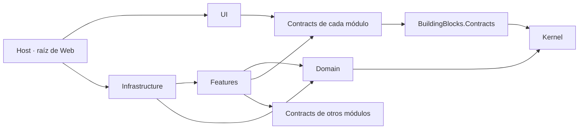
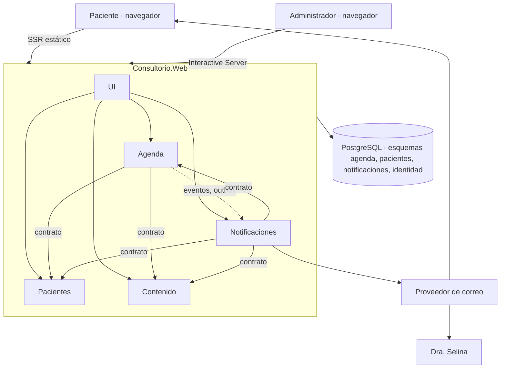
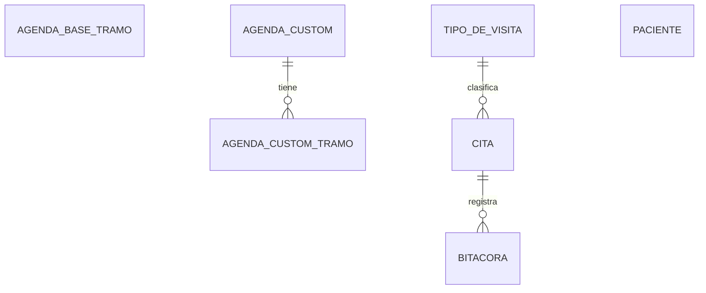

# Architecture Spine — Sistema de citas, Dra. Selina Medina

Este documento fija solo lo que dos partes construidas por separado podrían hacer de forma incompatible. El diseño de dominio, estratégico y táctico, y el modelo de datos están en `ddd-and-data-model-appointment-booking.md`, cuya Parte I es invariante, igual que las decisiones de este documento: no deben contradecirse, y una contradicción se corrige en los dos antes de construir. El plan de solución queda como referencia narrativa; **donde el plan y este documento se contradicen, gana este documento**. `[ADOPTED]` marca lo que el plan ya había decidido.

## Design Paradigm

Monolito modular: un solo despliegue, una base PostgreSQL. Cada contexto delimitado es un módulo; dentro de cada módulo el código se organiza por caso de uso.

Todo el código de la aplicación vive en un solo proyecto, `DraSelina.Consultorio.Web`. Los módulos y sus capas no son proyectos: son carpetas y namespaces dentro de él. Separarlos en proyectos o en servicios queda diferido hasta que haga falta (Deferred).

| Capa | Namespace | Carpeta dentro de `Web` | Contiene |
| --- | --- | --- | --- |
| Kernel | `DraSelina.Consultorio.Kernel` | `Kernel/` | Ids tipados, `IClock`, `Resultado`, `Actor`, `IActorActual` |
| Contratos base | `DraSelina.Consultorio.BuildingBlocks.Contracts` | `BuildingBlocks/Contracts/` | `ICommand<T>`, `IQuery<T>`, `ICommandHandler<TComando, T>`, `IQueryHandler<TConsulta, T>`, `IEventHandler<TEvento>`, marcadores de autorización |
| Contratos | `DraSelina.Consultorio.<Módulo>.Contracts` | `Modules/<Módulo>/Contracts/` | Comandos, consultas, DTOs, eventos de integración, API entre módulos |
| Dominio | `DraSelina.Consultorio.<Módulo>.Domain` | `Modules/<Módulo>/Domain/` | Agregados, objetos de valor, servicios de dominio, puertos de escritura |
| Casos de uso | `DraSelina.Consultorio.<Módulo>.Features` | `Modules/<Módulo>/Features/` | Un handler por comando o consulta; puertos de lectura |
| Infraestructura | `DraSelina.Consultorio.<Módulo>.Infrastructure` | `Modules/<Módulo>/Infrastructure/` | DbContext, migraciones, implementación de puertos |
| Interfaz | `DraSelina.Consultorio.UI` | `UI/` | Páginas y componentes Blazor |
| Host | `DraSelina.Consultorio.Web` | raíz del proyecto | Composición, identidad, decoradores de los handlers y entrega de eventos del outbox |

Módulos: **Agenda** (núcleo), **Pacientes**, **Notificaciones**, **Contenido**. Notificaciones no tiene dominio. Contenido es `Contracts` más una sola carpeta de implementación (`DraSelina.Consultorio.Contenido`).

## Invariants & Rules



Dependencias entre namespaces, todos dentro de `DraSelina.Consultorio.Web`:

| Namespace | Puede usar |
| --- | --- |
| `Kernel` | nada |
| `BuildingBlocks.Contracts` | `Kernel` |
| `<Módulo>.Contracts` | `Kernel`, `BuildingBlocks.Contracts` |
| `<Módulo>.Domain` | `Kernel` |
| `<Módulo>.Features` | su `Domain`, su `Contracts`, `Contracts` de otros módulos, `Kernel`, `BuildingBlocks.Contracts` |
| `<Módulo>.Infrastructure` | su `Features`, su `Domain`, su `Contracts`, `Kernel`, `BuildingBlocks.Contracts` |
| `Contenido` | `Contenido.Contracts`, `Kernel`, `BuildingBlocks.Contracts` |
| `UI` | todos los `*.Contracts`, `Kernel` |
| `Web` (host) | todo (compone) |

`Kernel`, `BuildingBlocks.Contracts`, todo `*.Contracts` y todo `*.Domain` no usan ningún paquete ni framework: solo la biblioteca base de .NET.

Referencias entre proyectos:

| Proyecto | Puede referenciar |
| --- | --- |
| `DraSelina.Consultorio.Web` | `ServiceDefaults` |
| `DraSelina.Consultorio.MigrationService` | `Web`; `ServiceDefaults` `[ASSUMPTION]` |
| `DraSelina.Consultorio.AppHost` | `Web`, `MigrationService` |
| `DraSelina.Consultorio.ServiceDefaults` | nada |

Las dos tablas son la regla; lo que no aparece está prohibido y lo verifican las pruebas de arquitectura: las dependencias entre namespaces, por las directivas `using` de cada archivo según su carpeta; las referencias entre proyectos, por los `.csproj`. Como todo compila en un solo ensamblado, el compilador ya no impide una dependencia prohibida: la impiden esas pruebas y la revisión de cada historia.

### AD-1 — Un módulo solo expone sus Contracts `[ADOPTED]`

- **Binds:** all
- **Prevents:** que el modelo interno de un módulo se filtre a otro o a la interfaz.
- **Rule:** las dependencias entre namespaces son exactamente las de la tabla anterior. Los ids tipados viven en `Kernel` para que contratos y dominio usen el mismo tipo y ningún contrato exponga un `Guid` desnudo.

### AD-2 — Datos privados por módulo `[ADOPTED]`

- **Binds:** all
- **Prevents:** dos dueños de una misma tabla.
- **Rule:** cada módulo con datos tiene su DbContext y su esquema: `agenda`, `pacientes`, `notificaciones`. El host es dueño de `identidad`. El outbox de un módulo que publica eventos es una tabla de su propio esquema. Contenido no tiene esquema en el piloto: su contenido se despliega con la aplicación. Sin joins ni llaves foráneas entre esquemas. Un módulo nunca lee ni escribe tablas de otro.

### AD-3 — Cómo se hablan los módulos `[ADOPTED]`

- **Binds:** Agenda, Pacientes, Notificaciones, Contenido
- **Prevents:** llamadas cruzadas ad hoc, eventos con forma libre o con datos ajenos, consumidores que recalculan lo que el dueño ya decidió.
- **Rule:**
  - Entre módulos, síncrono solo por las interfaces `I<Módulo>Api` de `Contracts`. Los handlers de casos de uso son exclusivos de la interfaz: un módulo nunca pide el handler de otro.
  - Asíncrono por eventos de integración publicados por el outbox del módulo que publica: una tabla en su propio esquema, donde el evento se guarda en la misma transacción que el cambio. Un servicio del host en segundo plano entrega cada evento a sus handlers y reintenta los que fallan; un evento puede entregarse más de una vez. Agenda nunca llama a Notificaciones.
  - Todo evento lleva `EventoId`, `OcurridoEn`, `CitaId`, `PatientId` y `Actor`. Además: `CitaAgendada {Inicio, Fin, Origen}`, `CitaReprogramada {InicioAnterior, InicioNuevo, FinNuevo}`, `CitaCancelada {Inicio, Motivo}`.
  - Ningún evento lleva nombre, teléfono, correo, motivo de consulta ni el enlace de gestión.
  - Un consumidor nunca recalcula una clasificación que Agenda ya decidió (por ejemplo, cancelación tardía) y deduplica por `EventoId`.

### AD-4 — El estado solo cambia por el agregado `[ADOPTED]`

- **Binds:** Agenda, Pacientes
- **Prevents:** actualizaciones que se saltan las reglas de negocio.
- **Rule:** setters privados. Los handlers llegan a la persistencia solo por puertos: de escritura por agregado en `Domain`, de lectura por slice en `Features`. Prohibido `ExecuteUpdate` y `ExecuteDelete` sobre agregados. La reconstitución desde la base no valida ni levanta eventos.

### AD-5 — La disponibilidad se calcula; los slots no existen

- **Binds:** FR-2, FR-12, FR-13
- **Prevents:** un inventario de slots, excepciones por rangos con precedencia, días u horas escritos en código.
- **Rule:** Agenda guarda dos cosas. **Agenda base:** por día de la semana, cero o más tramos. **Agenda custom:** por fecha, cero o más tramos que no se enciman y un motivo; a lo más una por fecha. En todo tramo, de base o de custom, cabe al menos una Cita del tipo de visita más corto. Para una fecha valen los tramos de su custom si existe; si no, los de la base. Base y custom viven en un solo agregado, `AgendaAtencion`, que es el único que resuelve los tramos vigentes de una fecha. `CalculadoraDeDisponibilidad` es la única implementación del cálculo: función pura que recibe la agenda de atención, citas activas, reglas y `now`, y devuelve los libres. Nada persiste slots.

### AD-6 — Qué provoca cada cambio de agenda

- **Binds:** FR-12, FR-13, FR-23
- **Prevents:** que un cambio de agenda cancele o mueva citas por su cuenta, o que la cancelación derivada de una custom se construya de dos formas.
- **Rule:**
  - Una Cita **queda fuera** cuando no cabe completa dentro de un solo tramo vigente de su fecha.
  - Una Cita ya agendada no se modifica sola: solo cambia por una acción explícita del paciente o del Administrador sobre ella.
  - Cambiar la **base** aplica de inmediato, no cancela ninguna Cita y no altera fechas con custom. No hay vigencias futuras ni versiones.
  - Guardar o borrar una **custom** tampoco cancela nada por sí solo. El Administrador elige, cita por cita, cuáles de las que quedan fuera se cancelan y cuáles se conservan, sin importar su origen. Borrar cuenta igual que guardar: la fecha vuelve a la base y eso puede dejar Citas fuera.
  - Todos estos cambios van precedidos de una consulta que lista lo afectado (Citas que quedan fuera, fechas con custom que no cambian). El comando que guarda o borra la custom recibe la lista completa vista con la decisión por Cita; si ya no coincide con las que quedan fuera, devuelve conflicto y no cambia nada.
  - El comando modifica solo la custom y guarda, en la misma transacción, un evento interno de Agenda con las Citas elegidas para cancelar y el actor que hizo el cambio. Una política de Agenda reacciona y cancela cada una por su agregado, en su propia transacción, con motivo *consultorio* y con ese mismo actor (AD-22); cada una levanta `CitaCancelada`. La política es idempotente y omite las Citas que ya no estén agendadas.
  - Borrar una custom devuelve la fecha a la base, después de esa misma elección cuando deja Citas fuera.

### AD-7 — Dos caminos para crear una Cita, uno para moverla

- **Binds:** FR-3, FR-9, FR-15
- **Prevents:** que la reserva en línea herede los permisos del consultorio, que la manual quede atada al horario, o que reprogramar se construya como cita nueva.
- **Rule:**
  - **En línea** (`Cita.Agendar`): valida tramos vigentes recibidos como entrada, rejilla, ventana de reserva y tope semanal.
  - **Del consultorio** (`Cita.AgendarPorConsultorio`): ignora base, custom, rejilla, ventana y tope; exige nota cuando cae fuera de los tramos vigentes.
  - **Reprogramar** (`cita.Reprogramar`) actúa sobre la misma Cita: conserva `CitaId`, enlace de gestión, origen y bitácora; no crea ni cancela ninguna Cita. Valida tramos vigentes, rejilla, ventana y el umbral de cancelación tardía (hoy 2 horas), que es el único valor que decide hasta cuándo se reprograma y desde cuándo una cancelación es tardía; no aplica el tope semanal.
  - Reglas duras de los tres: no traslapar (AD-8) y no caer en el pasado.
  - La Cita persiste `Origen` (en línea, consultorio) y `Nota`.
  - Una Cita del consultorio nunca genera disponibilidad pública.

### AD-8 — El no traslape lo garantiza la base de datos `[ADOPTED]`

- **Binds:** FR-4
- **Prevents:** doble reserva por condición de carrera, y dos lecturas del mismo rango.
- **Rule:** la Cita guarda `Inicio` y `Fin` en UTC; `Fin` se fija al crear o reprogramar y no se recalcula si cambia la duración del tipo de visita. El rango es semiabierto `[Inicio, Fin)` en la restricción, en la calculadora y en el dominio. Una restricción de exclusión de PostgreSQL sobre ese rango, para citas no canceladas, es la garantía. El puerto de escritura de Cita guarda de forma explícita dentro del handler y traduce la violación `23P01` a `Resultado` con código de conflicto; la página vuelve a pedir la disponibilidad. Nunca se muestra como error.

### AD-9 — Estados de la Cita `[ADOPTED]`

- **Binds:** FR-10, FR-14, FR-16, FR-17
- **Prevents:** estados finales que luego hay que corregir.
- **Rule:** se guardan tres: `Agendada`, `NoSePresento`, `Cancelada` (motivo: paciente, tarde, consultorio). `Atendida` se deriva de `Agendada` con el inicio ya pasado; "ya pasó" siempre se mide desde el inicio de la Cita. Reprogramar no es un estado.

### AD-10 — La interfaz habla con el backend por el handler de cada caso de uso

- **Binds:** all
- **Prevents:** páginas que usan dominio o DbContext directamente; interfaz que arma datos de varios módulos; una librería de despacho entre la página y el caso de uso.
- **Rule:** todo caso de uso es un `ICommand<T>` o `IQuery<T>` en `*.Contracts` con exactamente un handler, que implementa `ICommandHandler<TComando, T>` o `IQueryHandler<TConsulta, T>` y devuelve `Resultado<T>`. Esas dos interfaces viven en `BuildingBlocks.Contracts`. La interfaz pide al contenedor el handler del caso de uso que necesita, por su interfaz, y nunca conoce la clase que lo implementa. Cada módulo registra sus handlers. No hay `ISender`, mediador ni librería de despacho. La interfaz no compone datos de dos módulos: el handler de la consulta los reúne pidiendo a la API del otro módulo, en lote (`IPacientesApi.ObtenerContactos(ids)`). Sin MVC; HTTP solo con Minimal APIs y solo donde un formulario no alcanza (descarga del archivo de calendario).

### AD-11 — Modo de renderizado por zona

- **Binds:** FR-1 a FR-11, FR-14, FR-27 a FR-29
- **Prevents:** un paso de la reserva que guarda estado en el servidor y otro que lo lleva en la dirección; datos personales en direcciones.
- **Rule:**
  - Sitio y reserva del paciente en **SSR estático**. El servidor no guarda nada del paciente entre pasos y la base solo se escribe al confirmar.
  - En la cadena de consulta viajan solo tipo de visita, fecha y hora. Nombre, teléfono, correo y motivo viajan únicamente en el cuerpo del formulario.
  - Administración en **Interactive Server**, salvo inicio de sesión y segundo factor, que son SSR estático.
  - La agenda de administración se refresca consultando de nuevo a intervalos; no hay canal de notificación en tiempo real. `[ASSUMPTION: cada 30 segundos]`

### AD-12 — Un solo dialecto de validación

- **Binds:** all
- **Prevents:** reglas de forma duplicadas en dos librerías.
- **Rule:** la forma de la entrada se declara con DataAnnotations sobre los comandos en `*.Contracts`, sin dependencias de ASP.NET en esos namespaces. Los atributos estándar que el navegador soporta se validan también ahí en las páginas estáticas; todo lo demás, incluidos los atributos propios, se valida solo en el servidor. El backend valida siempre, antes del handler, con un decorador que envuelve a todo handler de comando y aplica DataAnnotations; el fallo se entrega como `Resultado` inválido con errores por campo y el handler no se ejecuta. Las reglas de negocio viven en el agregado, nunca en atributos.

### AD-13 — El tope semanal por teléfono lo decide Agenda

- **Binds:** FR-7
- **Prevents:** que Pacientes conozca citas o que el teléfono se copie en la Cita.
- **Rule:** al reservar en línea, Agenda pide a `IPacientesApi` los `PatientId` que comparten el teléfono y cuenta sus propias citas de la semana de calendario de la Cita. El handler entrega ese conteo a `Cita.Agendar`, que es quien compara contra el tope y rechaza. Es un límite blando, no transaccional. `[ASSUMPTION: semana de lunes a domingo; cuentan citas Agendadas de cualquier origen; las del consultorio no se bloquean]`

### AD-14 — Cada módulo es dueño de su configuración

- **Binds:** FR-19
- **Prevents:** una tabla de ajustes compartida con varios escritores; un umbral leído por dos módulos.
- **Rule:** Agenda guarda sus reglas de reserva y los tipos de visita; Notificaciones guarda la hora del Recordatorio y de la Agenda del día. La pantalla de Configuración compone ambas pidiendo el handler de cada consulta. Un módulo nunca lee la configuración de otro: recibe el resultado ya decidido (AD-3).

### AD-15 — Los datos del consultorio viven en Contenido

- **Binds:** FR-5, FR-21, FR-27
- **Prevents:** la dirección escrita por separado en páginas y plantillas de correo.
- **Rule:** nombre, dirección, enlace de mapa y WhatsApp se sirven por `IContenidoApi`. La Cita no lleva sede.

### AD-16 — La bitácora es de Agenda y es transaccional

- **Binds:** FR-20
- **Prevents:** un cambio sin registro, dos módulos registrando lo mismo, o cada handler averiguando el actor a su manera.
- **Rule:** cada cambio a una Cita, a la base o a una custom escribe su entrada en `agenda` dentro de la misma transacción, con el actor que entrega AD-22.

### AD-17 — Tiempo

- **Binds:** all
- **Prevents:** horas calculadas en zonas distintas.
- **Rule:** los instantes se guardan en UTC. Base y custom se guardan como día de la semana o fecha, y hora, **locales** de `America/Mexico_City`. "Mañana", la semana de calendario y la fecha de una Cita se evalúan en hora local. La disponibilidad se calcula en hora local y se convierte a UTC al guardar la Cita. El reloj se inyecta (`IClock`); el dominio nunca lee la hora del sistema.

### AD-18 — Identidad `[ADOPTED]`

- **Binds:** FR-6, FR-18
- **Prevents:** ids intercambiables y pacientes duplicados por formato.
- **Rule:** `CitaId` y `PatientId` son tipos propios sobre Guid v7, generados en el dominio. Un Paciente se reconoce por teléfono E.164 más nombre normalizado; la igualdad la decide un índice único con una collation ICU no determinista (insensible a mayúsculas y acentos), no el código. La búsqueda por nombre usa la columna normalizada con collation determinista.

### AD-19 — Enlace de gestión

- **Binds:** FR-5, FR-8, FR-21, FR-22, FR-23
- **Prevents:** un token que el correo no puede obtener, guardado en claro, o eterno.
- **Rule:** el token se deriva: `HMAC-SHA256(clave del host, CitaId)`. La clave vive fuera de la base. Agenda guarda solo el hash del token y es la única que arma el enlace, por `IAgendaApi.ObtenerEnlaceDeGestion(CitaId)`. El enlace no vence por un dato guardado: deja de valer cuando el `Inicio` actual de la Cita ya pasó. Reemplaza la decisión del plan de un token aleatorio.

### AD-20 — Mensajes y trabajos programados `[ADOPTED]`

- **Binds:** FR-21 a FR-26
- **Prevents:** que una reserva dependa del correo, trabajos programados fuera de Notificaciones, o dos dueños del Recordatorio.
- **Rule:** la reserva confirma sin esperar al correo: el evento se guarda con la Cita y el envío ocurre después, con reintentos. Notificaciones reacciona a los eventos; pide contacto a Pacientes, datos del consultorio a Contenido, y enlace de gestión y archivo de calendario a Agenda; envía por `INotificationChannel`. Es la única dueña del Recordatorio: lo programa con `CitaAgendada`, lo mueve con `CitaReprogramada` y lo elimina con `CitaCancelada`. El Recordatorio es una fila en una tabla de Notificaciones, con la hora en que debe enviarse. Un servicio en segundo plano de Notificaciones revisa a intervalos, envía los que ya tocan y deja pendientes los que fallan para la siguiente vuelta. `[ASSUMPTION: cada minuto]` Ese mismo servicio envía la Agenda del día a la hora configurada, una sola vez por fecha. La Agenda del día pregunta a Agenda qué hay ese día; nunca lee sus tablas.

### AD-21 — Un solo camino de telemetría

- **Binds:** all
- **Prevents:** dos canalizaciones de registro.
- **Rule:** `Microsoft.Extensions.Logging` y OpenTelemetry mediante Aspire ServiceDefaults. Sin Serilog.

### AD-22 — Acceso, actor y abuso

- **Binds:** FR-7, FR-11, FR-14, FR-18, FR-20
- **Prevents:** comandos o consultas de administración alcanzables sin sesión; actor de bitácora inventado por cada handler.
- **Rule:**
  - ASP.NET Core Identity en el host, con segundo factor obligatorio y sin registro público.
  - Todo comando y consulta de administración lleva el marcador `IRequiereAdministrador` en `Contracts`. Un único decorador, que envuelve a todo handler de comando y de consulta, rechaza con `Resultado` no autorizado los que lleguen sin usuario autenticado. No se confía en que la página esté protegida.
  - El host entrega el actor por un único servicio: `Administrador` cuando hay sesión; `Paciente` cuando el comando llega con un enlace de gestión válido o desde la reserva pública; `Sistema` en los trabajos programados (Recordatorio, Agenda del día). Una política que reacciona a un evento interno usa el actor que viene en ese evento, no `Sistema`: las cancelaciones elegidas al guardar o borrar una custom quedan a nombre del `Administrador`.
  - Las páginas de reserva llevan límite de frecuencia y verificación anti-bots, resueltos en el host antes de despachar el comando.

### AD-23 — Datos sensibles

- **Binds:** FR-3, FR-8, FR-14, FR-25, privacidad
- **Prevents:** datos de salud o personales filtrados por un camino lateral.
- **Rule:** el motivo de consulta pertenece a Agenda y vive en la Cita. Motivo, nombre, teléfono, correo y enlace de gestión nunca aparecen en eventos, en el outbox, en registros o telemetría, ni en la cadena de consulta. La telemetría enmascara la ruta del enlace de gestión. Solo se guardan datos de agenda; ningún dato clínico.

### AD-24 — Consentimiento

- **Binds:** FR-3, FR-15
- **Prevents:** dos módulos guardando el consentimiento, o ninguno.
- **Rule:** el consentimiento se registra por Cita, en Agenda, al crearla: fecha y hora, versión del aviso de privacidad y canal (en línea, externo). Por Cita y no por Paciente; queda por validar con el abogado que revisa el aviso.

### AD-25 — Migraciones, datos iniciales e identidad

- **Binds:** all
- **Prevents:** módulos que migran cada uno a su manera, o un host que migra al arrancar.
- **Rule:** cada DbContext lleva su historial de migraciones en su propio esquema. La extensión `btree_gist`, la restricción de exclusión y la collation se crean con SQL explícito en la migración del módulo que las posee. Un único proyecto `MigrationService` aplica todas las migraciones y ejecuta los datos iniciales; lo corre el AppHost en local y, cuando exista, el despliegue. La aplicación web nunca migra ni crea nada al arrancar: sobre una base sin migrar arranca igual y la deja como estaba. Los datos iniciales son idempotentes y de su módulo: Agenda base inicial, tipos de visita y reglas por defecto (Agenda); horas de envío (Notificaciones); cuenta del administrador (host).

### AD-26 — Concurrencia sobre una fecha

- **Binds:** FR-4, FR-13
- **Prevents:** una Cita agendada en una fecha que se cerró en el mismo instante.
- **Rule:** todo comando que crea o mueve una Cita en línea, o que guarda o borra una custom, toma un candado consultivo de transacción de PostgreSQL (advisory lock) por fecha local y lee los tramos vigentes después de tomarlo.

### AD-27 — Confirmar dos veces no crea dos citas

- **Binds:** FR-3, FR-4
- **Prevents:** que un doble envío choque contra la propia Cita del paciente y le muestre "horario ocupado".
- **Rule:** el formulario de confirmación lleva un `SolicitudId` generado al pintarlo. Agenda lo guarda en la Cita; un segundo comando con el mismo `SolicitudId` devuelve la Cita ya creada.

### AD-28 — Paciente al reservar

- **Binds:** FR-6
- **Prevents:** una transacción que cruza dos módulos.
- **Rule:** `IPacientesApi.BuscarOCrear` confirma en su propia transacción, antes de la de Agenda, y es idempotente por el índice único de AD-18. Un Paciente sin Cita es un resultado aceptable. Si el Paciente ya existe y llega un correo distinto, el nuevo reemplaza al guardado.

## Consistency Conventions

| Concern | Convention |
| --- | --- |
| Naming | Términos de negocio en español (`Cita`, `AgendaAtencion`, `Tramo`); capas técnicas en inglés. Raíz `DraSelina.Consultorio`. Eventos en pasado. Un namespace por capa; los sub-namespaces dentro de una capa (`Infrastructure.Migrations`, `UI.Layout`) son de esa capa y no tienen reglas propias. |
| Vocabulario | El Glosario del PRD manda. "Horario de atención" y "Bloqueo" no existen en código ni en pantallas. |
| Ids y datos | Guid v7 tipado. Teléfono en E.164. Instantes en UTC (`timestamptz`). Tramos como hora local sin zona. Rangos semiabiertos. |
| Resultados | Todo comando y consulta devuelve `Resultado`. Los fallos esperados llevan un código de un conjunto cerrado por módulo, definido en `Contracts`; nunca se lanzan como excepción ni se comunican con texto. |
| Textos | El dominio devuelve códigos. Los textos que ve el paciente viven en la interfaz y en las plantillas de correo, con el tono de `EXPERIENCE.md`. |
| Comandos | Clase con propiedades `set`, nunca `record`. Los formularios se ligan directo al comando; no hay modelos de formulario aparte. Eventos de integración y DTOs pueden ser `record`. |
| Errores de validación | Por campo, con el nombre de la propiedad del comando. |
| Transacciones | Un comando, una transacción, un módulo: cambio, bitácora y outbox juntos. El handler del comando abre la transacción de su módulo por un puerto, guarda de forma explícita y la confirma. Toda salida con un `Resultado` no exitoso deshace la transacción antes de devolver; una excepción también la deshace. Quien llama al handler nunca abre, confirma ni guarda. |
| Lecturas | `AsNoTracking()` y proyección; nunca `SaveChanges` en una consulta. Las consultas corren sin transacción. |
| Archivo de calendario | Un solo generador, en Agenda, usado por la pantalla de confirmación y por Notificaciones. El lugar lo pide a Contenido por `IContenidoApi`. `[ASSUMPTION]` |
| Pruebas | Dominio y handlers sin base de datos; integración contra PostgreSQL real, levantado con Testcontainers y migrado ejecutando el `MigrationService`; reglas de referencia como pruebas de arquitectura. |

## Stack

Versiones verificadas en la web el 2026-10-04.

| Name | Version |
| --- | --- |
| .NET / ASP.NET Core / Blazor Web App | 11.0 (candidata vigente al crear la solución; definitiva en noviembre de 2026) |
| Aspire (AppHost, ServiceDefaults) | 13.6.0 |
| EF Core | 10.0.12, hasta que salga la 11.0 definitiva |
| Npgsql.EntityFrameworkCore.PostgreSQL | 10.0.3, hasta que salga la 11.0 definitiva |
| PostgreSQL con `btree_gist` | 18.x `[ASSUMPTION: disponible en Azure Flexible Server; si no, 17.x]` |
| Bootstrap + CSS propio con los tokens de `DESIGN.md` | 5.3.8 |
| xunit.v3 | 4.0.1 |
| bUnit | 2.11.3 |
| Testcontainers.PostgreSql | 4.15.0 |
| Microsoft.AspNetCore.Mvc.Testing (solo en pruebas) | la misma que ASP.NET Core |
| Scrutor | 6.1.0 (la versión de Cypma.Cop; corre sobre .NET 11 rc.1, entrada 1.6) |
| libphonenumber-csharp | última estable al crear la solución |
| Correo: Azure Communication Services Email | servicio |
| Anti-bots: Cloudflare Turnstile | servicio |

## Structural Seed





`CITA` referencia a `PACIENTE` solo por `PatientId`, sin llave foránea.

```text
src/
  DraSelina.Consultorio.AppHost/            # Aspire: aplicación, migraciones y PostgreSQL local
  DraSelina.Consultorio.ServiceDefaults/    # OpenTelemetry, salud
  DraSelina.Consultorio.MigrationService/   # migraciones y datos iniciales
  DraSelina.Consultorio.Web/                # todo el código de la aplicación
    Kernel/                                 # ids, IClock, Resultado, Actor, IActorActual
    BuildingBlocks/Contracts/               # ICommand, IQuery, sus handlers, marcadores
    Modules/Agenda/{Contracts,Domain,Features,Infrastructure}/
    Modules/Pacientes/{Contracts,Domain,Features,Infrastructure}/
    Modules/Notificaciones/{Contracts,Features,Infrastructure}/
    Modules/Contenido/{Contracts,Contenido}/
    UI/                                     # páginas y componentes
tests/
```

**Entornos.** Local, levantado por el AppHost de Aspire. Producción en Azure, región Mexico Central, sin entorno intermedio. Nada se libera a producción todavía.

## Capability → Architecture Map

| Capability / Area | Lives in | Governed by |
| --- | --- | --- |
| Reserva en línea (FR-1 a FR-7) | Agenda, Pacientes, UI pública | AD-5, AD-7, AD-8, AD-11, AD-12, AD-13, AD-18, AD-24, AD-26, AD-27, AD-28 |
| Gestión por el Paciente (FR-8 a FR-10) | Agenda, UI pública | AD-7, AD-9, AD-19, AD-22 |
| Agenda base y custom (FR-12, FR-13) | Agenda, UI administración | AD-5, AD-6, AD-17, AD-26 |
| Cita manual (FR-15) | Agenda | AD-7, AD-8, AD-24 |
| Agenda, estados, pacientes (FR-14, FR-16 a FR-18) | Agenda, Pacientes | AD-4, AD-9, AD-10, AD-11, AD-18 |
| Configuración (FR-19) | Agenda, Notificaciones | AD-14 |
| Bitácora (FR-20) | Agenda | AD-16, AD-22 |
| Notificaciones (FR-21 a FR-26) | Notificaciones | AD-3, AD-19, AD-20 |
| Sitio (FR-27 a FR-30) | Contenido, UI pública | AD-11, AD-15 |
| Acceso (FR-11) | Host | AD-22 |
| Privacidad | todos | AD-23, AD-24 |

## Deferred

- **Separar los módulos en proyectos o en servicios.** Hoy todo vive en `DraSelina.Consultorio.Web`, separado por carpeta y namespace. Se sacan a proyectos propios, o a servicios, cuando haya una necesidad concreta; la separación por namespaces y las pruebas de arquitectura existen para que ese paso sea mecánico.
- **Aprovisionamiento de Azure y despliegue automático.** No se libera nada aún; se decide al preparar el piloto, incluido si Aspire publica a App Service o a Container Apps. Entra aquí todo lo operativo de producción: integración continua como puerta de las pruebas de arquitectura, secretos, HTTPS, chequeos de salud, alertas y respaldos.
- **Respaldo replicado a otra región.** Mexico Central no lo ofrece para PostgreSQL administrado; decidir la estrategia de respaldo antes de recibir pacientes reales.
- **Entorno intermedio.** Sin él en el piloto; revisar antes de recibir pacientes reales.
- **Varias sedes.** La Cita no lleva sede hasta que exista una segunda.
- **Canal de WhatsApp.** Entra por `INotificationChannel` sin tocar Agenda.
- **Expediente clínico.** Módulo nuevo, tras evaluar construir contra integrar.
- **Recurrencia en la agenda custom.** No hay patrón que la pida.
- **Edición de contenido desde administración.** En el piloto el contenido se despliega con la aplicación.
- **Rol de Asistente, fusión de pacientes duplicados, retención y derechos ARCO.** Después del piloto.
- **Uso de Specifications en el dominio.** Decisión de implementación.

## Open Questions

1. **.NET 11 con Wolverine 6 y con el AppHost de Aspire.** Resuelta el 2026-10-05: arrancan juntos sobre .NET 11.0.0-rc.1 y se sigue con .NET 11. Wolverine 6 necesita el paquete `WolverineFx.RuntimeCompilation` para arrancar en modo dinámico. Registro: `spikes/arranque/REGISTRO.md`. Wolverine se quitó el 2026-10-06; ver AD-10 y AD-12.
2. **Fallo de validación como resultado.** Resuelta el 2026-10-05: el middleware de DataAnnotations de Wolverine, con su configuración por defecto, lanza `ValidationException`; se usa un middleware propio (AD-12). Registro: `spikes/arranque/REGISTRO.md`. Wolverine se quitó el 2026-10-06; ver AD-10 y AD-12.
3. **Formulario ligado al comando.** Resuelta el 2026-10-05: un `EditForm` se liga directo al comando con `[SupplyParameterFromForm]`; los comandos son clases con propiedades `set` (Consistency Conventions). Registro: `spikes/arranque/REGISTRO.md`.
4. **Hora de la Agenda del día** cuando hay citas por la mañana.
5. **Motivo de consulta en la Agenda del día.** Es un dato de salud que viaja por correo; ¿se envía, o solo hora y Paciente?
6. **PostgreSQL 18 en Azure Flexible Server.** Confirmar la versión disponible al aprovisionar.
