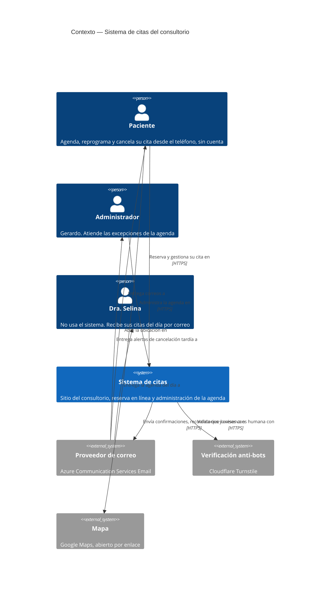
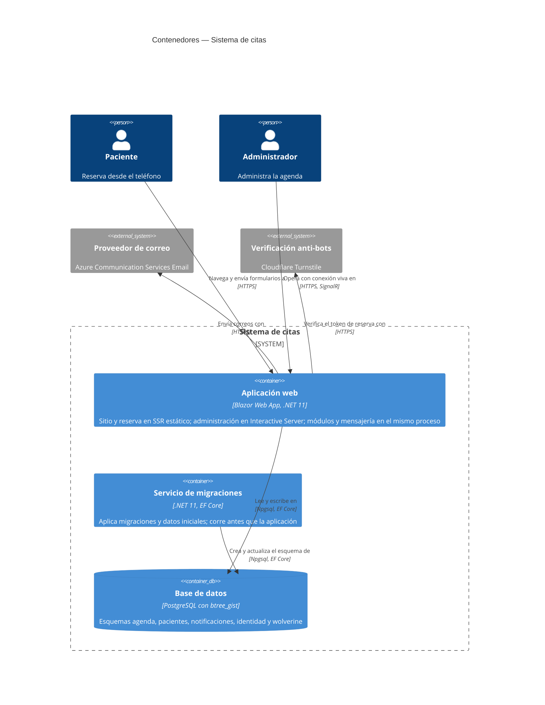
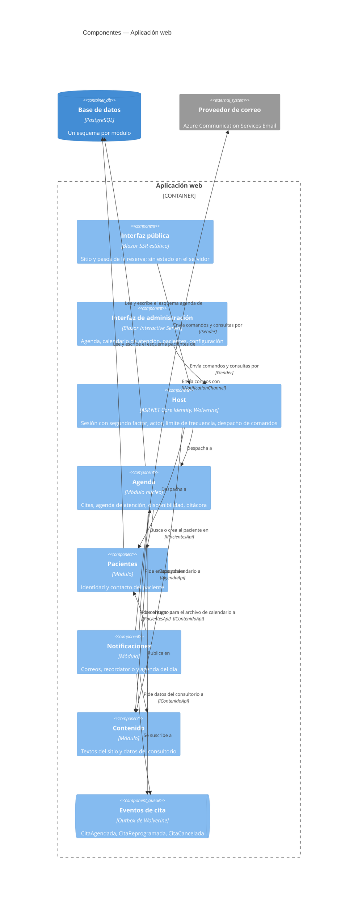
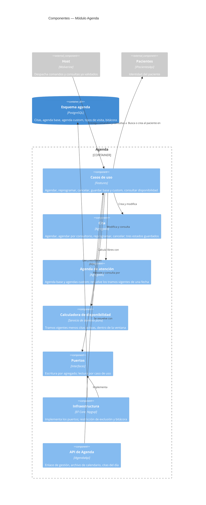
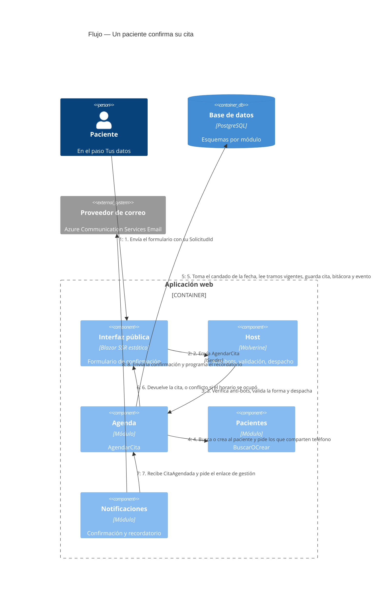

# Diagramas C4 — Sistema de citas, Dra. Selina Medina

Vista del sistema en cuatro niveles, derivada del documento de arquitectura (`architecture-appointment-booking.md`). Todavía no hay código: los diagramas muestran lo decidido, no lo construido. Si un diagrama y el documento de arquitectura se contradicen, gana el documento de arquitectura.

## 1. Contexto

Quién usa el sistema y con qué servicios externos habla.

## 2. Contenedores

Lo que se despliega. Es un monolito: una aplicación, una base de datos y un proceso de migraciones.

En desarrollo, el AppHost de Aspire levanta los tres contenedores y un panel con registros y trazas. El despliegue a Azure (Mexico Central) está diferido.

## 3. Componentes de la aplicación web

Los módulos dentro del proceso y cómo se hablan. Las flechas continuas son llamadas por contrato; la de eventos pasa por el outbox.

## 4. Componentes del módulo Agenda

El núcleo. La disponibilidad se calcula; nunca se guardan slots.

## 5. Flujo: reserva en línea

Lo que pasa cuando un paciente confirma su cita.

Los pasos 7 y 8 ocurren después de responder al paciente: la reserva nunca espera al correo.

## Lo que no se muestra

- **Despliegue.** No hay diagrama de despliegue porque el aprovisionamiento de Azure está diferido.
- **Proyectos y capas.** La tabla de referencias permitidas entre proyectos está en el documento de arquitectura.
