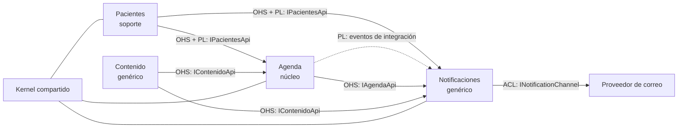
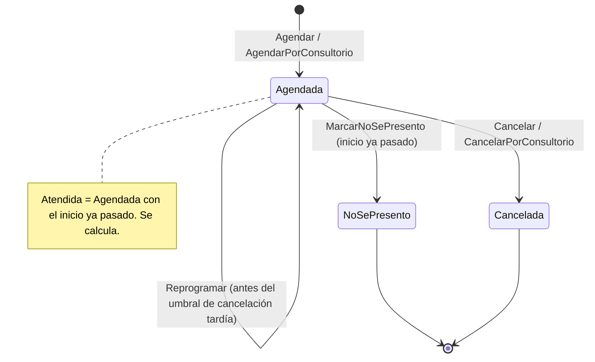
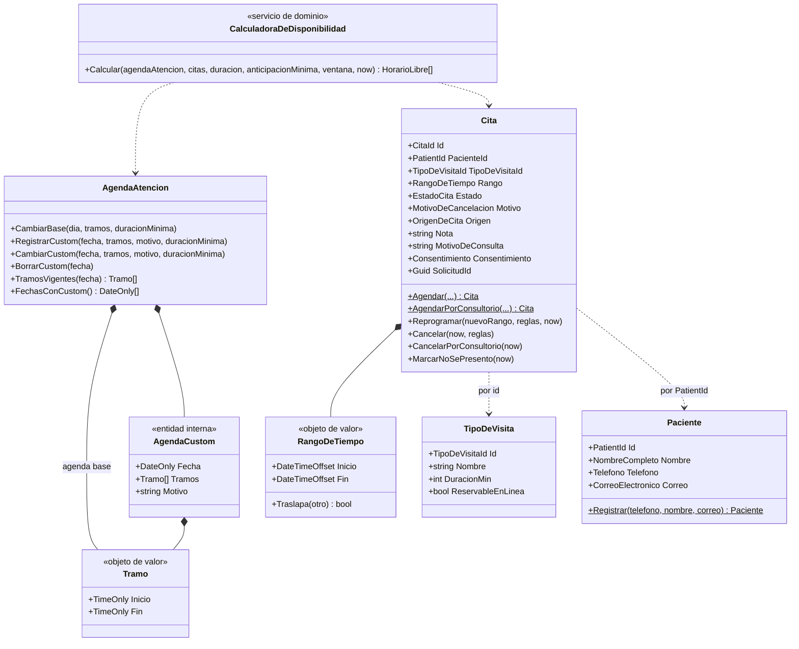
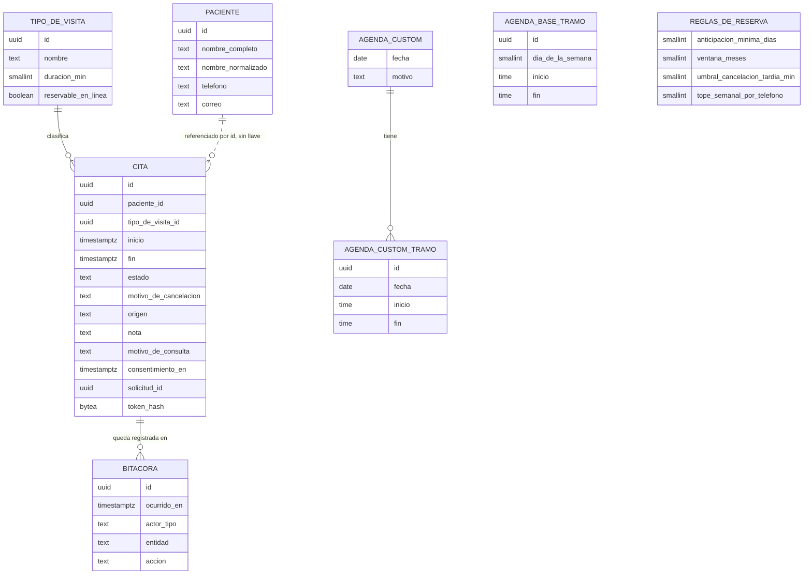
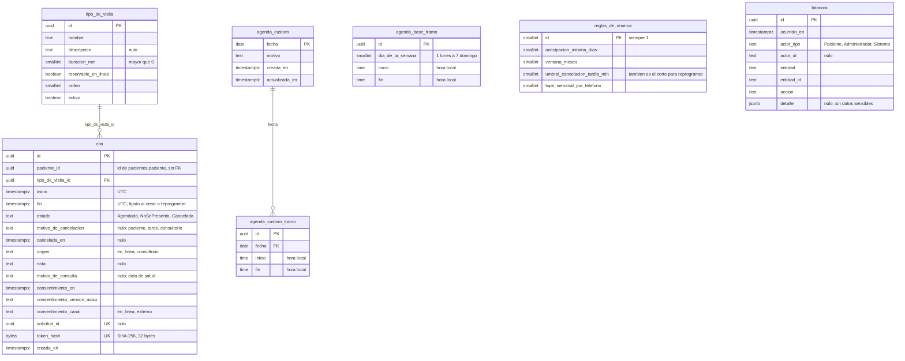
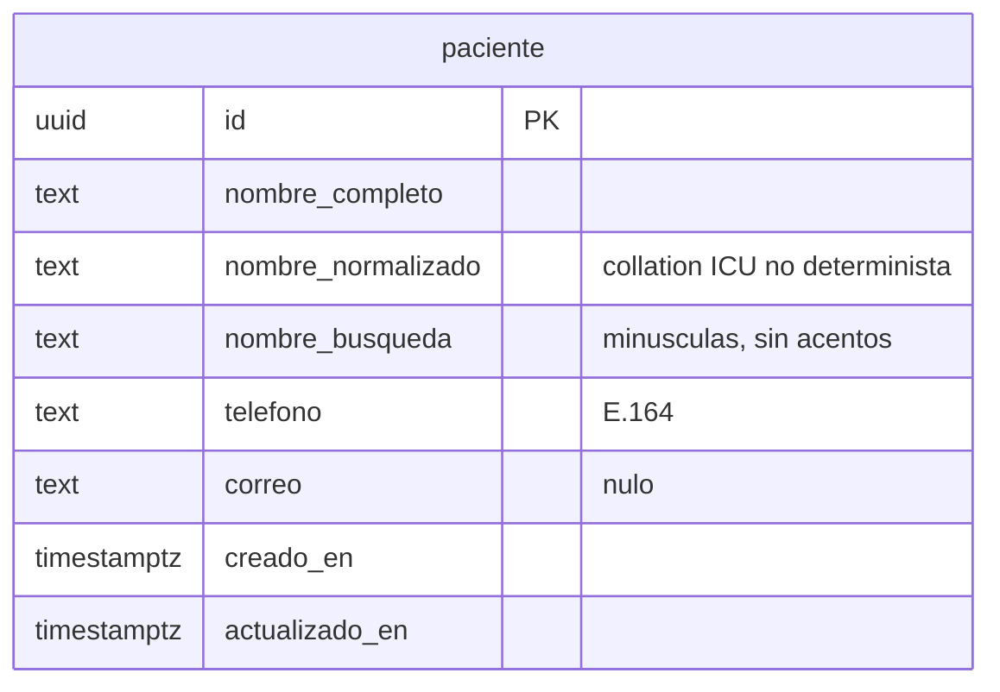
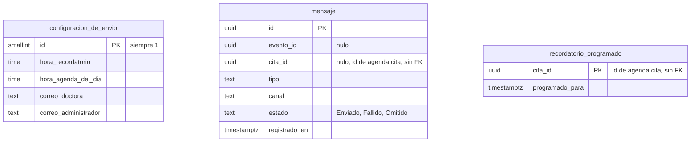
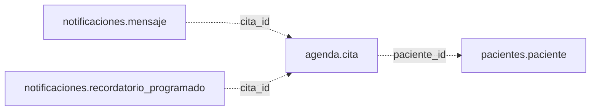

# Diseño de dominio (DDD) y modelo de datos — Sistema de citas, Dra. Selina Medina

## Cómo se lee este documento

**La Parte I es invariante.** No cambia mientras se construye: todo el código del sistema debe cumplir el diseño estratégico y táctico que aquí se define. Una historia, una revisión de código o una prueba puede citar cualquier regla por su identificador (`E-n`, `T-n`, `INV-n`, `RN-n`). Código que contradiga una regla es un defecto, aunque funcione.

**Dos usos de la palabra.** Aquí "invariante" tiene dos alcances que no deben confundirse. Una **invariante del diseño** es cualquier regla numerada de la Parte I (`E-n`, `T-n`, `RN-n`, `INV-n`): algo que el sistema siempre cumple. Una **invariante de agregado** (`INV-n`) es el caso particular clásico de DDD: lo que un agregado garantiza sobre sus propios datos. Toda invariante de agregado es invariante del diseño; no al revés.

**La Parte II es el modelo de datos** que materializa ese dominio. Las columnas que implementan una regla de la Parte I son obligatorias; el resto es punto de partida para las migraciones.

**Lo marcado `[ASSUMPTION]` todavía no es invariante.** Es algo que se infirió y que Gerardo no ha confirmado. Se construye así mientras no se diga otra cosa, pero puede cambiarse sin considerarlo una violación. Están listados al final de cada parte.

**Relación con la arquitectura.** El documento de arquitectura (`architecture-appointment-booking.md`, AD-1 a AD-28) fija las reglas entre módulos; este documento fija el diseño dentro del dominio. No deben contradecirse: si aparece una contradicción, es un defecto que se resuelve corrigiendo los dos documentos antes de construir. El plan de solución en `docs/` queda como referencia narrativa; ante diferencia, mandan la arquitectura y este documento.

**Cómo se cambia una invariante del diseño.** Solo Gerardo la cambia. Un cambio se hace editando este documento, con fecha en el historial del final, antes de cambiar el código, nunca después.

---

# Parte I — Diseño de dominio (invariante)

## 1. Diseño estratégico

### 1.1 Visión del dominio

Liberar a la Dra. Selina Medina de la carga administrativa de su agenda: que los pacientes reserven, reprogramen y cancelen sus citas por sí mismos, sin que ella intervenga.

- **E-1.** Ante cualquier duda de diseño, gana la opción que le quite trabajo a Selina.
- **E-2.** El sistema guarda solo datos de agenda. Ningún dato clínico entra al modelo: ni diagnósticos, ni notas médicas, ni tratamientos.

### 1.2 Actores

| Actor | Papel en el dominio | Cuenta |
| --- | --- | --- |
| Dra. Selina | Dueña del tiempo que se agenda. Decide su rutina y sus excepciones, y las comunica al Administrador | No |
| Administrador | Registra la agenda base y las agendas custom, crea citas del consultorio, marca ausencias, cancela, configura | Sí, única |
| Paciente | Agenda, reprograma y cancela su propia cita | No |
| Sistema | Ejecuta lo programado: recordatorio y agenda del día | No aplica |
| Asistente | Futuro; mismo papel que el Administrador | No se construye |

- **E-3.** Todo cambio en el dominio tiene exactamente un actor: `Paciente`, `Administrador` o `Sistema`.

### 1.3 Subdominios

Un subdominio es una parte del negocio que existe con o sin software. Su clasificación decide dónde se invierte.

| Subdominio | Tipo | Contexto delimitado | Inversión |
| --- | --- | --- | --- |
| Agendamiento de citas | Core de este sistema | Agenda | Modelo de dominio rico, la mayor cobertura de pruebas |
| Identidad de pacientes | Supporting | Pacientes | Modelo simple |
| Comunicación con pacientes | Generic | Notificaciones | Sin modelo de dominio; servicio externo detrás de una interfaz |
| Presencia en línea | Generic | Contenido | Sin modelo de dominio |
| Acceso del personal | Generic | Host (ASP.NET Core Identity) | Se usa tal cual |
| Atención clínica / expediente | Core del consultorio | Ninguno; fuera del sistema | No se construye |
| Cobro y aseguradoras | Supporting, futuro | Ninguno | No se construye |

- **E-4.** El modelo de dominio rico (agregados con comportamiento, objetos de valor, servicios de dominio) se construye solo en Agenda y, en versión simple, en Pacientes.
- **E-5.** Notificaciones y Contenido no tienen capa de dominio. Si alguno empieza a necesitar reglas de negocio, primero se revisa este documento.

Lo que justifica construir Agenda y no usar una herramienta genérica: la cancelación por el consultorio con disculpa y reubicación, la cancelación tardía marcada, la cita del consultorio fuera de horario, y el emparejamiento de pacientes por teléfono y nombre.

### 1.4 Lenguaje ubicuo

- **E-6.** Estos términos se usan exactamente así en código, pruebas, pantallas, correos y conversaciones. No se introducen sinónimos.
- **E-7.** "Horario de atención", "Bloqueo", "Slot" guardado, "Sede" y "Settings" no existen en el dominio. No aparecen en nombres de tipos, tablas ni pantallas.
- **E-8.** Los términos de negocio van en español; las capas técnicas, en inglés.

**Contexto Agenda**

| Término | Significado | En código |
| --- | --- | --- |
| Cita | Espacio reservado en la agenda para un paciente | `Cita` |
| Consulta | El acto médico que ocurre cuando el paciente llega a su cita. El sistema no registra su contenido | No es un tipo |
| Agenda de atención | Cuándo atiende Selina: la agenda base más las agendas custom | `AgendaAtencion` |
| Agenda base | La semana tipo de Selina, sin fechas: por cada día de la semana, cero o más tramos. Se repite sola | Parte de `AgendaAtencion` |
| Agenda custom | El horario propio de una fecha concreta, que reemplaza por completo a la base ese día: cero o más tramos y un motivo. Cero tramos = no se atiende | `AgendaCustom`, dentro de `AgendaAtencion` |
| Tramo | Periodo continuo de atención dentro de un día, con hora local de inicio y de fin | `Tramo` |
| Tramos vigentes | Los tramos que valen para una fecha: los de su custom si existe; si no, los de la base | `TramosVigentes` |
| Horario libre | Hora de inicio que hoy se puede reservar. Se calcula; nunca se guarda | `HorarioLibre` |
| Rejilla | Horas de inicio dentro de un tramo, en pasos de la duración del tipo de visita | Parte del cálculo |
| Ventana de reserva | Desde la anticipación mínima (hoy 1 día calendario: mañana) hasta el límite de la ventana (hoy 2 meses). Los dos valores son configurables | Parte de `ReglasDeAgenda` |
| Tipo de visita | Clase de cita que elige el paciente; define la duración. En pantalla se muestra como "Tipo de consulta" | `TipoDeVisita` |
| Motivo de consulta | Texto breve que escribe el paciente al reservar. Dato de salud | `MotivoDeConsulta` |
| Cita en línea | Cita que crea el paciente desde el sitio | `OrigenDeCita.EnLinea` |
| Cita del consultorio | Cita que registra el Administrador a mano | `OrigenDeCita.Consultorio` |
| Agendada | Estado inicial: reservada y firme | `EstadoCita.Agendada` |
| Atendida | Cita Agendada cuyo inicio ya pasó. Se deriva; no se guarda | Propiedad calculada |
| No se presentó | Estado final que marca el Administrador | `EstadoCita.NoSePresento` |
| Cancelada | Estado final, con motivo: paciente, tarde o consultorio | `EstadoCita.Cancelada` |
| Cancelación tardía | Cancelación del paciente con menos anticipación que el umbral de cancelación tardía | `MotivoDeCancelacion.Tarde` |
| Umbral de cancelación tardía | Un solo valor configurable (hoy 2 horas). Decide dos cosas: desde cuándo una cancelación es tardía y hasta cuándo se puede reprogramar | Parte de `ReglasDeAgenda` |
| Quedar fuera | Una cita queda fuera cuando no cabe completa dentro de un solo tramo vigente de su fecha | Regla, no tipo |
| Enlace de gestión | Enlace privado con el que el paciente ve, reprograma o cancela una cita | `EnlaceDeGestion` |
| Consentimiento | Aceptación del aviso de privacidad al crear la cita | `Consentimiento` |
| Bitácora | Registro de quién cambió qué y cuándo | `EntradaDeBitacora` |

**Contexto Pacientes**

| Término | Significado | En código |
| --- | --- | --- |
| Paciente | Persona que tiene o tuvo una cita. Se reconoce por teléfono y nombre | `Paciente` |
| Buscar o crear | Dado teléfono y nombre, devolver el paciente existente o registrar uno nuevo | `BuscarOCrear` |

**Contexto Notificaciones**

| Término | Significado |
| --- | --- |
| Mensaje | Lo que se envía a una persona: a quién, qué, cuándo, qué enlace |
| Canal | Medio de envío; hoy solo correo |
| Recordatorio | Mensaje informativo al paciente el día anterior a su cita. No pide confirmación |
| Agenda del día | Correo "Tus citas de hoy" que recibe Selina |

- **E-9.** Una misma palabra significa una sola cosa dentro de un contexto. "Paciente" en Agenda es solo un `PatientId`; el nombre y el contacto existen solo en Pacientes.

### 1.5 Contextos delimitados

| Contexto | Responsabilidad | Es dueño de |
| --- | --- | --- |
| **Agenda** (núcleo) | El tiempo de Selina: cuándo atiende y qué citas hay | Citas y su ciclo de vida; agenda base; agendas custom; cálculo de disponibilidad; no doble reserva; tipos de visita; reglas de reserva; consentimiento; enlace de gestión; bitácora |
| **Pacientes** (soporte) | Quién es cada paciente y cómo contactarlo | Identidad, nombre, teléfono, correo; el emparejamiento |
| **Notificaciones** (genérico) | Avisar a las personas | Mensajes enviados; recordatorios programados; horas de envío; destinatarios internos |
| **Contenido** (genérico) | El sitio y los datos del consultorio | Textos del sitio; nombre, dirección, mapa, WhatsApp |

- **E-10.** Cada contexto es dueño de sus datos. Ningún otro los lee ni los escribe directamente; sin joins ni llaves foráneas entre contextos.
- **E-11.** Un dato tiene un solo dueño. Si dos contextos lo necesitan, uno lo posee y el otro lo pide.
- **E-12.** Agenda no guarda ni modela nombres, teléfonos ni correos: los recibe en el comando de reserva solo para pasarlos a Pacientes, y los pide por contrato cuando una pantalla los necesita. Pacientes no conoce citas. Notificaciones no conoce reglas de reserva.

### 1.6 Mapa de contextos

La flecha apunta de quien provee (upstream) a quien consume (downstream). OHS = Open Host Service; PL = Published Language; ACL = Anti-Corruption Layer.

| Relación | Patrón | Regla |
| --- | --- | --- |
| Pacientes → Agenda | Customer-Supplier; Open Host Service con Published Language | Agenda usa `IPacientesApi`: buscar o crear, pacientes que comparten teléfono, contactos por lote para las pantallas (`ObtenerContactos`) |
| Pacientes → Notificaciones | Customer-Supplier; mismo Open Host Service | Notificaciones pide el contacto; no lo recibe en eventos |
| Agenda → Notificaciones | Published Language (eventos) más Open Host Service (`IAgendaApi`) | Notificaciones traduce los eventos a mensajes con una capa anticorrupción ligera |
| Contenido → Notificaciones, Agenda e interfaz | Open Host Service (`IContenidoApi`) | Datos del consultorio. Agenda los pide solo para poner el lugar en el archivo de calendario `[ASSUMPTION]` |
| Notificaciones → proveedor de correo | Anti-Corruption Layer (`INotificationChannel`) | Cambiar de proveedor toca una sola clase |
| Todos | Shared Kernel | Solo ids tipados, `IClock`, `Resultado`, `Actor` e `IActorActual`. Nada de negocio |

- **E-13.** Entre contextos solo hay dos formas de hablar: llamada síncrona por una interfaz `I<Contexto>Api`, o evento de integración por el outbox. No hay una tercera.
- **E-14.** Agenda nunca llama a Notificaciones. Publica eventos sin saber quién escucha.
- **E-15.** Los eventos de integración llevan identificadores y tiempos. Nunca nombre, teléfono, correo, motivo de consulta ni el enlace de gestión.
- **E-16.** Un consumidor nunca recalcula una clasificación que el dueño ya decidió. Si Agenda dice que una cancelación fue tardía, Notificaciones no lo vuelve a calcular.
- **E-17.** El Kernel compartido no crece con conceptos de negocio. Agregar algo requiere cambiar este documento.
- **E-18.** Un contexto futuro (expediente clínico) entra como contexto nuevo, sin modificar los existentes; si es un sistema comprado, queda detrás de una capa anticorrupción.

### 1.7 Eventos del dominio

Lo que ocurre en el negocio, en orden. Es el resultado del event storming.

| # | Evento | Lo provoca | Contexto | Reacción |
| --- | --- | --- | --- | --- |
| 1 | Agenda base cambiada | Administrador | Agenda | Se listan citas que quedan fuera y fechas con custom; nada se cancela |
| 2 | Agenda custom registrada, cambiada o borrada | Administrador | Agenda | Se cancelan solo las citas que el Administrador eligió cancelar; las demás no cambian |
| 3 | Cita agendada | Paciente | Agenda | Confirmación y recordatorio programado |
| 4 | Cita agendada por el consultorio | Administrador | Agenda | Confirmación y recordatorio programado |
| 5 | Cita reprogramada | Paciente | Agenda | Aviso; el recordatorio se mueve |
| 6 | Cita cancelada por el paciente | Paciente | Agenda | Aviso; el recordatorio se elimina |
| 7 | Cita cancelada tarde | Paciente | Agenda | Aviso amable; alerta inmediata al Administrador |
| 8 | Cita cancelada por el consultorio | Administrador: directamente, o al elegirla cuando guarda o borra una agenda custom | Agenda | Disculpa con enlace para elegir otro horario |
| 9 | Paciente no se presentó | Administrador | Agenda | Ninguna fuera de Agenda |
| 10 | Recordatorio enviado | Sistema | Notificaciones | Ninguna |
| 11 | Agenda del día enviada | Sistema | Notificaciones | Ninguna |

"Cita solicitada" no existe en el sistema: una petición por WhatsApp se convierte en cita cuando el Administrador la registra (evento 4).

## 2. Diseño táctico

### 2.1 Reglas generales

**Agregados**

- **T-1.** Un agregado protege únicamente las invariantes que puede comprobar con sus propios datos y con lo que recibe como parámetro. Nunca consulta la base, el reloj ni la configuración.
- **T-2.** El estado de un agregado cambia solo por sus métodos. Setters privados. Prohibido `ExecuteUpdate` y `ExecuteDelete` sobre agregados.
- **T-3.** Un agregado referencia a otro únicamente por su identificador.
- **T-4.** Los agregados son pequeños. No existe un agregado "Calendario" que contenga las citas.
- **T-5.** Un comando modifica un solo agregado por transacción, sin excepciones. Cuando un cambio en un agregado debe provocar cambios en otros, el primero levanta un evento y una política reacciona, modificando cada agregado en su propia transacción (2.2, Políticas).
- **T-6.** Crear y reconstituir son caminos distintos. La creación valida todas las invariantes, fija el estado inicial y levanta el evento. La reconstitución desde la base solo asigna valores: no valida ni levanta eventos.
- **T-7.** Un agregado nunca conoce a su repositorio, a otros contextos ni a la infraestructura.

**Objetos de valor**

- **T-8.** Inmutables, sin identidad, iguales cuando sus valores son iguales. Se validan al construirse: no existe uno inválido.
- **T-9.** Todo concepto con reglas de forma propias es un objeto de valor, no un tipo primitivo: teléfono, nombre, correo, tramo, rango de tiempo.
- **T-10.** Los identificadores son tipos propios sobre Guid v7, generados en el dominio al crear el agregado.

**Servicios de dominio**

- **T-11.** Un servicio de dominio existe solo cuando la lógica no cabe en un agregado ni en un objeto de valor. Es puro: sin estado y sin entrada/salida.
- **T-12.** Los servicios se mantienen escasos. Hoy hay uno. Agregar otro requiere cambiar este documento.

**Servicios de aplicación (handlers)**

- **T-13.** Un handler orquesta: carga, llama al dominio, guarda. No contiene reglas de negocio.
- **T-14.** Un caso de uso es un comando o una consulta, con exactamente un handler. Los comandos cambian estado; las consultas nunca lo cambian.

**Fábricas**

- **T-15.** La creación se hace con métodos de fábrica estáticos en el agregado, nombrados con el verbo del lenguaje ubicuo (`Cita.Agendar`, `Paciente.Registrar`). No hay constructores públicos.

**Repositorios**

- **T-16.** Un repositorio por agregado, como puerto de escritura definido en el dominio e implementado en infraestructura.
- **T-17.** Las lecturas para pantallas no pasan por el repositorio del agregado: usan un puerto de lectura propio del caso de uso, que proyecta lo necesario.

**Eventos**

- **T-18.** El agregado levanta eventos de dominio, en pasado, que solo su contexto conoce. El handler los traduce a eventos de integración, que son los únicos que cruzan a otros contextos.
- **T-19.** El evento de integración se guarda en la misma transacción que el cambio que lo origina.

**Tiempo**

- **T-20.** El reloj se recibe como parámetro (`now`) o por `IClock`. Los instantes se manejan en UTC; los tramos, como hora local de Ciudad de México.

### 2.2 Contexto Agenda

#### Agregados

| Agregado | Identidad | Qué protege |
| --- | --- | --- |
| `Cita` | `CitaId` | Su tiempo, su estado y las reglas para crearla, moverla y cancelarla |
| `AgendaAtencion` | Único en el sistema | Cuándo atiende Selina: que la agenda base y cada agenda custom sean coherentes, y cuáles son los tramos vigentes de una fecha |
| `TipoDeVisita` `[ASSUMPTION: agregado propio]` | `TipoDeVisitaId` | Nombre, duración y si es reservable en línea |
| `ReglasDeReserva` `[ASSUMPTION: agregado propio]` | Único en el sistema | Que los valores configurables sean válidos |

#### `Cita`

**Estado:** paciente (`PatientId`), tipo de visita, rango de tiempo, estado, motivo de cancelación, origen, nota, motivo de consulta, consentimiento, identificador de solicitud.

**Invariantes**

- **INV-C1.** Tiene un paciente y un tipo de visita.
- **INV-C2.** Su rango es coherente: el inicio es anterior al fin. El rango es semiabierto, `[inicio, fin)`.
- **INV-C3.** El fin se fija al crear o reprogramar y no se recalcula si después cambia la duración del tipo de visita.
- **INV-C4.** No se crea ni se mueve a un momento pasado.
- **INV-C5.** Una cita en línea cabe completa dentro de un solo tramo vigente, empieza en la rejilla y cae dentro de la ventana de reserva.
- **INV-C6.** Una cita del consultorio lleva nota cuando cae fuera de los tramos vigentes.
- **INV-C7.** Solo guarda tres estados: `Agendada`, `NoSePresento`, `Cancelada`. Los dos últimos son finales.
- **INV-C8.** Tiene motivo de cancelación si y solo si está `Cancelada`.
- **INV-C9.** Lleva su consentimiento desde que se crea.
- **INV-C10.** El origen no cambia después de creada.
- **INV-C11.** Una cita en línea lleva motivo de consulta.

**Lo que no es invariante de la `Cita`:** que no se traslape con otra. Es una regla entre citas y la garantiza la base de datos (RN-1).

**Comportamiento**

| Método | Quién | Reglas | Evento |
| --- | --- | --- | --- |
| `Cita.Agendar(paciente, tipo, rango, motivo, consentimiento, solicitud, reglas, citasDeLaSemana, now)` | Paciente | INV-C1 a C5, C9, C11. Rechaza si `citasDeLaSemana` ya alcanzó el tope semanal de `reglas` (RN-18) | `CitaFueAgendada` |
| `Cita.AgendarPorConsultorio(paciente, tipo, rango, nota, motivo, consentimiento, tramosVigentes, now)` | Administrador | INV-C1 a C4, C6, C9. No valida rejilla, ventana ni tramos | `CitaFueAgendada` |
| `cita.Reprogramar(nuevoRango, reglas, now)` | Paciente | Solo si está `Agendada`; mientras falte para su inicio actual al menos el umbral de cancelación tardía (hoy 2 horas); INV-C4 y C5 sobre el nuevo rango. Es la misma cita | `CitaFueReprogramada` |
| `cita.Cancelar(now, reglas)` | Paciente | Solo si está `Agendada` y no ha empezado. Nunca se impide. Si falta menos que el umbral de cancelación tardía (hoy 2 horas), el motivo es `Tarde`; si no, `Paciente` | `CitaFueCancelada` |
| `cita.CancelarPorConsultorio(now)` | Administrador: directamente, o por la política P-1 cuando la eligió al guardar o borrar una agenda custom | Solo si está `Agendada` y su inicio no ha pasado. Una cita que ya empezó no se cancela; para esa existe `MarcarNoSePresento` | `CitaFueCancelada` |
| `cita.MarcarNoSePresento(now)` | Administrador | Solo si está `Agendada` y su inicio ya pasó | `PacienteNoSePresento` |

**Ciclo de vida**

#### `AgendaAtencion`

Un solo agregado reúne la agenda base y las agendas custom. Existe una sola en el sistema. Las citas no forman parte de él (T-4).

**Estado:** la agenda base (por cada día de la semana, una lista de tramos) y las agendas custom (por fecha, una lista de tramos y un motivo). `AgendaCustom` es una entidad interna del agregado, identificada por su fecha; fuera del agregado nadie la crea ni la modifica directamente.

**Invariantes de la agenda base**

- **INV-B1.** En cada tramo, el fin es posterior al inicio.
- **INV-B2.** Los tramos de un mismo día no se enciman.
- **INV-B3.** Un día puede tener cero tramos: ese día no se atiende.
- **INV-B4.** No tiene fechas ni vigencias.
- **INV-B5.** En cada tramo cabe al menos una cita del tipo de visita más corto. La duración mínima se recibe como parámetro (T-1). `[ASSUMPTION: el más corto entre los tipos de visita activos]`

**Invariantes de las agendas custom**

- **INV-A1.** A lo más una por fecha: la fecha es su identidad dentro del agregado.
- **INV-A2.** En cada tramo, el fin es posterior al inicio, y los tramos no se enciman.
- **INV-A3.** Puede tener cero tramos: ese día no se atiende.
- **INV-A4.** Siempre tiene motivo.
- **INV-A5.** No se repite ni genera otras fechas.
- **INV-A6.** En cada tramo cabe al menos una cita del tipo de visita más corto, igual que en la base (INV-B5).

**Invariante que las une**

- **INV-V1.** Los tramos vigentes de una fecha son los de su agenda custom si existe; si no, los de la agenda base para ese día de la semana. Solo `AgendaAtencion` contesta esa pregunta.

**Comportamiento**

| Método | Regla | Evento |
| --- | --- | --- |
| `agendaAtencion.CambiarBase(dia, tramos, duracionMinima)` | INV-B1 a B3 y B5. No cancela citas ni toca agendas custom | `AgendaBaseFueCambiada` |
| `agendaAtencion.RegistrarCustom(fecha, tramos, motivo, duracionMinima)` | INV-A1 a A4 y A6. Falla si la fecha ya tiene custom | `AgendaCustomFueRegistrada` |
| `agendaAtencion.CambiarCustom(fecha, tramos, motivo, duracionMinima)` | INV-A2 a A4 y A6 | `AgendaCustomFueCambiada` |
| `agendaAtencion.BorrarCustom(fecha)` | La fecha vuelve a la base | `AgendaCustomFueBorrada` |
| `agendaAtencion.TramosVigentes(fecha)` | Consulta. INV-V1 | — |
| `agendaAtencion.FechasConCustom()` | Consulta. Para avisar cuáles no cambian al cambiar la base (RN-7) | — |

La agenda de atención no cancela citas: no las conoce (T-3). El handler que guarda o borra una custom adjunta al evento los identificadores de las citas que el Administrador eligió cancelar y el actor que hizo el cambio, y la política P-1 las cancela después (RN-9, RN-10).

INV-B5 e INV-A6 se comprueban al cambiar la base o una custom, con la duración mínima de ese momento. Si después se crea un tipo de visita más corto o se cambia una duración, los tramos ya guardados no se revalidan (T-6).

`[ASSUMPTION: el agregado se carga con las agendas custom de hoy en adelante; las de fechas pasadas no participan en ninguna regla]`

#### Objetos de valor

| Objeto | Contiene | Regla |
| --- | --- | --- |
| `RangoDeTiempo` | Inicio y fin, instantes UTC | Inicio anterior al fin; semiabierto; sabe si traslapa a otro |
| `Tramo` | Hora local de inicio y de fin | Inicio anterior al fin; sabe si se encima con otro y si un rango cabe dentro |
| `AgendaCustom` (entidad interna) | Fecha, tramos, motivo | Vive dentro de `AgendaAtencion`; su identidad es la fecha |
| `TramosVigentes` | Los tramos de una fecha y de dónde salieron (base o custom) | Los produce `AgendaAtencion`; el handler se los pasa a la `Cita` |
| `ReglasDeAgenda` | Tramos vigentes de la fecha de la cita, anticipación mínima, ventana, umbral de cancelación tardía, tope semanal | Es el paquete que recibe la `Cita`; el agregado nunca lee configuración. No es `ReglasDeReserva`: ese es el agregado que guarda los valores configurables; el handler arma `ReglasDeAgenda` con esos valores más los tramos vigentes |
| `EstadoCita` | `Agendada`, `NoSePresento`, `Cancelada` | — |
| `MotivoDeCancelacion` | `Paciente`, `Tarde`, `Consultorio` | — |
| `OrigenDeCita` | `EnLinea`, `Consultorio` | — |
| `Consentimiento` | Fecha y hora, versión del aviso, canal (en línea, externo) | Los tres son obligatorios |
| `EnlaceDeGestion` | Token derivado de la cita | Se deriva, no se genera al azar; se guarda solo su hash |
| `HorarioLibre` | Fecha y hora de inicio ofrecidas | Resultado del cálculo; nunca se persiste |
| `CitaId`, `TipoDeVisitaId` | Guid v7 | T-10. Viven en el Kernel, como todos los ids tipados, porque los contratos los usan |

#### Servicio de dominio: `CalculadoraDeDisponibilidad`

El único servicio de dominio del sistema. Existe porque razona a la vez sobre la agenda de atención y muchas citas, que son agregados distintos.

**Recibe:** la agenda de atención, citas activas de la ventana, duración del tipo de visita, anticipación mínima y ventana, `now`. Los tramos no le llegan en un paquete: los pide a la agenda de atención fecha por fecha. **Devuelve:** horarios libres. No toca la base ni el reloj.

Por cada fecha de la ventana de reserva:

1. Pedir a la agenda de atención los tramos vigentes de esa fecha (INV-V1).
2. Dentro de cada tramo, construir la rejilla: desde su inicio, en pasos de la duración, solo los que quepan completos.
3. Quitar los que traslapen una cita activa, de cualquier origen.
4. Quitar los que caen antes de la anticipación mínima (hoy: antes de mañana) o después de la ventana.

- **T-21.** Es la única implementación del cálculo de disponibilidad. Ninguna pantalla, consulta ni handler lo reimplementa.

**No son servicios de dominio:** decidir si una cancelación es tardía (lo hace `cita.Cancelar`); cancelar las citas que el Administrador eligió al guardar o borrar una custom (lo hace una política que reacciona al evento, P-1); normalizar teléfono y nombre (lo hacen sus objetos de valor).

#### Repositorios (puertos de escritura)

| Puerto | Agregado | Operaciones |
| --- | --- | --- |
| `ICitas` | `Cita` | Agregar, obtener por id, obtener por solicitud, guardar |
| `IAgendaAtencion` | `AgendaAtencion` | Obtener, guardar |
| `ITiposDeVisita` | `TipoDeVisita` | Obtener, agregar, guardar |
| `IReglasDeReserva` | `ReglasDeReserva` | Obtener, guardar |

- **T-22.** El puerto `ICitas` guarda de forma explícita dentro del handler y traduce el choque de traslape a un resultado de conflicto; nunca deja escapar la excepción de la base.

#### Eventos

**De dominio** (internos de Agenda): `CitaFueAgendada`, `CitaFueReprogramada`, `CitaFueCancelada`, `PacienteNoSePresento`, `AgendaBaseFueCambiada`, `AgendaCustomFueRegistrada`, `AgendaCustomFueCambiada`, `AgendaCustomFueBorrada`. Los tres de custom (registro, cambio y borrado) llevan la fecha, los identificadores de las citas elegidas para cancelar y el actor que hizo el cambio.

**De integración** (cruzan a otros contextos). Todos llevan `EventoId`, `OcurridoEn`, `CitaId`, `PatientId` y `Actor`.

| Evento | Además lleva |
| --- | --- |
| `CitaAgendada` | Inicio, Fin, Origen |
| `CitaReprogramada` | InicioAnterior, InicioNuevo, FinNuevo |
| `CitaCancelada` | Inicio, Motivo |

- **T-23.** Solo esos tres eventos salen de Agenda. Las ausencias y los cambios de base y custom no se publican mientras nadie fuera de Agenda los necesite.

#### Políticas

Una política es una reacción a un evento: "cuando ocurre X, hacer Y". Vive en `Features`, como handler del evento, y modifica un solo agregado por transacción (T-5).

| Política | Cuando | Entonces |
| --- | --- | --- |
| **P-1** | `AgendaCustomFueRegistrada`, `AgendaCustomFueCambiada` o `AgendaCustomFueBorrada` trae citas elegidas para cancelar | Por cada una, en su propia transacción: `cita.CancelarPorConsultorio(now)`. Si la cita ya no está `Agendada`, se omite. El actor de cada cancelación es el que viene en el evento: el Administrador que guardó o borró la custom |

- **T-29.** Las políticas son idempotentes: procesar dos veces el mismo evento no cambia el resultado.
- **T-30.** El evento que dispara una política se guarda en la misma transacción que el cambio que lo origina, así no se pierde si el proceso se cae entre los dos pasos.
- **T-31.** Una política nunca actúa como `Sistema` por correr en segundo plano: usa el actor que viene en el evento que la dispara. Así la bitácora y `CitaCancelada` dicen quién tomó la decisión.

Las reacciones que ocurren fuera de Agenda (enviar la disculpa, mover el recordatorio, alertar por una cancelación tardía) son de Notificaciones y parten de los tres eventos de integración.

#### Reglas de negocio de Agenda

- **RN-1. Sin doble reserva.** Dos citas no canceladas nunca se traslapan. Lo garantiza la base de datos; el cálculo de disponibilidad es cortesía, la restricción es la garantía. Ante el choque, el paciente ve los horarios libres restantes, nunca un error.
- **RN-2. Sin aprobación.** Una cita en línea queda firme al instante.
- **RN-3. Los horarios libres se calculan.** Nada guarda slots, ni habilita periodos, ni los crea por adelantado.
- **RN-4. La custom reemplaza a la base.** Para una fecha valen los tramos de su custom si existe; si no, los de la base. No hay precedencia entre excepciones porque solo hay una por fecha. Lo resuelve únicamente `AgendaAtencion` (INV-V1); ningún handler ni consulta lo reimplementa.
- **RN-5. La base aplica de inmediato.** No hay fecha de inicio futura ni versiones.
- **RN-6. Cambiar la base no cancela citas.** Las que quedan fuera se listan antes de guardar y el Administrador decide.
- **RN-7. Cambiar la base no altera fechas con custom.** Se listan al guardar.
- **RN-8. Una cita ya agendada no se modifica sola.** Una cita agendada con reglas anteriores sigue siendo válida. Ningún cambio de agenda base ni de agenda custom la mueve ni la cancela por su cuenta; solo cambia por una acción explícita del paciente o del Administrador sobre esa cita.
- **RN-9. Al guardar o borrar una custom, el Administrador decide cita por cita.** Borrar cuenta igual que guardar: si la fecha vuelve a la base y eso deja citas fuera (por ejemplo, se borra la custom que abría un sábado), el sistema pregunta qué hacer con cada una. Antes de guardar o borrar se listan las citas activas y futuras que quedan fuera, de cualquier origen, y el Administrador elige para cada una: cancelar o conservar. Puede cancelarlas todas, ninguna, o todas menos una. El comando recibe la lista completa que vio con su decisión por cita; si ya no coincide con las que quedan fuera, devuelve conflicto y no cambia nada.
- **RN-10. La custom se guarda o se borra sola; las cancelaciones ocurren después, por evento.** Guardar o borrar la custom no toca ninguna cita. Levanta un evento con las citas elegidas para cancelar; una política (P-1) cancela cada una por su agregado, en su propia transacción, con motivo `Consultorio` y con el Administrador como actor (T-31), y el paciente recibe la disculpa con el enlace para reagendar. Las citas conservadas no cambian y su paciente no recibe ningún aviso. Una cita conservada queda agendada en una fecha fuera de sus tramos, igual que una cita del consultorio. `[ASSUMPTION: en la lista, las citas en línea no vienen preseleccionadas y las del consultorio vienen marcadas "conservar"; hay un atajo "cancelar todas"]`
- **RN-11. Una custom se registra con cualquier anticipación y no se repite.**
- **RN-12. Rehabilitar es editar o borrar la custom.** Borrarla devuelve la fecha a la base; si eso deja citas fuera, aplica RN-9.
- **RN-13. La cita del consultorio ignora base, custom, rejilla, ventana y tope semanal,** incluso en una fecha marcada "no se atiende". Sus reglas duras son RN-1 e INV-C4.
- **RN-14. Una cita del consultorio nunca abre disponibilidad al público.**
- **RN-15. Reprogramar es mover la misma cita.** Conserva identificador, enlace de gestión, origen y bitácora. Solo mientras falte al menos el umbral de cancelación tardía (hoy 2 horas). No aplica el tope semanal.
- **RN-16. Cancelar siempre es posible** para el paciente, hasta el inicio de la cita. Con menos anticipación que el umbral de cancelación tardía (hoy 2 horas) queda marcada como tardía.
- **RN-17. Un solo valor decide las dos cosas.** El umbral de cancelación tardía (configurable, hoy 2 horas) marca desde cuándo una cancelación es tardía y hasta cuándo se puede reprogramar. No existe un corte de reprogramación aparte. Dentro del umbral no se reprograma; se ofrece cancelar y volver a agendar, para que una cancelación tardía no se disfrace.
- **RN-18. Tope semanal por teléfono.** Lo decide Agenda al reservar en línea. El handler pide a Pacientes los pacientes que comparten el teléfono, cuenta las citas de Agenda de la semana de calendario de la cita y le pasa ese conteo a `Cita.Agendar`; la `Cita` es quien compara contra el tope y rechaza (el handler no decide, T-13; la cita no consulta, T-1). Es un límite blando. `[ASSUMPTION: semana de lunes a domingo; cuentan las citas Agendadas de cualquier origen]`
- **RN-19. Atendida se deriva.** No hay transición ni tarea programada que la produzca.
- **RN-31. "Ya pasó" se mide desde el inicio de la cita,** no desde su fin. Una cita de 4:00 a 4:30, a las 4:10: ya cuenta como Atendida, ya se puede marcar "no se presentó", ya no la puede cancelar ni el paciente ni el consultorio, y su enlace de gestión ya no vale.
- **RN-20. Concurrencia sobre una fecha.** Crear o mover una cita en línea, y guardar o borrar una custom, hacen fila sobre la fecha local y leen los tramos vigentes después.
- **RN-21. Confirmar dos veces no crea dos citas.** Un segundo comando con el mismo identificador de solicitud devuelve la cita ya creada.
- **RN-22. El enlace de gestión se deriva de la cita** con una clave del servidor que vive fuera de la base; Agenda es la única que lo arma. Deja de valer cuando el inicio actual de la cita ya pasó.
- **RN-23. El consentimiento se registra por cita,** al crearla, no por paciente: se acepta en cada reserva. Queda por validar con el abogado que revisa el aviso de privacidad.
- **RN-24. Todo cambio deja bitácora** en la misma transacción, con su actor.

### 2.3 Contexto Pacientes

#### Agregado `Paciente`

**Estado:** `PatientId`, nombre completo, teléfono, correo opcional.

- **INV-P1.** Tiene nombre y teléfono; el correo es opcional.
- **INV-P2.** El teléfono solo existe en formato E.164 válido para México.
- **INV-P3.** El teléfono no es la identidad: puede cambiar o compartirse.

| Método | Regla |
| --- | --- |
| `Paciente.Registrar(telefono, nombre, correo)` | INV-P1, P2 |
| `paciente.ActualizarCorreo(correo)` | Correo válido. Se usa cuando al reservar llega un correo distinto al guardado: el nuevo reemplaza al anterior y aplica a todos los avisos pendientes |

#### Objetos de valor

| Objeto | Regla |
| --- | --- |
| `Telefono` | Solo se construye en E.164 válido; los números imposibles se rechazan |
| `NombreCompleto` | Guarda el valor original y su forma normalizada (espacios) |
| `CorreoElectronico` | Opcional; validado al construirse |
| `PatientId` | Guid v7; vive en el Kernel porque Agenda lo usa |

#### Reglas de negocio de Pacientes

- **RN-25. Emparejamiento.** Mismo teléfono y mismo nombre = mismo paciente. Mismo teléfono con otro nombre = paciente distinto. La comparación ignora mayúsculas, acentos y espacios de más.
- **RN-26. La igualdad la decide la base de datos,** con un índice único, no el código. Eso hace idempotente a `BuscarOCrear`.
- **RN-27. Límite aceptado:** un error de dedo en el nombre crea un duplicado. No se intenta adivinar.
- **RN-28. `BuscarOCrear` confirma en su propia transacción,** antes de la de Agenda. Un paciente sin cita es un resultado aceptable.
- **RN-29. Pacientes nunca conoce citas.** Contesta sobre identidad y contacto, nada más.
- **RN-30. El correo más reciente manda.** Si al reservar llega un correo distinto al guardado, lo reemplaza.

#### Repositorio

`IPacientes`: buscar por teléfono y nombre, obtener por id, obtener varios por id, obtener por teléfono, agregar, guardar.

### 2.4 Contextos sin modelo de dominio

**Notificaciones.** Casos de uso e infraestructura, sin agregados.

- **T-24.** Reacciona a los tres eventos de Agenda y envía, cuando les llega su hora, sus propios envíos programados (Recordatorio y Agenda del día). Pide lo que necesita por contrato.
- **T-25.** Es la única dueña del recordatorio: lo programa al agendarse la cita, lo mueve al reprogramarse y lo elimina al cancelarse.
- **T-26.** La reserva nunca espera al correo: el envío ocurre después, con reintentos, y deduplica por `EventoId`.
- **T-27.** No decide nada del negocio de citas: ni si una cancelación fue tardía, ni si un día se atiende. Lo pregunta o lo recibe.

**Contenido.** Sirve textos del sitio y datos del consultorio por `IContenidoApi`. Sin reglas de negocio.

### 2.5 Diagrama de agregados

`Paciente` pertenece al contexto Pacientes; los demás, a Agenda. Las líneas punteadas son referencias por identificador o de uso, nunca objetos contenidos.

### 2.6 Dónde vive cada pieza en el código

| Pieza | Namespace (carpeta dentro de `DraSelina.Consultorio.Web`) |
| --- | --- |
| Agregados, objetos de valor, servicio de dominio, eventos de dominio, puertos de escritura | `<Contexto>.Domain` |
| Handlers, puertos de lectura | `<Contexto>.Features` |
| Comandos, consultas, DTOs, eventos de integración, `I<Contexto>Api` | `<Contexto>.Contracts` |
| Implementación de puertos, persistencia | `<Contexto>.Infrastructure` |
| Ids tipados, `IClock`, `Resultado`, `Actor`, `IActorActual` | `Kernel` |

- **T-28.** El namespace `Domain` de un contexto no usa nada salvo el `Kernel`. No conoce EF Core, ASP.NET ni otros contextos. Las capas son namespaces y carpetas dentro de un solo proyecto, no proyectos separados.

### 2.7 Cómo se hace cumplir

| Qué | Con qué |
| --- | --- |
| Dependencias entre namespaces y contextos (E-10, E-13, T-28) | Pruebas de arquitectura, sobre las directivas `using` de cada archivo |
| Invariantes `INV-*` | Una prueba unitaria por invariante, sobre el agregado, sin base de datos |
| Reglas `RN-*` | Pruebas del agregado o del handler; las que dependen de la base (RN-1, RN-20, RN-26), pruebas de integración |
| `CalculadoraDeDisponibilidad` | La suite más completa del sistema, sin base de datos |
| Lenguaje ubicuo (E-6, E-7) | Revisión de código; los términos prohibidos no aparecen en nombres |
| Todo lo demás | Revisión de cada historia contra este documento antes de darla por terminada |

## 3. Supuestos de la Parte I

No son invariantes del diseño hasta que Gerardo los confirme. Ninguno cambia lo que el sistema hace salvo el de RN-18.

- `TipoDeVisita` y `ReglasDeReserva` como agregados propios, con sus puertos `ITiposDeVisita` e `IReglasDeReserva`.
- RN-18: semana de lunes a domingo; cuentan las citas Agendadas de cualquier origen.
- Los nombres exactos de métodos y puertos que no venían del plan de solución: `TramosVigentes`, `HorarioLibre`, `MarcarNoSePresento`, `IAgendaAtencion`, `IPacientes`.
- `AgendaAtencion` se carga con las agendas custom de hoy en adelante.
- INV-B5 e INV-A6: "el tipo de visita más corto" se toma entre los tipos activos.
- El valor único de RN-17 conserva el nombre "umbral de cancelación tardía".
- Agenda pide a Contenido el lugar para el archivo de calendario.

---

# Parte II — Modelo de datos

Modelo lógico y físico que materializa la Parte I. Sustituye la sección "Data model" original del plan de solución.

Las columnas y restricciones que implementan una regla de la Parte I o una decisión de arquitectura son obligatorias y lo indican. El resto es punto de partida: una vez que exista el código, las migraciones de cada módulo son la verdad.

## Convenciones físicas

| Tema | Convención | Origen |
| --- | --- | --- |
| Base | PostgreSQL, una sola base | AD-2 |
| Esquemas | `agenda`, `pacientes`, `notificaciones`, `identidad` (host) | AD-2 |
| Entre esquemas | Sin llaves foráneas ni joins; solo el id | AD-2 |
| Nombres | Tablas y columnas en `snake_case`, en español | `[ASSUMPTION]` |
| Identificadores | `uuid`, Guid v7 generado en el dominio | AD-18 |
| Instantes | `timestamptz`, en UTC | AD-17 |
| Tramos | `time` sin zona, hora local de Ciudad de México | AD-17 |
| Fechas de agenda | `date`, fecha local | AD-17 |
| Enumeraciones | `text` con `CHECK` | `[ASSUMPTION]` |
| Rangos de cita | Semiabiertos `[inicio, fin)` | AD-8 |
| Migraciones | Historial por esquema; las aplica solo `MigrationService` | AD-25 |

## Modelo lógico

Lo que **no** existe como tabla: los horarios libres (se calculan, AD-5), el estado "Atendida" (se deriva, AD-9), una sede (AD-15), una tabla de ajustes compartida (AD-14).

## Modelo físico

Un diagrama por esquema, con las tablas, columnas y tipos de PostgreSQL tal como quedarían en la base. `PK` es llave primaria, `FK` llave foránea y `UK` valor único. Las líneas entre tablas son llaves foráneas reales; entre esquemas no hay ninguna (AD-2). El detalle de cada columna, con índices y restricciones, está en las secciones que siguen.

### Esquema `agenda`

`cita` lleva además la restricción de exclusión sobre `[inicio, fin)` para las citas no canceladas. `bitacora` apunta a su entidad por `entidad` y `entidad_id`, sin llave foránea, porque registra varias tablas. `agenda_base_tramo` y `reglas_de_reserva` no se relacionan con ninguna otra tabla.

### Esquema `pacientes`

Único en la pareja `(telefono, nombre_normalizado)`: es la identidad del paciente.

### Esquema `notificaciones`

Único en la pareja `(evento_id, tipo)` de `mensaje`. Ninguna tabla de este esquema tiene llaves foráneas.

### Referencias entre esquemas

Solo por valor, nunca por llave foránea:

## Esquema `agenda`

### `agenda.cita`

| Columna | Tipo | Nulo | Notas |
| --- | --- | --- | --- |
| `id` | `uuid` | no | PK. Guid v7 del dominio |
| `paciente_id` | `uuid` | no | Id de `pacientes.paciente`; **sin** llave foránea (AD-2) |
| `tipo_de_visita_id` | `uuid` | no | FK a `agenda.tipo_de_visita` |
| `inicio` | `timestamptz` | no | UTC |
| `fin` | `timestamptz` | no | UTC. Se fija al crear o reprogramar; no se recalcula (AD-8) |
| `estado` | `text` | no | `Agendada`, `NoSePresento`, `Cancelada` (AD-9) |
| `motivo_de_cancelacion` | `text` | sí | `paciente`, `tarde`, `consultorio`; solo si `estado = 'Cancelada'` |
| `cancelada_en` | `timestamptz` | sí | |
| `origen` | `text` | no | `en_linea`, `consultorio` (AD-7) |
| `nota` | `text` | sí | Obligatoria en el dominio cuando la cita del consultorio cae fuera de los tramos (AD-7) |
| `motivo_de_consulta` | `text` | sí | Dato de salud (AD-23). Obligatorio en línea `[ASSUMPTION: opcional en la cita del consultorio]` |
| `consentimiento_en` | `timestamptz` | no | AD-24 |
| `consentimiento_version_aviso` | `text` | no | Versión del aviso de privacidad aceptado |
| `consentimiento_canal` | `text` | no | `en_linea`, `externo` |
| `solicitud_id` | `uuid` | sí | Del formulario de confirmación; nulo en citas del consultorio (AD-27) |
| `token_hash` | `bytea` | no | SHA-256 del token derivado, 32 bytes (AD-19) |
| `creada_en` | `timestamptz` | no | |

Restricciones e índices:

- **No traslape (AD-8):** `EXCLUDE USING gist (tstzrange(inicio, fin, '[)') WITH &&) WHERE (estado <> 'Cancelada')`.
- `CHECK (fin > inicio)`.
- `CHECK` de coherencia: `motivo_de_cancelacion` y `cancelada_en` presentes si y solo si `estado = 'Cancelada'`.
- Único en `solicitud_id` (los nulos no chocan).
- Único en `token_hash`.
- Índice en `(inicio)` para la agenda del día y la disponibilidad.
- Índice en `(paciente_id, inicio)` para el historial y el tope semanal.
- Concurrencia al cambiar una cita: el comando la lee con `SELECT … FOR UPDATE` dentro de su transacción, después del candado de fecha (AD-26) cuando el cambio la mueve; cancelar o marcar No se presentó no toman candado (Gerardo, 2026-11-10, entrada 5.5); un segundo cambio a la misma cita espera y ve el estado ya cambiado (Gerardo, 2026-11-06, entrada 3.2). Reemplaza el `[ASSUMPTION]` de concurrencia optimista con `xmin`.

La fecha local de una cita, usada para el candado por fecha (AD-26) y para decidir sus tramos vigentes, es `(inicio AT TIME ZONE 'America/Mexico_City')::date`. No se guarda.

### `agenda.tipo_de_visita`

| Columna | Tipo | Nulo | Notas |
| --- | --- | --- | --- |
| `id` | `uuid` | no | PK |
| `nombre` | `text` | no | "Primera consulta", "Consulta de seguimiento" |
| `descripcion` | `text` | sí | Texto que ve el paciente al elegir |
| `duracion_min` | `smallint` | no | `CHECK (duracion_min > 0)`; hoy 30 |
| `reservable_en_linea` | `boolean` | no | |
| `orden` | `smallint` | no | Orden en pantalla `[ASSUMPTION]` |
| `activo` | `boolean` | no | Un tipo con citas no se borra, se desactiva `[ASSUMPTION]` |

### `agenda.agenda_base_tramo`

La semana tipo. Hoy cinco filas.

| Columna | Tipo | Nulo | Notas |
| --- | --- | --- | --- |
| `id` | `uuid` | no | PK |
| `dia_de_la_semana` | `smallint` | no | 1 = lunes … 7 = domingo `[ASSUMPTION: numeración ISO]` |
| `inicio` | `time` | no | Hora local |
| `fin` | `time` | no | Hora local |

- `CHECK (fin > inicio)`, `CHECK (dia_de_la_semana BETWEEN 1 AND 7)`.
- Único en `(dia_de_la_semana, inicio)`.
- Que los tramos de un día no se encimen (INV-B2) y que en cada uno quepa una cita del tipo más corto (INV-B5) lo garantiza el agregado `AgendaAtencion`, que carga todas las filas; la base de datos no lo comprueba.

### `agenda.agenda_custom`

| Columna | Tipo | Nulo | Notas |
| --- | --- | --- | --- |
| `fecha` | `date` | no | PK. Garantiza a lo más una custom por fecha (AD-5) |
| `motivo` | `text` | no | "cirugía", "vacaciones", "sábado abierto" |
| `creada_en` | `timestamptz` | no | |
| `actualizada_en` | `timestamptz` | no | |

Una fila sin tramos hijos significa "ese día no se atiende".

### `agenda.agenda_custom_tramo`

| Columna | Tipo | Nulo | Notas |
| --- | --- | --- | --- |
| `id` | `uuid` | no | PK |
| `fecha` | `date` | no | FK a `agenda.agenda_custom`, borrado en cascada |
| `inicio` | `time` | no | Hora local |
| `fin` | `time` | no | Hora local |

- `CHECK (fin > inicio)`. Único en `(fecha, inicio)`.
- El no encimarse (INV-A2) y la duración mínima del tramo (INV-A6) los garantiza el agregado `AgendaAtencion`.

### `agenda.reglas_de_reserva`

Una sola fila (AD-14).

| Columna | Tipo | Valor inicial |
| --- | --- | --- |
| `id` | `smallint` | 1, con `CHECK (id = 1)` |
| `anticipacion_minima_dias` | `smallint` | 1 |
| `ventana_meses` | `smallint` | 2 |
| `umbral_cancelacion_tardia_min` | `smallint` | 120. Es también el corte para reprogramar (RN-17) |
| `tope_semanal_por_telefono` | `smallint` | 3 `[ASSUMPTION, del PRD]` |

### `agenda.bitacora`

Se escribe en la misma transacción que el cambio (AD-16). Solo se inserta; nunca se actualiza ni se borra.

| Columna | Tipo | Nulo | Notas |
| --- | --- | --- | --- |
| `id` | `uuid` | no | PK, Guid v7 (ordenable por tiempo) |
| `ocurrido_en` | `timestamptz` | no | |
| `actor_tipo` | `text` | no | `Paciente`, `Administrador`, `Sistema` (AD-22) |
| `actor_id` | `text` | sí | Id del usuario administrador; nulo para Paciente y Sistema |
| `entidad` | `text` | no | `Cita`, `AgendaBase`, `AgendaCustom`, `TipoDeVisita`, `ReglasDeReserva`. Base y custom se registran por separado aunque sean un solo agregado, para saber qué parte cambió |
| `entidad_id` | `text` | no | Id de la cita, fecha de la custom, etc. |
| `accion` | `text` | no | `Agendada`, `Reprogramada`, `Cancelada`, `NoSePresento`, `Registrada`, `Cambiada`, `Borrada` |
| `detalle` | `jsonb` | sí | Antes y después. **Nunca** motivo de consulta ni datos de contacto (AD-23) |

- Índice en `(entidad, entidad_id, ocurrido_en)`.

### `agenda.outbox` `[ASSUMPTION: tabla completa]`

Los eventos de integración que Agenda publica (AD-3). Cada fila se guarda en la misma transacción que el cambio que la origina.

| Columna | Tipo | Nulo | Notas |
| --- | --- | --- | --- |
| `id` | `uuid` | no | PK. Es el `EventoId` del evento |
| `tipo` | `text` | no | `CitaAgendada`, `CitaReprogramada`, `CitaCancelada` |
| `contenido` | `jsonb` | no | El evento serializado. Sin datos personales (AD-23) |
| `ocurrido_en` | `timestamptz` | no | |
| `clave_de_orden` | `uuid` | no | El `CitaId`. Un evento no se entrega mientras haya otro anterior con la misma clave todavía pendiente |
| `estado` | `text` | no | `Pendiente`, `Entregado`, `Fallido` |
| `intentos` | `integer` | no | Entregas fallidas hasta ahora |
| `proximo_intento_en` | `timestamptz` | no | Desde cuándo puede intentarse. Al guardar el evento es `ocurrido_en` |
| `entregado_en` | `timestamptz` | sí | Nulo mientras no se ha entregado |

- Tras una entrega fallida el evento espera 1 min, 5 min, 15 min, 1 h, 4 h y 12 h; al fallar el séptimo intento queda `Fallido`.
- El servicio de entrega toma los pendientes con `FOR UPDATE SKIP LOCKED`, para que dos instancias no entreguen el mismo evento.
- Un handler de evento tiene 30 segundos para terminar; si no termina se cancela y la entrega cuenta como un intento fallido.

## Esquema `pacientes`

### `pacientes.paciente`

| Columna | Tipo | Nulo | Notas |
| --- | --- | --- | --- |
| `id` | `uuid` | no | PK, Guid v7 |
| `nombre_completo` | `text` | no | Como lo escribió el paciente |
| `nombre_normalizado` | `text` | no | Espacios normalizados; collation ICU no determinista (AD-18) |
| `nombre_busqueda` | `text` | no | Minúsculas y sin acentos, collation determinista, para buscar con `LIKE` `[ASSUMPTION]` |
| `telefono` | `text` | no | E.164 (`+52…`) |
| `correo` | `text` | sí | |
| `creado_en` | `timestamptz` | no | |
| `actualizado_en` | `timestamptz` | no | |

- Collation creada en la migración del módulo: `CREATE COLLATION pacientes.es_ci_ai (provider = icu, locale = 'es-u-ks-level1', deterministic = false)`.
- **Identidad del paciente (AD-18):** índice único en `(telefono, nombre_normalizado)`, con `nombre_normalizado` bajo esa collation. Es lo que hace idempotente a `BuscarOCrear` (AD-28).
- Índice en `(telefono)` para el tope semanal (AD-13).
- Índice en `(nombre_busqueda)` para la lista de pacientes.

El consentimiento no vive aquí: está en la cita (AD-24).

## Esquema `notificaciones`

### `notificaciones.configuracion_de_envio`

Una sola fila (AD-14).

| Columna | Tipo | Valor inicial |
| --- | --- | --- |
| `id` | `smallint` | 1, con `CHECK (id = 1)` |
| `hora_recordatorio` | `time` | 09:00 |
| `hora_agenda_del_dia` | `time` | 14:00 |
| `correo_doctora` | `text` | Destino de "Tus citas de hoy" `[ASSUMPTION]` |
| `correo_administrador` | `text` | Destino de la alerta de cancelación tardía `[ASSUMPTION]` |

### `notificaciones.mensaje` `[ASSUMPTION: tabla completa]`

Registro de lo enviado, para no duplicar correos (AD-3 pide deduplicar por `EventoId`).

| Columna | Tipo | Nulo | Notas |
| --- | --- | --- | --- |
| `id` | `uuid` | no | PK |
| `evento_id` | `uuid` | sí | Nulo en los envíos programados |
| `cita_id` | `uuid` | sí | Sin llave foránea |
| `tipo` | `text` | no | `Confirmacion`, `Recordatorio`, `Reprogramada`, `Cancelada`, `CanceladaPorConsultorio`, `AlertaTardia`, `AgendaDelDia` |
| `canal` | `text` | no | `correo` |
| `estado` | `text` | no | `Enviado`, `Fallido`, `Omitido` |
| `registrado_en` | `timestamptz` | no | |
| `fecha` | `date` | sí | Fecha local de un envío programado por fecha (la Agenda del día); nula en los demás (Gerardo, 2026-11-09, entrada 4.6) |

- Único en `(evento_id, tipo)`.
- Único en `(tipo, fecha)` donde `fecha` no es nula: la Agenda del día sale una vez por fecha.
- No guarda dirección de correo ni contenido (AD-23).

### `notificaciones.recordatorio_programado` `[ASSUMPTION: tabla completa]`

El recordatorio pendiente de una cita (AD-20). El servicio en segundo plano de Notificaciones envía los que tienen `programado_para` ya cumplido. Mover el recordatorio es actualizar `programado_para`; eliminarlo es borrar la fila. `[ASSUMPTION]` Al enviarlo se borra la fila; lo enviado queda en `notificaciones.mensaje`.

| Columna | Tipo | Nulo | Notas |
| --- | --- | --- | --- |
| `cita_id` | `uuid` | no | PK |
| `paciente_id` | `uuid` | no | Del evento; para pedir el contacto a Pacientes al enviar (Gerardo, 2026-11-08, entrada 4.2) |
| `inicio` | `timestamptz` | no | Inicio de la cita, del evento; para escribir el correo sin preguntar a Agenda (Gerardo, 2026-11-08, entrada 4.2) |
| `programado_para` | `timestamptz` | no | |

## Esquemas que no se diseñan aquí

- **`identidad`:** las tablas estándar de ASP.NET Core Identity. Las crea la migración del host.

## Datos iniciales (AD-25)

| Módulo | Dato |
| --- | --- |
| Agenda | `agenda_base_tramo`: lunes a viernes, 15:30–18:00 |
| Agenda | `tipo_de_visita`: "Primera consulta" y "Consulta de seguimiento", 30 min, reservables en línea |
| Agenda | `reglas_de_reserva`: los valores de la tabla |
| Notificaciones | `configuracion_de_envio`: 09:00 y 14:00, más los dos correos |
| Host | Cuenta del administrador |

## Observaciones

- **`btree_gist` puede no hacer falta todavía.** La restricción de exclusión de `cita` usa solo un rango, y GiST soporta rangos sin esa extensión. `btree_gist` se necesita cuando se combina el rango con una igualdad sobre una columna escalar, como la sede. La arquitectura la nombra porque el plan original excluía por sede. Conviene comprobarlo en la primera migración; si no hace falta, se quita de la lista de requisitos de Azure.
- **Solo las citas canceladas quedan fuera de la restricción.** Una cita `NoSePresento` sigue ocupando su rango, lo cual es inofensivo porque ya pasó.
- **Tipos de visita con citas.** `fin` se guarda en la cita, así que cambiar la duración de un tipo no mueve citas existentes (AD-8).

## Supuestos de la Parte II

- Nombres en `snake_case` y en español.
- Enumeraciones guardadas como `text` con `CHECK`.
- `dia_de_la_semana` con numeración ISO (1 = lunes).
- `motivo_de_consulta` opcional en la cita del consultorio.
- Concurrencia optimista con `xmin` en `cita`.
- `orden` y `activo` en `tipo_de_visita`.
- `nombre_busqueda` como columna aparte para la búsqueda.
- Los correos de la doctora y del administrador viven en la configuración de Notificaciones.
- Las tablas `notificaciones.mensaje`, `notificaciones.recordatorio_programado` y `agenda.outbox` completas.
- El recordatorio se borra al enviarse.
- Tope semanal inicial de 3.

---

## Historial de cambios a las invariantes del diseño

| Fecha | Cambio | Quién |
| --- | --- | --- |
| 2026-10-04 | Primera versión, derivada del plan de solución, la decisión de agenda base y custom, el PRD y la arquitectura | Gerardo |
| 2026-10-04 | T-5 queda sin excepciones. RN-8, RN-9 y RN-10 reescritas: una custom no cancela nada por sí sola; el Administrador elige cita por cita y las cancelaciones ocurren por evento (política P-1). Se agregan T-29 y T-30 | Gerardo |
| 2026-10-04 | Pasan de supuesto a invariante: cancelar por el consultorio solo aplica a citas futuras; el correo más reciente reemplaza al guardado (RN-30); el consentimiento se registra por cita (RN-23). La Parte II se mantiene: solo es obligatorio lo que respalda una regla | Gerardo |
| 2026-10-04 | Se deja de usar el término "ley"; las reglas de la Parte I se llaman invariantes del diseño | Gerardo |
| 2026-10-05 | `AgendaBase` y `AgendaCustom` se unen en un solo agregado, `AgendaAtencion`; la custom pasa a ser entidad interna. Se agrega INV-V1 (tramos vigentes). Un solo puerto, `IAgendaAtencion`. Las tablas no cambian | Gerardo |
| 2026-10-05 | Cierre del documento. Borrar una custom pregunta qué hacer con las citas que quedan fuera, igual que guardarla (RN-9, RN-10, RN-12, P-1). Las cancelaciones de P-1 llevan como actor al Administrador (T-31). El tope semanal lo decide `Cita.Agendar` con el conteo que le pasa el handler (RN-18). Tramo mínimo en base y custom (INV-B5, INV-A6). Un solo valor para tardía y reprogramación (RN-17); desaparece el corte de reprogramación. E-12 reescrita: Agenda no guarda ni modela datos de contacto | Gerardo |
| 2026-10-05 | "Ya pasó" se mide desde el inicio de la cita (RN-31). Motivo de consulta obligatorio en línea (INV-C11). Precisiones sin cambio de comportamiento: ids en el Kernel, `ReglasDeAgenda` frente a `ReglasDeReserva`, entradas de la calculadora, Contenido → Agenda para el archivo de calendario. El documento pasa a final, sin revisión independiente | Gerardo |
| 2026-10-05 | Las capas de cada contexto (`Contracts`, `Domain`, `Features`, `Infrastructure`), el Kernel y la interfaz dejan de ser proyectos: son namespaces y carpetas dentro de `DraSelina.Consultorio.Web` (2.6, T-28, 2.7). Las reglas de dependencia no cambian; ahora las verifican las pruebas, no el compilador. Separarlas en proyectos queda diferido | Gerardo |
| 2026-10-06 | Se quita Wolverine de la solución. T-24: "mensajes programados" pasa a "envíos programados (Recordatorio y Agenda del día)", que Notificaciones envía cuando les llega su hora. T-28: sale la palabra "Wolverine" de lo que el dominio no conoce. Ninguna de las dos reglas cambia de fondo. En la Parte II: sale el esquema `wolverine`, `recordatorio_programado` pierde `version` y se agrega `agenda.outbox` | Gerardo |
