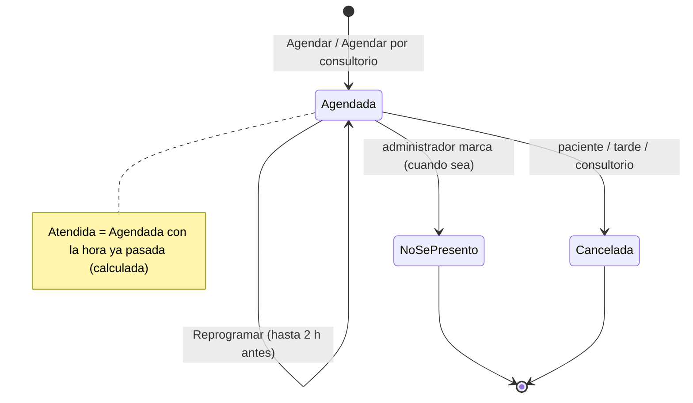
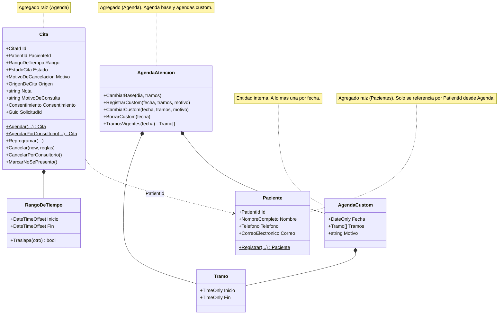

# Appointment Booking System — Solution Plan

For Dra. Selina Medina — Ortopedia y Traumatología

Oct 3, 2026 · updated Oct 4, 2026 · @Gerardo Sanchez Hernandez

> **Updated on Oct 4, 2026** with the results of the PRD, UX, availability brainstorm and architecture work. The original is kept in `docs/archive/`. This plan stays the detailed reference; where it disagrees with the documents below, they win:
>
> - Requirements: `_bmad-output/initiative-draselina/prd-appointment-booking/prd-appointment-booking.md`
> - UX: `_bmad-output/initiative-draselina/ux-appointment-booking/DESIGN.md` and `EXPERIENCE.md`
> - Availability decision: `_bmad-output/initiative-draselina/brainstorm-agenda-horario-configuracion/brainstorm-agenda-horario-configuracion.md`
> - Architecture (AD-1 to AD-28) and C4 diagrams: `_bmad-output/initiative-draselina/architecture-appointment-booking/`
> - Domain design (DDD, invariant) and data model: `_bmad-output/initiative-draselina/architecture-appointment-booking/ddd-and-data-model-appointment-booking.md`
>
> **What changed:** availability is now *Agenda base* plus *Agenda custom* (replacing working hours and blocks); manual appointments may fall outside hours; two visit types; one-page site; .NET 11, Aspire, DataAnnotations and OpenTelemetry replace .NET 10, hand-configured Docker, FluentValidation and Serilog; Wolverine 6; a derived manage link; no shared Settings or Location table; production deployment deferred.

## Overview

Version 1 is a custom .NET web app where patients book their own appointment with Dra. Selina Medina from their phone, and the administrator handles the exceptions from one admin area, so Selina doesn't have to. It starts as a **pilot**: a few real patients first, then it is tightened.

**In scope for v1**

- Public booking page: choose visit type, pick an open slot, leave contact details
- Admin area: agenda (day and week), agenda base, agenda custom per date, manual appointments, no-shows, cancel, patient list, settings
- Email confirmation and a cancel/reschedule link for the patient
- Practice website (one page with sections)

**Out of scope for v1** (planned in the roadmap)

- Insurer rules (GNP, AXA, Chubb)
- WhatsApp reminders
- Deposits or prepaid appointments
- Clinical records: the system stores scheduling data only, not diagnoses or notes (Expediente clínico comes after the MVP; its place in the roadmap is set after the build-vs-integrate evaluation)
- Several locations, the Assistant role, merging duplicate patients, retention policy and ARCO rights
- Production deployment: nothing is released yet; Azure provisioning and the deploy pipeline are deferred until the pilot is ready

## Dominio (DDD)

**Visión del dominio.** Liberar a la Dra. Selina Medina de la carga administrativa de su agenda: que los pacientes reserven, reprogramen y cancelen sus citas por sí mismos, sin que ella tenga que intervenir. Ante cualquier duda de diseño, gana la opción que le quite trabajo a Selina.

### Actores

- **Dra. Selina:** actor principal. Es su tiempo y su agenda; no tiene cuenta en el sistema. Recibe a las 2:00 pm, cada fecha que tenga tramos de atención o al menos una cita, un correo "Tus citas de hoy" (hora, paciente y motivo). Pendiente: la hora de envío cuando hay citas por la mañana.
- **Gerardo (administrador, único usuario del área de administración):** opera el lado administrativo: registra la agenda custom, captura citas manuales, marca "no se presentó", cancela cuando hace falta, ajusta la configuración y recibe las alertas.
- **Paciente:** actor externo. Agenda, reprograma y cancela por sí mismo.
- **Asistente:** rol futuro, con el mismo acceso que el administrador. Previsto en el modelo, no se construye todavía.

### Lenguaje ubicuo

"Horario de atención" y "Bloqueo" ya no existen: no se usan en código ni en pantallas.

| Término | Significado |
| --- | --- |
| Cita | Espacio reservado en la agenda para un paciente |
| Consulta | El acto médico que ocurre cuando el paciente llega a su cita |
| Agenda base | La semana tipo de Selina, sin fechas: por cada día de la semana, cero o más tramos. Se repite sola (hoy: lunes a viernes 3:30–6:00 pm) |
| Agenda custom | El horario propio de una fecha concreta, que reemplaza por completo a la base ese día: cero o más tramos y un motivo. Cero tramos = ese día no se atiende. A lo más una por fecha |
| Tramo | Periodo continuo de atención dentro de un día, con hora de inicio y de fin |
| Horario libre | Hora de inicio que hoy se puede reservar. Se calcula al momento; nunca se guarda |
| Cita del consultorio | Cita que registra el administrador a mano; puede caer fuera de los tramos, con nota obligatoria |
| Tipo de visita | Clase de cita que elige el paciente; define la duración. En pantalla se dice "Tipo de consulta" |

### Eventos del dominio (event storming)

1. Agenda base definida o cambiada
2. Agenda custom registrada, cambiada o borrada
3. Cita solicitada (solo por canales externos como WhatsApp; en línea no existe)
4. Cita agendada (en línea queda firme de inmediato, sin aprobación)
5. Cita agendada por el consultorio (manual, puede ser fuera de horario)
6. Recordatorio enviado (solo informa, no pide confirmación)
7. Cita reprogramada por el paciente
8. Cita cancelada por el paciente
9. Cita cancelada por el consultorio
10. Paciente llegó
11. Consulta realizada
12. Paciente no se presentó
13. Cita de seguimiento agendada

### Reglas de negocio (hotspots resueltos)

- **Sin aprobación:** una cita en línea queda firme al instante. "Cita solicitada" solo aplica a peticiones por otros canales.
- **El recordatorio solo informa:** no pide confirmación, para no crear la duda de qué hacer si el paciente no confirma. La cita sigue firme hasta que el paciente la cancele.
- **La disponibilidad se calcula al vuelo:** para cada fecha valen los tramos de su agenda custom si existe; si no, los de la agenda base. Menos las citas activas. No hay slots guardados, ni periodos que "habilitar", ni precedencia entre excepciones.
- **La base se toca poco y aplica de inmediato:** solo cambia cuando Selina cambia de rutina. No hay fecha de inicio futura ni versiones. Cambiarla no cancela ninguna cita: las que queden fuera se muestran antes de guardar y el administrador decide. Las fechas con custom no heredan el cambio; se listan al guardar.
- **Una custom no cancela nada por sí sola; el administrador decide cita por cita:** una cita queda fuera cuando no cabe completa en un solo tramo vigente. Antes de guardar se listan las que quedan fuera y, para cada una, se elige cancelar o conservar ("ciérrame el sábado y cancela todas excepto la de las 12:30"). Las elegidas quedan canceladas por el consultorio poco después, por evento; las conservadas no cambian. Una cita ya agendada nunca se modifica sola.
- **Una custom se registra con cualquier anticipación y no se repite:** las vacaciones de diciembre se capturan en octubre; un sábado abierto no abre los siguientes. Rehabilitar es editar o borrar la custom; el día vuelve a la base. Si borrarla deja citas fuera, el sistema pregunta qué hacer con cada una, igual que al guardarla.
- **Cita del consultorio:** ignora base, custom, rejilla, ventana y tope semanal, incluso en una fecha marcada "no se atiende". Reglas duras: no traslapar otra cita y no caer en el pasado. Nota obligatoria cuando cae fuera de los tramos. Nunca abre disponibilidad al público.
- **Reubicación tras cancelación del consultorio:** el mensaje al paciente ofrece una disculpa sincera en nombre del consultorio, avisa que la cita fue cancelada e incluye un enlace para que elija por sí mismo cualquier horario libre. El sistema nunca aparta un horario que no pueda garantizar.
- **Cancelación tardía permitida:** el paciente siempre puede cancelar, incluso dentro de las 2 horas previas; nunca se bloquea. Reprogramar, en cambio, solo se permite hasta 2 horas antes. Es un solo valor configurable, el umbral de cancelación tardía, el que decide las dos cosas; dentro de ese plazo el enlace ofrece cancelar y volver a agendar, para que una cancelación tardía no se oculte como reprogramación. Una cancelación tardía alerta de inmediato al administrador (mejor enterarse que tener una silla vacía).
- **Cancelación tardía marcada:** la cita se marca como "cancelada tarde" para identificar a quienes cancelan repetidamente a última hora. La confirmación al paciente reconoce, en tono amable, que se canceló con menos de 2 horas de anticipación.
- **Reprogramar es mover la misma cita:** conserva identificador, enlace de gestión, origen y bitácora. No se le aplica el tope semanal.
- **Tope semanal por teléfono:** frena reservas en línea excesivas. Cuenta la semana de calendario de la cita. Es un límite blando. Supuestos: semana de lunes a domingo, cuentan citas agendadas de cualquier origen, las del consultorio no se bloquean.
- **Sin doble reserva:** una restricción de exclusión de PostgreSQL (ningún par de citas activas puede traslaparse en el tiempo) garantiza que, si dos pacientes intentan el mismo horario a la vez, solo uno lo obtiene; al otro se le muestran los horarios libres restantes.

### Contextos delimitados

**Subdominios (espacio del problema).** Un subdominio es una parte del negocio que existe con o sin software; se descubre, no se diseña. Los contextos delimitados son la respuesta de software (espacio de la solución). La clasificación decide dónde invertir: core se construye con el mayor esfuerzo, supporting se construye simple, generic se compra o se usa una librería.

| Subdominio | Tipo | Contexto |
| --- | --- | --- |
| Agendamiento de citas | Core (de este sistema) | Agenda |
| Identidad de pacientes | Supporting | Pacientes |
| Comunicación con pacientes | Generic | Notificaciones |
| Presencia en línea | Generic | Contenido |
| Acceso del personal | Generic | Host (ASP.NET Identity) |
| Atención clínica / expediente | Core del consultorio, fuera del MVP | Expediente clínico (después) |
| Cobro y aseguradoras | Supporting, futuro | Ninguno todavía |

El core real del consultorio es la medicina; dentro de este sistema, el core es el agendamiento. Se justifica construirlo (y no usar una herramienta genérica) porque sus reglas lo distinguen: cancelación del consultorio con disculpa y reubicación, cancelación tardía marcada, citas del consultorio fuera de horario, emparejamiento de pacientes por teléfono y nombre, pacientes que viven en WhatsApp.

Cada contexto es una región de significado: dentro de él, cada palabra significa una sola cosa. Cada contexto posee sus propios datos; ningún otro los toca directamente (sin joins ni llaves foráneas entre contextos). Se comunican por contratos (llamadas síncronas) y por eventos de integración (asíncronos).

- **Agenda (núcleo):** el recurso real de Selina, su tiempo. Agenda base, agenda custom y todo el ciclo de vida de la cita. Dueño de la disponibilidad, de la regla de no doble reserva, de sus reglas de reserva y tipos de visita, del consentimiento de cada cita, del enlace de gestión y de la bitácora. Lenguaje: Cita, Agenda base, Agenda custom, Tramo, Consulta.
- **Pacientes (soporte):** identidad y datos del paciente, separados de sus citas. La identidad es un Guid v7 generado por el sistema; teléfono y nombre normalizados se usan para emparejar. Lenguaje: Paciente.
- **Notificaciones (genérico):** envío de mensajes (correo ahora, WhatsApp después). No sabe nada de medicina; reacciona a los eventos de Agenda. Dueño del recordatorio y de sus horas de envío. Lenguaje: Mensaje, Canal, Recordatorio.
- **Contenido:** el sitio web del consultorio y los datos del consultorio (nombre, dirección, mapa, WhatsApp). Sin base de datos en el piloto: su contenido se despliega con la aplicación.
- **Expediente clínico (fase siguiente al MVP):** nota médica, diagnóstico, tratamiento, antecedentes. Contexto propio que referencia el PatientId y la cita; el estado "Atendida" es donde empieza la nota de una consulta. Implica NOM-004-SSA3-2012 (contenido y conservación mínima de 5 años), NOM-024-SSA3-2012 (expediente electrónico), consentimiento expreso por datos sensibles, bitácora de accesos y notas que nunca se editan ni borran, solo se complementan. Antes de construirlo: evaluar sistemas ya certificados (construir vs. integrar) y validar requisitos con un experto en cumplimiento médico. El MVP no necesita cambios para soportarlo.

### Cómo se comunican

- **Registro del paciente:** Agenda *dispara* el registro, Pacientes lo *ejecuta*. Al reservar, Agenda llama a Pacientes por contrato ("buscar o crear paciente" por teléfono y nombre) y recibe un PatientId. Pacientes confirma en su propia transacción, antes de la de Agenda; un paciente sin cita es un resultado aceptable. Agenda nunca escribe en la tabla de pacientes.
- **Tope semanal:** Agenda pide a Pacientes los pacientes que comparten un teléfono y cuenta sus propias citas. Pacientes nunca conoce citas.
- **Mensajes:** Agenda publica eventos ("Cita agendada", "Cita reprogramada", "Cita cancelada") sin saber quién escucha; Notificaciones está suscrito y pide lo que necesita por contrato: contacto a Pacientes, datos del consultorio a Contenido, y enlace de gestión y archivo de calendario a Agenda. Agenda nunca llama a Notificaciones.
- **Dos mecanismos, sin mezclar:** entre módulos solo las interfaces `I<Módulo>Api`; `ISender` es exclusivo de la interfaz de usuario.
- **Consulta (fase 1):** no es un contexto propio todavía; es un estado de la cita (Atendida / No se presentó).

Los diagramas actuales están en `c4-appointment-booking.md` (contexto, contenedores, componentes y el flujo de una reserva).

**Patrones del mapa de contextos**

- **Pacientes → Agenda:** Customer-Supplier. Pacientes (upstream) expone un Open Host Service (`IPacientesApi`) con Published Language (los tipos de Contracts, PatientId).
- **Agenda → Notificaciones:** Agenda (upstream) publica sus eventos como Published Language (`Agenda.Contracts`) y expone `IAgendaApi`. Notificaciones (downstream) los traduce a mensajes planos con una Anti-Corruption Layer ligera, para que el modelo de Agenda no se filtre.
- **Pacientes → Notificaciones:** Customer-Supplier con el mismo Open Host Service: Notificaciones pide el contacto del paciente en vez de recibirlo en los eventos.
- **Contenido → Notificaciones e interfaz:** Open Host Service (`IContenidoApi`) para los datos del consultorio.
- **Notificaciones → proveedor de correo / WhatsApp (Meta):** sistemas externos detrás de una ACL (`INotificationChannel`); cambiar de proveedor toca una sola clase.
- **Expediente clínico (futuro):** si se compra un sistema certificado, queda detrás de una ACL.

Con un solo desarrollador, estos patrones no resuelven relaciones entre equipos; su valor es técnico: evitar que el modelo de un módulo se filtre a otro.

### Agenda por dentro

- **Cita es el agregado raíz.** Protege solo sus propias invariantes, las que puede verificar con sus propios datos: tiene un paciente; su tiempo es coherente (inicio antes que fin); una cita en línea cabe completa dentro de un tramo vigente, que recibe como entrada, y respeta la rejilla y la ventana de reserva; una cita del consultorio lleva nota cuando cae fuera de los tramos; y sus transiciones de estado son legales.
- **Agenda de atención es un solo agregado (`AgendaAtencion`).** Reúne la agenda base y las agendas custom; la custom es una entidad interna, identificada por su fecha. Protege que los tramos de un día no se encimen, que el fin sea posterior al inicio, que en cada tramo quepa al menos una cita del tipo de visita más corto y que haya a lo más una custom por fecha, y es el único que resuelve los tramos vigentes de una fecha.
- **Agregados pequeños.** No existe un agregado "Calendario" con todas las citas; sería enorme y haría chocar reservas de días distintos.
- **Reglas configurables por fuera.** Los valores (anticipación, ventana, umbral de cancelación tardía, tope) son configuración de Agenda y se le pasan a la Cita al validar, junto con los tramos vigentes; el agregado se mantiene puro y nunca lee configuración.
- **Una cita agendada con reglas anteriores sigue siendo válida.** La reconstitución no valida, y un cambio de base no la invalida.
- **El no-traslape no es invariante del agregado.** Es una regla entre citas; se garantiza con una restricción de exclusión en la base de datos (EXCLUDE USING gist sobre el rango de tiempo de las citas no canceladas, extensión btree\_gist). El rango es semiabierto `[Inicio, Fin)`. `Fin` se guarda al crear o reprogramar y no se recalcula si cambia la duración del tipo de visita. A diferencia de un índice único sobre la hora de inicio, también bloquea traslapes con horas de inicio distintas (citas fuera de la rejilla o de otra duración).
- **Servicio de disponibilidad = cortesía,** restricción = garantía. El servicio pregunta "¿está libre?" para dar un mensaje amable; la restricción de la base es la garantía real, porque entre la consulta y el guardado otro paciente puede reservar.
- **Concurrencia sobre una fecha.** Todo comando que crea o mueve una cita en línea, o que guarda o borra una custom, toma un bloqueo consultivo de transacción por fecha local y lee los tramos después. Evita una cita agendada en un día que se cerró en el mismo instante.
- **Confirmar dos veces no crea dos citas.** El formulario lleva un `SolicitudId`; un segundo envío devuelve la cita ya creada.
- **Specifications:** posible forma de expresar las invariantes propias de la Cita. Decisión pospuesta hasta implementar; si se usan, las de validación van puras en el dominio y nunca consultan la base de datos.

**Ciclo de vida de la Cita**

- **Agendada:** reservada y firme; estado inicial.
- **Atendida:** calculada, no guardada. Una cita Agendada cuya hora ya pasó se muestra como Atendida; no hay tarea programada ni transición que la cambie. Cuando llegue el expediente clínico, escribir la nota será el evento que confirme la consulta.
- **No se presentó:** el administrador la marca como excepción.
- **Cancelada:** con motivo (por el paciente / tarde / por el consultorio).



Solo se guardan tres estados: Agendada, No se presentó y Cancelada; los dos últimos son finales. Atendida no se guarda: se deriva de Agendada más la hora ya pasada, así el administrador puede marcar "No se presentó" en cualquier momento sin corregir un estado final. **Reprogramar** no es un estado: la misma cita sigue Agendada y cambia de horario, validada contra tramos vigentes, rejilla, ventana y el umbral de cancelación tardía (hoy 2 horas).

**Algoritmo de disponibilidad (función pura)**

Recibe agenda base, agendas custom, citas activas, reglas y `now`, y devuelve los horarios libres; sin base de datos ni reloj propio. Se calcula en hora local de Ciudad de México y se convierte a UTC solo al guardar. Por cada fecha de la ventana:

1. Tomar los tramos vigentes: los de la agenda custom de esa fecha si existe; si no, los de la agenda base para ese día de la semana. Sin tramos, la fecha no se atiende.
2. Construir la rejilla dentro de cada tramo: desde su inicio, en pasos de la duración del tipo de visita, solo los que quepan completos. Con la base actual: 3:30, 4:00, 4:30, 5:00, 5:30.
3. Quitar los que traslapen una cita activa, incluidas las del consultorio.
4. Aplicar la ventana: desde mañana (día calendario, sin importar la hora de hoy) hasta 2 meses adelante.

### Pacientes por dentro

- **Paciente es el agregado raíz.** Identidad: PatientId generado con `Guid.CreateVersion7()` en el dominio al crear el Paciente (generación temprana), no por la base de datos. Atributos: teléfono, nombre, correo opcional. El teléfono no es la identidad porque puede cambiar o compartirse (una madre que agenda para sus hijos).
- **Buscar o crear:** dado teléfono y nombre, devuelve el Paciente existente o crea uno nuevo. Nuevo vs. subsecuente sale de si el registro ya existía. Es idempotente por el índice único. Si el paciente ya existe y llega un correo distinto, el nuevo reemplaza al guardado.
- **Emparejamiento por teléfono + nombre.** Mismo teléfono y mismo nombre = mismo paciente; mismo teléfono con otro nombre = paciente nuevo. El nombre se normaliza (espacios) y la comparación usa una collation ICU no determinista en PostgreSQL (insensible a mayúsculas y acentos); índice único sobre (teléfono, nombre normalizado) con esa collation. Límite aceptado: un error de dedo en el nombre crea un duplicado. Ojo: las collations no deterministas no admiten LIKE; la búsqueda de pacientes por nombre en admin compara contra la columna normalizada con una collation determinista.
- **Teléfono en E.164** (+52 y el número nacional), parseado y validado con libphonenumber (región "MX"); los números imposibles se rechazan al reservar, en el servidor.
- **El consentimiento ya no vive aquí.** Se registra por cita, en Agenda.

### Objetos de valor

Inmutables, sin identidad, iguales cuando sus valores son iguales, y se validan al crearse (no existe uno inválido). En C#: `record` o `readonly record struct`.

- **Agenda:** `RangoDeTiempo` (inicio, fin, semiabierto; sabe si traslapa a otro), `Tramo` (hora local de inicio y de fin; lo usan base y custom), `ReglasDeAgenda` (tramos vigentes, anticipación, ventana, umbral de cancelación tardía, tope; el paquete que recibe la Cita), `MotivoDeCancelacion` (paciente / tarde / consultorio), `OrigenDeCita` (en línea / consultorio), `Consentimiento` (fecha y hora, versión del aviso, canal).
- **Pacientes:** `Telefono` (solo se construye en E.164 válido), `NombreCompleto` (con su forma normalizada), `CorreoElectronico` (opcional, validado).
- **IDs fuertemente tipados:** `CitaId` y `PatientId` envuelven el Guid v7 (`readonly record struct PatientId(Guid Value)` con `New()` que llama a `Guid.CreateVersion7()`), para que el compilador impida pasar un id donde va otro. Viven en el **Kernel** (`BuildingBlocks/Kernel`), junto con `IClock`, `Resultado` y `Actor`, para que contratos y dominio usen el mismo tipo. Costo: value converters en EF Core.

**Bosquejo de agregados**



### Servicios de dominio

Lógica de negocio que no pertenece a una sola entidad u objeto de valor; sin estado y nombrada en el lenguaje ubicuo. No confundir con los servicios de aplicación (handlers de Features), que solo orquestan: cargan, llaman al dominio y guardan.

- **`CalculadoraDeDisponibilidad`**: razona sobre la agenda de atención y muchas citas a la vez, que son agregados distintos, así que no cabe en ninguno. Pura, sin I/O. Es el único servicio de dominio del MVP y la única implementación del cálculo.
- **No son servicios:** decidir si una cancelación es tardía (lo hace `cita.Cancelar(now, reglas)`); cancelar las citas elegidas al guardar una custom (el handler `GuardarAgendaCustom` solo guarda la custom y levanta un evento; una política reacciona y llama `cita.CancelarPorConsultorio()` en cada una, en su propia transacción); normalizar teléfono y nombre (lo hacen sus objetos de valor).

Los servicios se mantienen escasos para que las entidades conserven su comportamiento y no se vuelvan bolsas de datos anémicas.

### Repositorios

**Decisión: repositorios como puertos.** Para que el código pueda promoverse a arquitectura hexagonal, los handlers nunca tocan EF Core: los comandos usan un puerto de escritura por agregado (`ICitas`, `IAgendaAtencion` en `Domain`) y las consultas un puerto de lectura propio de su slice. Las implementaciones viven en `Infrastructure`.

- **Setters privados:** el estado solo cambia por métodos del agregado (`Cancelar`, `Reprogramar`), que aplican las reglas.
- **DbContext `internal`:** solo la Infrastructure de su módulo lo usa; los handlers nunca lo ven.
- **Disciplina explícita:** prohibido `ExecuteUpdate` / `ExecuteDelete` sobre agregados, porque saltan las reglas. Las lecturas (horarios libres, agenda del administrador) usan `AsNoTracking()` y proyectan solo lo necesario.
- **Guardado explícito de la Cita:** el puerto de escritura guarda dentro del handler y traduce la violación `23P01` a un `Resultado` de conflicto. No se deja el guardado al middleware transaccional, porque entonces el error llegaría después del handler.
- **Eventos:** el agregado levanta eventos de dominio; el handler los traduce a eventos de integración y Wolverine los guarda en el outbox en la misma transacción. Verificar al implementar si la integración de Wolverine con EF Core puede recogerlos de las entidades directamente.
- **Bitácora:** cada cambio a una cita, a la base o a una custom escribe su entrada en el esquema de Agenda dentro de la misma transacción, con actor Paciente, Administrador o Sistema.

### Fábricas

**Decisión: métodos de fábrica estáticos en el agregado.** Creación y reconstitución son caminos distintos:

- **Creación en línea** (`Cita.Agendar(paciente, rango, reglas, now)`, `Paciente.Registrar(telefono, nombre, correo)`): genera el id (Guid v7), valida todas las invariantes, fija el estado inicial y levanta el evento (`CitaAgendada`).
- **Creación por el consultorio** (`Cita.AgendarPorConsultorio(paciente, rango, nota, now)`): el administrador puede agendar fuera de la rejilla, fuera de la ventana de reserva, fuera de los tramos vigentes y en una fecha marcada "no se atiende". Sirve para capturar las citas pactadas por WhatsApp y para las excepciones de Selina ("te puedo atender el sábado"). Reglas duras: sin traslapes (restricción de exclusión) y nunca en el pasado. Exige nota cuando cae fuera de los tramos vigentes. Requiere en admin un formulario "Agendar cita".
- **Reconstitución** (EF Core al leer de la base): constructor privado que solo asigna valores, sin reglas ni eventos. Si validara, una cita de la semana pasada fallaría al cargarse ("mínimo mañana"); si levantara eventos, cada lectura reenviaría correos.
- **Objetos de valor:** EF los reconstituye con `HasConversion` (un valor: `Telefono`, `CitaId`, `PatientId`, `CorreoElectronico`) y `ComplexProperty` (varios valores: `RangoDeTiempo`). Sus constructores solo validan su propia forma (E.164 válido, inicio antes que fin), que los datos guardados ya cumplen.

### Eventos de dominio (modelo)

Dos niveles. **Eventos de dominio** (en `Agenda.Domain`, p. ej. `CitaFueAgendada`): records inmutables en pasado que levanta la `Cita`; solo Agenda los conoce. **Eventos de integración** (en `Agenda.Contracts`, los de la tabla): el handler de Features los crea a partir de los de dominio y se publican por el outbox; son los que escucha Notificaciones. Así Agenda puede cambiar su modelo interno sin romper a nadie.

Todos llevan `EventoId`, `OcurridoEn`, `CitaId`, `PatientId` y `Actor`.

| Evento | Además lleva |
| --- | --- |
| `CitaAgendada` | Inicio, Fin (UTC), Origen |
| `CitaReprogramada` | InicioAnterior, InicioNuevo, FinNuevo |
| `CitaCancelada` | Inicio, Motivo (paciente / tarde / consultorio) |

Atendida, No se presentó y los cambios de base y custom quedan internos por ahora: nadie fuera de Agenda los escucha. Al guardar una custom, cada cita que el administrador eligió cancelar levanta su `CitaCancelada` con motivo consultorio.

**Los eventos no llevan datos de contacto ni sensibles.** Ni nombre, teléfono, correo, motivo de consulta, ni el enlace de gestión. Notificaciones los pide por contrato. Un consumidor nunca recalcula una clasificación que Agenda ya decidió (por ejemplo, si la cancelación fue tardía) y deduplica por `EventoId`.

### Notificaciones por dentro

Convierte los eventos de Agenda en mensajes planos (a quién, qué, cuándo, qué enlace). En el MVP el único canal es correo.

- **Cita agendada** → paciente: confirmación con detalles, archivo de calendario y enlace para cancelar o reprogramar.
- **Recordatorio** → paciente: el día anterior a las 9:00 am (configurable), solo informa. Si al agendar esa hora ya pasó, se omite.
- **Cita reprogramada** → paciente: nueva fecha y hora.
- **Cita cancelada por el paciente** → paciente: confirmación; si fue tardía, lo menciona con amabilidad.
- **Cita cancelada por el consultorio** → paciente: disculpa sincera y enlace para volver a agendar.
- **Cancelación tardía** → administrador: alerta inmediata.
- **Agenda del día** → Dra. Selina: a las 2:00 pm (configurable) de cada fecha con tramos o con citas, "Tus citas de hoy" con hora, paciente y motivo; es un mensaje programado de Wolverine más una consulta a Agenda.

**Mecánica:** Agenda guarda la cita y el evento en la misma transacción (outbox), así la reserva nunca espera ni falla por el correo; Notificaciones envía después, con reintentos. Notificaciones es la única dueña del recordatorio: lo programa con `CitaAgendada`, lo mueve con `CitaReprogramada` y lo elimina con `CitaCancelada`.

**Correo opcional.** El teléfono es obligatorio; el correo no. Sin correo no hay notificaciones por ahora (WhatsApp, fase 2, cubrirá esos casos). Mitigaciones: la confirmación en pantalla muestra el enlace de gestión con un aviso de "guarda este enlace" y el evento de calendario lo incluye; en la vista de administración esas citas se marcan "sin correo" para avisar a mano si el consultorio cancela.

## Requirements

The full, numbered requirements (FR-1 to FR-30) are in the PRD. Summary:

**Patient (public, no account needed)**

1. Choose a visit type: "Primera consulta" or "Consulta de seguimiento"; both are 30 min for now and no prices are shown
2. See only truly available slots, from tomorrow up to 2 months ahead
3. Book with name, phone, optional email, reason for visit, and privacy consent
4. If an email was given, receive a confirmation email with date, address, and a link to cancel or reschedule
5. Reschedule up to 2 hours before the appointment; cancel at any time (within 2 hours it is marked as a late cancellation)

**Administrator (logged in)**

1. Configure the agenda base: per weekday, zero or more time ranges (today: Monday–Friday 3:30–6:00 pm)
2. Give any date an agenda custom, to trim it, close it, or open a day that is normally closed (surgery, vacations, an open Saturday)
3. Day and week agenda view; create appointments manually, including outside hours, with a mandatory note
4. Mark appointments as no-show or cancel them (attended is computed: a booked appointment whose time has passed)
5. Basic patient list with visit history
6. Change the booking rules and visit types; see an audit log of who changed what

**Non-functional**

- Mobile-first, in Spanish, all times in America/Mexico\_City
- Booking in under 1 minute, no app to install
- Two people booking the same slot at once must never both succeed
- Privacy notice and express consent for health data under Mexico's personal data protection law

## Practice website

The booking app's home page is Selina's practice website: same domain, same deploy, with an "Agendar cita" button always at hand. Following the design, it is **one page with anchored sections**, plus a separate privacy notice page.

| Section | Content |
| --- | --- |
| Encabezado | Logo, anchor navigation, "Agendar cita" button |
| Portada | Specialty, name, one line on what she treats, "Agendar cita en línea" and WhatsApp, cédulas, portrait |
| Sobre mí | Short bio, training, certification, cédulas, hospital affiliations |
| Padecimientos y tratamientos | Six cards: Rodilla, Hombro, Columna, Cadera, Fracturas, Lesiones deportivas |
| Ubicación y horarios | Hospital Star Médica, consultorio 101; address; hours taken from the agenda base; WhatsApp; map |
| Franja final | "Agenda tu consulta en menos de un minuto" with "Agendar cita" |
| Aviso de privacidad | Separate page |

- **Build:** Blazor static SSR pages, so they load fast on phones and Google can index them; content is deployed with the app in the pilot, editable from the admin later
- **Look:** Montserrat, wine `#6B2A45` on blush `#FBF6F5`; all tokens in `DESIGN.md`
- **Search:** Spanish page titles with specialty and city, schema.org Physician markup, and a Google Business Profile linking to the site
- **Legal:** Mexican rules on advertising medical services generally require showing the doctor's name, cédula profesional and specialty; confirm current COFEPRIS requirements before launch, and leave out testimonials or before/after photos until reviewed

**Content needed from Selina**

- [ ] Professional photo and clinic photos
- [ ] Short bio, training and hospital affiliations
- [ ] Cédula profesional and specialty certification numbers (the mockup shows "UANL" next to the cédula and "Universidad Autónoma de San Luis Potosí" as training: confirm which is right)
- [ ] Descriptions for the conditions and treatments
- [ ] Confirm the clinic address and the WhatsApp number to show

## Architecture

One ASP.NET Core app on .NET 11, built as a modular monolith: public website and booking pages, the admin area and background jobs run in a single deploy over one PostgreSQL database. The binding decisions are AD-1 to AD-28 in the architecture document.

Every booking goes through the AgendarCita handler; an exclusion constraint in PostgreSQL is the final guarantee against overlaps. Notifications run in the background so the patient never waits on email.

- **Proyectos:** cada módulo (Agenda, Pacientes, Notificaciones, Contenido) en hasta cuatro proyectos (Contracts, Domain, Features, Infrastructure), más Consultorio.UI, el host Consultorio.Web, el AppHost y ServiceDefaults de Aspire y un servicio de migraciones; detalle en Estructura de la solución.
- **Database:** EF Core migrations; PostgreSQL (Npgsql) is the chosen database, picked over Azure SQL for lower cost
- **Local development:** Aspire AppHost starts the app, the migration service and a PostgreSQL container, with a dashboard for logs and traces
- **Hosting:** Azure, Mexico Central region; provisioning and deploys are deferred

### Estructura de la solución (módulos)

Monolito modular: cada contexto delimitado es un módulo con hasta cuatro proyectos (Contracts, Domain, Features, Infrastructure); hacia fuera solo expone Contracts. Dentro de cada módulo, el código se organiza por caso de uso (vertical slices).

```
src/
  Consultorio.AppHost/             Aspire: aplicación, migraciones y PostgreSQL local
  Consultorio.ServiceDefaults/     OpenTelemetry, salud
  Consultorio.MigrationService/    migraciones y datos iniciales
  Consultorio.Web/                 Host: Program.cs, Identity, Wolverine, DI (sin pantallas)
  Consultorio.UI/                  Razor Class Library: páginas, componentes, Bootstrap

  BuildingBlocks/
    Kernel/                        ids tipados, IClock, Resultado, Actor
    Contracts/                     ICommand<T>, IQuery<T>, ISender, marcadores de autorización

  Modules/
    Agenda/
      Contracts/                   comandos, consultas, DTOs, eventos, IAgendaApi
      Domain/                      Cita, AgendaAtencion, Tramo, CalculadoraDeDisponibilidad, puertos
      Features/
        AgendarCita/               handler
        AgendarCitaPorConsultorio/
        CancelarCita/
        ReprogramarCita/
        ObtenerDisponibilidad/
        CambiarAgendaBase/
        GuardarAgendaCustom/
        AgendaDelDia/              handler, IConsultasAgendaDelDia
      Infrastructure/              AgendaDbContext, migraciones, implementación de puertos, bitácora
    Pacientes/
      Contracts/  Domain/  Features/  Infrastructure/
    Notificaciones/
      Contracts/  Features/  Infrastructure/
    Contenido/
      Contracts/  Contenido/       implementación en un solo proyecto, sin dominio

tests/
  Agenda.Domain.Tests/  Agenda.Features.Tests/  Pacientes.*.Tests/
  Consultorio.UI.Tests/            bUnit
  Consultorio.IntegrationTests/    PostgreSQL real
  Consultorio.ArchitectureTests/
  Consultorio.E2ETests/            Playwright, solo local
```

**Capas y dependencias.** Todo caso de uso entra por `Features` (obligatorio, también las consultas): UI → `ISender` → handler en `Features` → dominio (solo comandos) → infraestructura a través de puertos. Las dependencias apuntan hacia adentro y las pruebas de arquitectura las hacen cumplir. Lo que no aparece en la tabla está prohibido:

| Proyecto | Puede referenciar |
| --- | --- |
| `Kernel` | nada |
| `BuildingBlocks.Contracts` | `Kernel` |
| `<Módulo>.Contracts` | `Kernel`, `BuildingBlocks.Contracts` |
| `<Módulo>.Domain` | `Kernel` |
| `<Módulo>.Features` | su `Domain`, su `Contracts`, `Contracts` de otros módulos |
| `<Módulo>.Infrastructure` | su `Features`, su `Domain`, su `Contracts`, EF Core, Npgsql |
| `Contenido` | `Contenido.Contracts` |
| `Consultorio.UI` | todos los `*.Contracts`, `Kernel` |
| `Consultorio.Web` | todo (compone) |
| `MigrationService` | todos los `*.Infrastructure` |

**Puertos.** Los de escritura (`ICitas`: `Agregar`, `ObtenerPorId`) viven en `Domain`, como propone Evans para los repositorios. Los de lectura viven dentro de su slice (`Features/AgendaDelDia/IConsultasAgendaDelDia`) y su implementación proyecta con EF y `AsNoTracking()`. `Contracts` solo contiene lo que la UI y otros módulos pueden conocer. EF Core aparece únicamente en `Infrastructure`.

**CQRS ligero.** `ICommand<T>` cambia estado: pasa por validación, dominio, transacción y outbox (middleware de Wolverine). `IQuery<T>` solo lee: nunca llama `SaveChanges` ni levanta eventos. Misma base de datos; sin base de lectura separada ni event sourcing. Un comando, una transacción, un módulo.

**Namespaces** (guía de Microsoft: `<Compañía>.<Producto>.<Función>.<Subnamespace>`):

- Raíz `DraSelina.Consultorio`; patrón `DraSelina.Consultorio.<Módulo>.<Capa>`, p. ej. `DraSelina.Consultorio.Agenda.Domain`.
- Un namespace plano por capa (`DraSelina.Consultorio.Agenda.Features`); las carpetas de cada slice solo organizan, para no repetir el nombre de un tipo (`AgendarCita`) como namespace.
- Términos de negocio en español, capas técnicas en inglés.
- Las carpetas dentro de cada módulo son cortas (`Domain/`), pero el proyecto lleva el nombre completo: `Modules/Agenda/Domain/DraSelina.Consultorio.Agenda.Domain.csproj`.
- Namespaces con alcance de archivo y `RootNamespace` en `Directory.Build.props`.

**Reglas de la estructura**

- **Datos privados por módulo:** cada módulo con datos tiene su DbContext y su esquema SQL (`agenda`, `pacientes`, `notificaciones`); el host es dueño de `identidad` y Wolverine de `wolverine`. Sin joins ni llaves foráneas entre esquemas.
- **Configuración por módulo:** no hay tabla de Settings compartida. Agenda guarda sus reglas de reserva y los tipos de visita; Notificaciones guarda sus horas de envío. La pantalla de Configuración compone ambas.
- **Datos del consultorio en Contenido:** nombre, dirección, mapa y WhatsApp se piden por `IContenidoApi`. La cita no lleva sede.
- **Un módulo solo referencia los Contracts de otro**, nunca su implementación. Las fronteras se verifican con tests de arquitectura (NetArchTest o ArchUnitNET).
- **Comunicación:** llamadas síncronas por las interfaces `I<Módulo>Api` de Contracts; asíncronas por eventos de integración publicados a través del outbox.
- **Vertical slices:** cada carpeta de Features contiene su handler y, si es consulta, su puerto de lectura; el comando o consulta vive en Contracts. Sin endpoints HTTP salvo donde un formulario no alcanza (descarga del archivo de calendario).
- **Dispatcher, outbox y tareas programadas:** Wolverine 6 (licencia MIT) con persistencia en PostgreSQL. Despacha los eventos en proceso, guarda el outbox en la misma transacción que EF Core y programa los recordatorios de forma durable, con reintentos. Reemplaza a Hangfire y al outbox propio. Si algún día se necesita entrega entre procesos, Wolverine puede usar PostgreSQL como transporte, sin broker. Se descartaron MediatR y MassTransit v9 (licencia comercial) y MassTransit v8 (mantenimiento oficial termina después de 2026). Wolverine 6 declara soporte para .NET 9 y 10; sobre .NET 11 hay que comprobarlo en la primera historia.
- **Separación UI / backend (puerto de entrada hexagonal):** la UI vive en `Consultorio.UI` (Razor Class Library) y referencia **solo** proyectos `*.Contracts` y el Kernel; nunca ve el dominio, el DbContext ni Wolverine. `Consultorio.Web` es solo el host que compone todo. La UI habla con el backend a través de un mediador propio mínimo: `ISender.Send(ICommand<T>) / ISender.Query(IQuery<T>)`; cada comando o consulta declara su resultado (`AgendarCita : ICommand<Resultado<CitaAgendadaDto>>`). El adaptador `WolverineSender` (en el host) delega en `IMessageBus.InvokeAsync`. La UI siempre recibe un `Resultado`, con un código de un conjunto cerrado por módulo; nunca una excepción ni un texto. La UI no compone datos de dos módulos: lo hace el handler de la consulta. Si algún día el backend se separa, basta un `HttpSender : ISender` contra endpoints Minimal API, sin tocar la UI. Una prueba de arquitectura exige que todo `ICommand<>` e `IQuery<>` viva en `*.Contracts` y tenga exactamente un handler. **Sin MVC.**
- **Transporte de Wolverine:** sin broker. Los comandos de la UI usan `InvokeAsync` (llamada directa en proceso). Los eventos van por colas locales **durables**, respaldadas por el outbox en PostgreSQL, así que sobreviven reinicios. Los recordatorios son mensajes programados en PostgreSQL. Un transporte externo (PostgreSQL, RabbitMQ) solo si el backend se divide en procesos.
- **Frontend:** Blazor Web App en .NET 11. Static SSR para el sitio público y las páginas de reserva (rápidas en móvil, buen SEO); Interactive Server para el área de administración, salvo inicio de sesión y segundo factor, que son SSR estático. Sin librería de componentes: solo CSS propio y Bootstrap. Se descartó Blazor WebAssembly standalone porque obligaría a construir y proteger una API aparte y haría lenta la primera visita de los pacientes.
- **La reserva pública no guarda estado en el servidor:** cada paso es una página; tipo de visita, fecha y hora viajan en la cadena de consulta; nombre, teléfono, correo y motivo viajan solo en el cuerpo del formulario; la base se escribe únicamente al confirmar. Se descartó hacer el flujo interactivo con conexión, porque una caída de red en el celular a medio formulario es la peor experiencia posible.
- **La agenda de administración se refresca sola** consultando de nuevo a intervalos (supuesto: cada 30 segundos); no hay canal en tiempo real.
- **Validación:** un solo dialecto. (1) Forma de la entrada (campos requeridos, formatos) con DataAnnotations sobre los comandos en `*.Contracts`. En .NET 11 las páginas estáticas validan en el navegador los atributos estándar que el navegador soporta; todo lo demás, incluidos los atributos propios como el teléfono estricto, se valida solo en el servidor. El backend valida siempre, antes del handler, con el middleware de DataAnnotations de Wolverine (`WolverineFx.DataAnnotationsValidation`). Reemplaza a FluentValidation y a Blazored.FluentValidation, que quedó descontinuada. (2) Reglas de negocio (tramos vigentes, ventana de reserva, transiciones) viven en el agregado `Cita`, nunca en atributos.
- **Autorización y actor:** todo comando y consulta de administración lleva un marcador en Contracts, y un único middleware de Wolverine rechaza los que lleguen sin usuario autenticado. El host entrega el actor (Administrador, Paciente o Sistema) por un único servicio. Las cancelaciones elegidas al guardar o borrar una custom quedan a nombre del Administrador, aunque ocurran después por evento.
- **Telemetría:** un solo camino: el registro estándar de .NET más OpenTelemetry, mediante Aspire ServiceDefaults; en producción se exporta a Application Insights. Sin Serilog. La telemetría enmascara la ruta del enlace de gestión y nunca registra datos personales ni el motivo de consulta.
- **Migraciones y datos iniciales:** cada DbContext lleva su historial en su propio esquema. La extensión `btree_gist`, la restricción de exclusión y la collation se crean con SQL explícito en la migración del módulo dueño. Un único servicio de migraciones las aplica y carga los datos iniciales (agenda base, tipos de visita, reglas, horas de envío, cuenta del administrador); la aplicación web nunca migra al arrancar.
- **Pruebas unitarias:** xUnit v3 como framework base (bUnit y las pruebas de integración corren sobre él). Se prueban sin base de datos: los agregados y sus transiciones, los objetos de valor, `CalculadoraDeDisponibilidad` (la más cubierta) y los handlers de Features (se instancian con puertos falsos, sin Wolverine). Pruebas de integración contra PostgreSQL real; Testcontainers o el soporte de pruebas de Aspire, a decidir con la primera historia que lo necesite. Aserciones con el `Assert` propio de xUnit, sin librerías extra (FluentAssertions pasó a licencia comercial).
- **Pruebas de UI/UX:** dos niveles. (1) **bUnit** para el comportamiento de componentes (renderizado, mensajes de validación, UI condicional). (2) **Playwright** para pocos recorridos clave en viewport móvil: agendar, cancelar y que el administrador marque un no-show, más revisiones de accesibilidad y capturas de regresión visual. Playwright corre **solo en local**.
- **Integración continua y despliegue:** diferidos junto con la salida a producción. Cuando se monten: compilar, pruebas unitarias, de componentes, de arquitectura y de integración (outbox, restricción de exclusión, collation ICU), y despliegue solo desde `main`.
- **Módulos genéricos sin dominio rico:** Notificaciones y Contenido no tienen carpeta Domain; no la necesitan.
- **Expediente clínico** entrará después como un módulo nuevo con la misma forma, sin tocar los existentes.

### Technology choices

Versions verified on the web on Oct 4, 2026.

| Concern | Choice | Why |
| --- | --- | --- |
| Runtime | .NET 11 (release candidate now; final in November 2026) | Brings browser-side validation for static forms; support ends about when .NET 10's does |
| UI, public | Blazor static SSR | Fast on phones, indexable by Google, no open connection per visitor |
| UI, admin | Blazor Interactive Server | Rich agenda with little JavaScript; one administrator |
| Data | EF Core 10.0.12 + Npgsql 10.0.3 until the 11.0 finals; PostgreSQL 18.x with btree\_gist | Same stack you use daily |
| Local orchestration | Aspire 13.6 | One command starts app, migrations and database; dashboard for logs and traces |
| Auth | ASP.NET Core Identity, 2FA required | One administrator account (Assistant role later), no public sign-up |
| Messaging and jobs | Wolverine 6.45.x | Reminders, daily agenda email, retries, outbox |
| Email | Azure Communication Services | Cheap, native to Azure |
| Anti-bot | Cloudflare Turnstile | Free, no puzzle for the patient |
| Validation | DataAnnotations | One dialect for browser, forms and backend; no third-party library |
| Telemetry | OpenTelemetry via Aspire, to Application Insights in production | One pipeline |
| Styling | Bootstrap 5.3.8 + own CSS with the `DESIGN.md` tokens | No component library |
| Tests | xunit.v3 4.0.1, bUnit 2.11.3, Testcontainers.PostgreSql 4.15.0 | |
| Time | UTC in database for instants; local wall-clock times for agenda ranges; TimeZoneInfo America/Mexico\_City at the edges | Mexico dropped daylight saving in 2022, but the code should not assume it |

### Key design decisions

- **Availability is a pure function:** it takes agenda base, agenda customs, active appointments, rules and `now`, and returns slots with no database access inside, so it is fully unit-tested
- **Nothing stores slots:** agenda base plus agenda custom per date; the custom fully replaces the base on its date, so there is no precedence to remember
- **No double booking, enforced by the database:** a PostgreSQL exclusion constraint (EXCLUDE USING gist, btree\_gist) so no two non-cancelled appointments can overlap in time, even with different start times; on a violation (error 23P01) the patient sees the remaining free slots
- **Grid from the ranges:** slots are cut inside each range in steps of the visit type's duration; with today's base they start at 3:30, 4:00, 4:30, 5:00 and 5:30
- **Patient links:** the manage token is derived, `HMAC-SHA256(host key, CitaId)`, with the key kept outside the database; Agenda stores only its hash and is the only one that builds the link. The link stops working once the appointment's current start time has passed. This replaces the earlier random token, which the email had no way to obtain
- **Rules as configuration:** minimum notice (from tomorrow, by calendar day), 2-month horizon, 2-hour reschedule cutoff, 2-hour late-cancellation threshold and the weekly cap per phone belong to Agenda and are editable from admin
- **Extension points for later phases:** `INotificationChannel` (WhatsApp), nullable insurer on the appointment, nullable price on the visit type

### Booking flow

1. Patient opens the site and taps Agendar cita
2. Each step is a static page; the chosen type, date and time travel in the address
3. Web asks the availability calculator for the free slots of the booking window
4. Patient picks a slot, enters name, phone, optional email, reason and accepts the privacy notice
5. The host checks the anti-bot token and the shape of the input, then the AgendarCita handler finds or creates the patient through Pacientes, locks the date, reads the ranges in force, validates the rules and saves appointment, audit entry and event in one transaction; the exclusion constraint rejects any overlap
6. The patient sees the confirmed appointment, the manage link and the calendar option; if the slot was just taken, they return to the day and time step with their data kept
7. Afterwards, the CitaAgendada event triggers the confirmation email (if an email was given) with the .ics file and manage link, and schedules the reminder for 9:00 am the day before
8. The appointment appears on the administrator's agenda at its next refresh and in Selina's daily email

### Deployment

- **Environments:** local (Aspire AppHost with PostgreSQL in a container) and production; no staging for the pilot
- **Status:** nothing is released to production yet; provisioning and the deploy pipeline are deferred
- **Hosting when it comes:** Azure, Mexico Central. Azure Database for PostgreSQL Flexible Server is available there (with btree\_gist on the extension allow-list), but without geo-redundant backup, so the backup strategy must be decided before real patients. Whether Aspire publishes to App Service or Container Apps is open
- **Operations when it comes:** secrets outside the repository, HTTPS only, health check endpoint, alerts on errors, daily database backups

## Data model

The original table (Location, WorkingHours, ScheduleBlock, Settings) no longer applies. The current entities, by owner:

| Owner | Entity | Notes |
| --- | --- | --- |
| Agenda | Cita | Patient id, visit type, start and end in UTC, status, cancellation reason, origin, note, reason for visit, consent, request id, manage-token hash. Overlaps blocked by an exclusion constraint |
| Agenda | Agenda base (ranges) | One row per range and weekday, local times |
| Agenda | Agenda custom + its ranges | One custom per date, with a reason and zero or more ranges |
| Agenda | Tipo de visita | Name, duration, bookable online |
| Agenda | Reglas de reserva | Minimum notice, window, cutoffs, weekly cap |
| Agenda | Bitácora | Who changed what and when |
| Pacientes | Paciente | Guid v7 id, full name, normalized name, phone (E.164), optional email. Matched by phone + normalized name |
| Notificaciones | Horas de envío | Reminder hour, daily agenda hour |
| Host | Identity tables | Administrator account |
| Wolverine | Outbox and scheduled messages | Its own tables |

Store instants in UTC and convert to America/Mexico\_City at the edges; agenda ranges are stored as local times. The detailed logical and physical model (columns, types, indexes, constraints) is in `_bmad-output/initiative-draselina/architecture-appointment-booking/ddd-and-data-model-appointment-booking.md`.

## Booking logic

Available slots are computed on request, never stored: the ranges in force for each date, minus existing appointments, cut into steps of the chosen visit type.

1. For each date in the window, take its agenda custom if it has one; otherwise the agenda base for that weekday
2. Slice each range into back-to-back slots of the visit type's duration; a visit must fit completely inside one range
3. Remove slots that overlap an active appointment, including manual ones
4. Drop slots before tomorrow (1 day minimum notice) or more than 2 months ahead

**Preventing double booking.** An exclusion constraint on the appointment's time range (non-cancelled only) makes overlaps impossible, including off-grid bookings made by the administrator. On conflict, show the patient the next free slots instead of an error.

**Rules to configure, not hard-code:** minimum notice, booking horizon, cancellation cutoff, max bookings per phone per week, and which visit types are bookable online. Post-surgery or urgent trauma visits may be better left as "call us" types.

## Notifications

v1 sends email only, and only to patients who gave one; WhatsApp comes in phase 2 because it needs a Meta business account and approved message templates.

- **On booking:** confirmation to the patient (date, address, map link, .ics calendar file, cancel/reschedule link)
- **Day before, 9:00 am:** reminder email that only informs; skipped if that time had already passed at booking
- **On change:** email when the patient reschedules or cancels, or when the practice cancels (with an apology and a rebooking link); late cancellations alert the administrator
- **Daily, 2:00 pm:** Selina's agenda for the day, on any date with ranges or appointments

Send through Azure Communication Services Email, queued by Wolverine's outbox on PostgreSQL so a slow provider never blocks the booking. Put the sender behind an `INotificationChannel` interface so WhatsApp plugs in later without touching booking code. One generator, in Agenda, produces the calendar file for both the confirmation screen and the email.

## Security and privacy

The reason for visit is health data, which Mexican law treats as sensitive: the booking form needs a privacy notice and an explicit consent checkbox, and the data stays minimal.

- **Staff access:** ASP.NET Core Identity with an Administrator role (Assistant later), mandatory 2FA, no public sign-up. Every admin command and query is checked in one place, not page by page
- **Patient access:** no accounts; the manage link only allows viewing, cancelling, or rescheduling that one appointment
- **Abuse:** rate limiting on the booking pages (ASP.NET Core rate limiter), Cloudflare Turnstile, and a per-phone weekly cap
- **Sensitive data:** reason for visit, name, phone, email and the manage link never appear in events, the outbox, logs or telemetry, or in page addresses
- **Consent:** recorded per appointment, in Agenda: date and time, privacy notice version and channel (online or external). Decided per appointment rather than per patient; still to be validated with the lawyer
- **Data:** HTTPS only, encryption at rest (default on Azure Database for PostgreSQL), daily backups, an audit log of who changed each appointment and each agenda change
- **Legal:** publish an aviso de privacidad and keep consent records; have a lawyer review the notice. Keeping clinical notes out of v1 avoids the stricter electronic health record rules (NOM-024) until the Expediente clínico phase

## Roadmap

Ship phase 1 as a pilot, run it with real patients, then add the features that attack no-shows before insurer and payment work.

Phases 2–4 have no estimates yet; their order can change once the pilot shows where Selina loses the most time.

## Costs and effort

Running v1 should cost roughly US$30–40 per month; the real cost is your time. The original estimate was about 4–6 weeks of part-time work for the MVP; **it has not been re-estimated** after the Oct 4 changes (agenda custom calendar, audit log, migration service, Aspire). Figures are approximate, from memory, not quoted prices; check the Azure pricing calculator before committing.

**Base de datos en Azure:** Azure Database for PostgreSQL Flexible Server, nivel Burstable B1ms (1 vCPU, 2 GiB), en Mexico Central, donde el servicio sí está disponible. Cuesta alrededor de US$12–15 al mes solo de cómputo; almacenamiento y respaldos se cobran aparte (unos pocos dólares). Cifras aproximadas: verificar en la calculadora de Azure para la región elegida.

**Correo y observabilidad:** costo prácticamente nulo. Azure Communication Services cobra US$0.00025 por correo más US$0.00012 por MB; con unos 200–300 correos al mes queda por debajo de US$0.10. Application Insights incluye 5 GB gratis al mes (compartidos por toda la cuenta de facturación) y 90 días de retención sin costo; se configura un **límite diario** (p. ej. 100 MB/día) para evitar sorpresas.

| Item | Approx. cost |
| --- | --- |
| Azure hosting for the app (App Service Basic B1 in the original plan) | \~US$13/month |
| Azure Database for PostgreSQL Flexible Server (B1ms) | \~US$12–15/month plus storage |
| Email (Azure Communication Services) | Cents per month at clinic volume |
| Domain (.com or .mx) | \~US$15–40/year |
| WhatsApp, phase 2 | Per-conversation fees set by Meta |

| Phase 1 work (original estimate) | Approx. effort |
| --- | --- |
| Data model, availability engine, tests | 1–1.5 weeks |
| Public booking pages | 1 week |
| Admin agenda and settings | 1–1.5 weeks |
| Email, privacy notice, deploy, pilot | 1 week |

## Selina's decisions

Agreed on 3 Oct 2026. Updated 3 Oct 2026: visits are 30 minutes (confirmed by Selina). With today's agenda base, the 30-minute grid gives five slots a day: 3:30, 4:00, 4:30, 5:00 and 5:30 pm, the last one ending at 6:00 pm, with no spare time.

| Question | Decision |
| --- | --- |
| Visit types and duration | All 30 min for now, configurable per type; no overlaps |
| Location and hours | One location, Monday–Friday 3:30–6:00 pm |
| Who manages the agenda | Gerardo is the only administrator; Selina has no account and gets a daily 2:00 pm email with that day's appointments (an assistant may come later) |
| Booking window | At least 1 day ahead, up to 2 months ahead |
| Cancel or reschedule | Reschedule up to 2 hours before; cancel any time, marked late within 2 hours |
| New patients online | Yes, new and returning patients |
| Prices on booking page | Not for now |
| Current tool | WhatsApp for everything |

## Gerardo's decisions, 4 Oct 2026

Taken while writing the PRD, the UX documents, the availability brainstorm and the architecture.

| Question | Decision |
| --- | --- |
| Scope of v1 | Pilot first, tightened after |
| Visit types | Two public types, from the design: Primera consulta and Consulta de seguimiento |
| Availability model | Agenda base plus agenda custom per date, computed on request; no stored slots. Both live in one aggregate, `AgendaAtencion` (decided 5 Oct) |
| Changing the base | Immediate; existing appointments are respected |
| Agenda custom over appointments | Never cancels on its own; the administrator chooses per appointment which to cancel and which to keep; cancellations happen by event |
| Manual appointments | Allowed outside hours and on closed dates, with a mandatory note |
| Public booking flow | Static pages, no state kept on the server |
| Weekly cap per phone | Decided by Agenda; calendar week |
| Configuration, practice data, audit log | Each module owns its configuration; practice data in Contenido; audit log in Agenda |
| Form validation | DataAnnotations |
| Runtime | .NET 11, with a boot test as the first build task |
| Local development and telemetry | Aspire; OpenTelemetry only, no Serilog |
| Region and environments | Mexico Central; no staging; nothing released yet |

**Still open**

- [ ] Wolverine 6 and the Aspire AppHost on .NET 11: prove it in the first build task; fall back to .NET 10 if it fails
- [ ] Validation failures returned as a result instead of an exception, and forms bound directly to commands: prove both in the first build task
- [ ] Hour of Selina's daily email when there are morning appointments, and whether the reason for visit travels in that email
- [ ] Consent per appointment: confirm with the lawyer who reviews the privacy notice
- [ ] Pilot definition: how long, with which patients, and what result means "continue"
- [ ] How patients without email are told when the practice cancels, beyond the "sin correo" flag
- [ ] PostgreSQL version available on Azure, and the backup strategy without geo-redundancy
- [ ] UX: which wine wins (mockup `#6B2A45` or stationery `#6D2D45`); desktop calendar columns; which admin screens need a mockup
- [ ] Datos de contacto erróneos (typo en teléfono o correo): en fase 1 se mitiga mostrando la cita completa en pantalla al reservar, con opción de agendar al calendario. La confirmación bidireccional confiable (WhatsApp u otro broker) se discute en fase 2.
- [ ] Privacidad: el texto del aviso lo revisa un abogado antes del lanzamiento. Quedan para después del MVP: política de retención y el proceso de derechos ARCO (acceso, rectificación, cancelación, oposición).
- [ ] Fusionar pacientes duplicados (por un error de dedo en el nombre): función de administrador para después del MVP.
