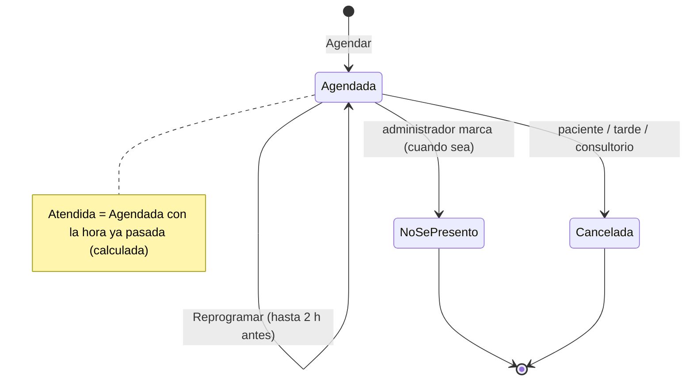
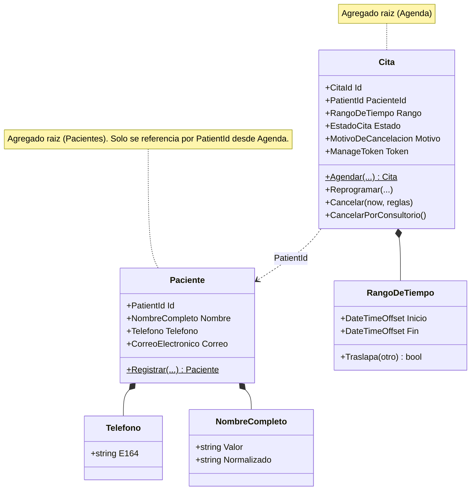

# Appointment Booking System — Solution Plan

For Dra. Selina Medina — Ortopedia y Traumatología

Oct 3, 2026 · @Gerardo Sanchez Hernandez

## Overview

Version 1 is a custom .NET web app where patients book their own appointment with Dra. Selina Medina from their phone, and the administrator handles the exceptions from one admin screen, so Selina doesn't have to.

**In scope for v1**

- Public booking page: choose visit type, pick an open slot, leave contact details
- Admin agenda: weekly hours, blocked days, no-shows, reschedule, cancel
- Email confirmation and a cancel/reschedule link for the patient

**Out of scope for v1** (planned in the roadmap)

- Insurer rules (GNP, AXA, Chubb)
- WhatsApp reminders
- Deposits or prepaid appointments
- Clinical records: the system stores scheduling data only, not diagnoses or notes (Expediente clínico comes after the MVP; its place in the roadmap is set after the build-vs-integrate evaluation)

## Dominio (DDD)

**Visión del dominio.** Liberar a la Dra. Selina Medina de la carga administrativa de su agenda: que los pacientes reserven, reprogramen y cancelen sus citas por sí mismos, sin que ella tenga que intervenir. Ante cualquier duda de diseño, gana la opción que le quite trabajo a Selina.

### Actores

- **Dra. Selina:** actor principal. Es su tiempo y su agenda; no tiene cuenta en el sistema. Recibe cada día laborable, a las 2:00 pm, un correo "Tus citas de hoy" (hora, paciente y motivo).
- **Gerardo (administrador, único usuario del área de administración):** opera el lado administrativo: marca "no se presentó", cancela cuando hace falta, ajusta settings y recibe las alertas.
- **Paciente:** actor externo. Agenda, reprograma y cancela por sí mismo.
- **Asistente:** rol futuro, con el mismo acceso que el administrador. Previsto en el modelo, no se construye todavía.

### Lenguaje ubicuo

| Término | Significado |
| --- | --- |
| Cita | Espacio reservado en la agenda para un paciente |
| Consulta | El acto médico que ocurre cuando el paciente llega a su cita |
| Bloqueo | Tiempo que Selina marca como no disponible (cirugía, vacaciones) |
| Horario de atención | Franja semanal en que Selina atiende (hoy: lunes a viernes 3:30–6:00 pm) |

### Eventos del dominio (event storming)

1. Horario de atención definido
2. Horario bloqueado
3. Cita solicitada (solo por canales externos como WhatsApp; en línea no existe)
4. Cita agendada (en línea queda firme de inmediato, sin aprobación)
5. Recordatorio enviado (solo informa, no pide confirmación)
6. Cita reprogramada por el paciente
7. Cita cancelada por el paciente
8. Cita cancelada por el consultorio
9. Paciente llegó
10. Consulta realizada
11. Paciente no se presentó
12. Cita de seguimiento agendada

### Reglas de negocio (hotspots resueltos)

- **Sin aprobación:** una cita en línea queda firme al instante. "Cita solicitada" solo aplica a peticiones por otros canales.
- **El recordatorio solo informa:** no pide confirmación, para no crear la duda de qué hacer si el paciente no confirma. La cita sigue firme hasta que el paciente la cancele.
- **El bloqueo de Selina siempre gana:** si bloquea tiempo que ya tiene una cita, el sistema la cancela (Cita cancelada por el consultorio) y avisa al paciente.
- **Reubicación tras cancelación del consultorio:** el mensaje al paciente ofrece una disculpa sincera en nombre del consultorio, avisa que la cita fue cancelada e incluye un enlace para que elija por sí mismo cualquier horario libre. El sistema nunca aparta un horario que no pueda garantizar.
- **Cancelación tardía permitida:** el paciente siempre puede cancelar, incluso dentro de las 2 horas previas; nunca se bloquea. Reprogramar, en cambio, solo se permite hasta 2 horas antes; dentro de ese plazo el enlace ofrece cancelar y volver a agendar, para que una cancelación tardía no se oculte como reprogramación. Una cancelación tardía alerta de inmediato al administrador (mejor enterarse que tener una silla vacía).
- **Cancelación tardía marcada:** la cita se marca como "cancelada tarde" para identificar a quienes cancelan repetidamente a última hora. La confirmación al paciente reconoce, en tono amable, que se canceló con menos de 2 horas de anticipación.
- **Sin doble reserva:** una restricción de exclusión de PostgreSQL (ningún par de citas activas puede traslaparse en el tiempo) garantiza que, si dos pacientes intentan el mismo horario a la vez, solo uno lo obtiene; al otro se le muestran los horarios libres restantes.

### Contextos delimitados

**Subdominios (espacio del problema).** Un subdominio es una parte del negocio que existe con o sin software; se descubre, no se diseña. Los contextos delimitados son la respuesta de software (espacio de la solución). La clasificación decide dónde invertir: core se construye con el mayor esfuerzo, supporting se construye simple, generic se compra o se usa una librería.

| Subdominio | Tipo | Contexto |
| --- | --- | --- |
| Agendamiento de citas | Core (de este sistema) | Agenda |
| Identidad de pacientes | Supporting | Pacientes |
| Comunicación con pacientes | Generic | Notificaciones |
| Presencia en línea | Generic | Contenido |
| Acceso del personal | Generic | Host (ASP.NET Identity) |
| Atención clínica / expediente | Core del consultorio, fuera del MVP | Expediente clínico (después) |
| Cobro y aseguradoras | Supporting, futuro | Ninguno todavía |

El core real del consultorio es la medicina; dentro de este sistema, el core es el agendamiento. Se justifica construirlo (y no usar una herramienta genérica) porque sus reglas lo distinguen: cancelación del consultorio con disculpa y reubicación, cancelación tardía marcada, emparejamiento de pacientes por teléfono y nombre, pacientes que viven en WhatsApp.

Cada contexto es una región de significado: dentro de él, cada palabra significa una sola cosa. Cada contexto posee sus propios datos; ningún otro los toca directamente (sin joins ni llaves foráneas entre contextos). Se comunican por contratos (llamadas síncronas) y por eventos de dominio (asíncronos).

- **Agenda (núcleo):** el recurso real de Selina, su tiempo. Horario de atención, bloqueos y todo el ciclo de vida de la cita. Dueño de la disponibilidad y de la regla de no doble reserva. Lenguaje: Cita, Bloqueo, Horario, Consulta.
- **Pacientes (soporte):** identidad y datos del paciente, separados de sus citas. La identidad es un Guid v7 generado por el sistema; teléfono y nombre normalizados se usan para emparejar. Lenguaje: Paciente, Consentimiento.
- **Notificaciones (genérico):** envío de mensajes (correo ahora, WhatsApp después). No sabe nada de medicina; reacciona a los eventos de Agenda. Lenguaje: Mensaje, Canal, Recordatorio.
- **Contenido:** el sitio web del consultorio. Casi estático; módulo simple, no un contexto completo.
- **Expediente clínico (fase siguiente al MVP):** nota médica, diagnóstico, tratamiento, antecedentes. Contexto propio que referencia el PatientId y la cita; el estado "Atendida" es donde empieza la nota de una consulta. Implica NOM-004-SSA3-2012 (contenido y conservación mínima de 5 años), NOM-024-SSA3-2012 (expediente electrónico), consentimiento expreso por datos sensibles, bitácora de accesos y notas que nunca se editan ni borran, solo se complementan. Antes de construirlo: evaluar sistemas ya certificados (construir vs. integrar) y validar requisitos con un experto en cumplimiento médico. El MVP no necesita cambios para soportarlo.

### Cómo se comunican

- **Registro del paciente:** Agenda *dispara* el registro, Pacientes lo *ejecuta*. Al reservar, Agenda llama a Pacientes por contrato ("buscar o crear paciente" por teléfono y nombre) y recibe un PatientId. Agenda nunca escribe en la tabla de pacientes.
- **Mensajes:** Agenda publica eventos ("Cita agendada", "Cita cancelada") sin saber quién escucha; Notificaciones está suscrito, pide a Pacientes el nombre y correo del paciente, y envía. Agenda y Notificaciones no se llaman directamente.
- **Consulta (fase 1):** no es un contexto propio todavía; es un estado de la cita (Atendida / No se presentó).

&#91;embedded content: mapa de contextos · Agenda (núcleo), Pacientes, Notificaciones, Contenido\]

Agenda es el núcleo: llama a Pacientes por un contrato síncrono y publica eventos que Notificaciones escucha; los contextos no comparten tablas. Contenido es un módulo simple aparte.

**Patrones del mapa de contextos**

- **Pacientes → Agenda:** Customer-Supplier. Pacientes (upstream) expone un Open Host Service (`IPacientesApi`) con Published Language (los tipos de Contracts, PatientId).
- **Agenda → Notificaciones:** Agenda (upstream) publica sus eventos como Published Language (`Agenda.Contracts`). Notificaciones (downstream) los traduce a mensajes planos con una Anti-Corruption Layer ligera, para que el modelo de Agenda no se filtre.
- **Pacientes → Notificaciones:** Customer-Supplier con el mismo Open Host Service: Notificaciones pide el contacto del paciente (`ObtenerContacto(PatientId)`) en vez de recibirlo en los eventos.
- **Notificaciones → proveedor de correo / WhatsApp (Meta):** sistemas externos detrás de una ACL (`INotificationChannel`); cambiar de proveedor toca una sola clase.
- **Expediente clínico (futuro):** si se compra un sistema certificado, queda detrás de una ACL.

Con un solo desarrollador, estos patrones no resuelven relaciones entre equipos; su valor es técnico: evitar que el modelo de un módulo se filtre a otro.

### Agenda por dentro

- **Cita es el agregado raíz.** Protege solo sus propias invariantes, las que puede verificar con sus propios datos: tiene un paciente; su tiempo es coherente (inicio + duración = fin); termina a más tardar a las 6:00 pm y no empieza antes del bloque de atención; respeta la ventana de reserva; y sus transiciones de estado son legales.
- **Agregados pequeños.** No existe un agregado "Calendario" con todas las citas; sería enorme y haría chocar reservas de días distintos.
- **Reglas configurables por fuera.** Los valores (cierre, anticipación, ventana) vienen de Settings y se le pasan a la Cita al validar; el agregado se mantiene puro.
- **El no-traslape no es invariante del agregado.** Es una regla entre citas; se garantiza con una restricción de exclusión en la base de datos (EXCLUDE USING gist sobre el rango de tiempo de las citas no canceladas, extensión btree\_gist). A diferencia de un índice único sobre la hora de inicio, también bloquea traslapes con horas de inicio distintas (citas fuera de la rejilla o de otra duración).
- **Servicio de disponibilidad = cortesía,** restricción = ley. El servicio pregunta "¿está libre?" para dar un mensaje amable; la restricción de la base es la garantía real, porque entre la consulta y el guardado otro paciente puede reservar.
- **Specifications:** posible forma de expresar las invariantes propias de la Cita. Decisión pospuesta hasta implementar; si se usan, las de validación van puras en el dominio y nunca consultan la base de datos.

**Ciclo de vida de la Cita**

- **Agendada:** reservada y firme; estado inicial.
- **Atendida:** calculada, no guardada. Una cita Agendada cuya hora ya pasó se muestra como Atendida; no hay tarea programada ni transición que la cambie. Cuando llegue el expediente clínico, escribir la nota será el evento que confirme la consulta.
- **No se presentó:** el administrador la marca como excepción.
- **Cancelada:** con motivo (por el paciente / tarde / por el consultorio).



Solo se guardan tres estados: Agendada, No se presentó y Cancelada; los dos últimos son finales. Atendida no se guarda: se deriva de Agendada más la hora ya pasada, así el administrador puede marcar "No se presentó" en cualquier momento sin corregir un estado final. **Reprogramar** no es un estado: la cita sigue Agendada y cambia de horario, validada con las mismas reglas que una reserva nueva y solo hasta 2 horas antes.

**Algoritmo de disponibilidad (función pura)**

Recibe horario de atención, bloqueos, citas activas, reglas de Settings y `now`, y devuelve los horarios libres; sin base de datos ni reloj propio. Se calcula en hora local de Ciudad de México y se convierte a UTC solo al guardar. Por cada día de la ventana:

1. Saltar días no laborables (solo lunes a viernes).
2. Construir la rejilla: desde las 3:30 pm en pasos de 30 min, solo los que terminen a más tardar a las 6:00 pm → 3:30, 4:00, 4:30, 5:00, 5:30.
3. Quitar los horarios que traslapen un bloqueo.
4. Quitar los que traslapen una cita activa.
5. Aplicar la ventana: desde mañana (día calendario, sin importar la hora de hoy) hasta 2 meses adelante.

### Pacientes por dentro

- **Paciente es el agregado raíz.** Identidad: PatientId generado con `Guid.CreateVersion7()` en el dominio al crear el Paciente (generación temprana), no por la base de datos. Atributos: teléfono, nombre, correo opcional. El teléfono no es la identidad porque puede cambiar o compartirse (una madre que agenda para sus hijos).
- **Buscar o crear:** dado teléfono y nombre, devuelve el Paciente existente o crea uno nuevo. Nuevo vs. subsecuente sale de si el registro ya existía.
- **Emparejamiento por teléfono + nombre.** Mismo teléfono y mismo nombre = mismo paciente; mismo teléfono con otro nombre = paciente nuevo. El nombre se normaliza (espacios) y la comparación usa una collation ICU no determinista en PostgreSQL (insensible a mayúsculas y acentos); índice único sobre (teléfono, nombre normalizado) con esa collation. Límite aceptado: un error de dedo en el nombre crea un duplicado. Ojo: las collations no deterministas no admiten LIKE; la búsqueda de pacientes por nombre en admin compara contra la columna normalizada con una collation determinista.
- **Teléfono en E.164** (+52 y el número nacional), parseado y validado con libphonenumber (región "MX"); los números imposibles se rechazan al reservar.

### Objetos de valor

Inmutables, sin identidad, iguales cuando sus valores son iguales, y se validan al crearse (no existe uno inválido). En C#: `record` o `readonly record struct`.

- **Agenda:** `RangoDeTiempo` (inicio, fin; sabe si traslapa a otro; lo usan citas, bloqueos y horarios), `HorarioDeAtencion` (día, inicio, fin), `ReglasDeAgenda` (duración, cierre, anticipación, ventana, corte de cancelación; el paquete de Settings que recibe la Cita), `MotivoDeCancelacion` (paciente / tarde / consultorio), `ManageToken` (genera el token y guarda solo el hash).
- **Pacientes:** `Telefono` (solo se construye en E.164 válido), `NombreCompleto` (con su forma normalizada), `CorreoElectronico` (opcional, validado).
- **IDs fuertemente tipados:** `CitaId` y `PatientId` envuelven el Guid v7 (`readonly record struct PatientId(Guid Value)` con `New()` que llama a `Guid.CreateVersion7()`), para que el compilador impida pasar un id donde va otro. Viven en un **kernel compartido** (`BuildingBlocks/Domain`), que solo contiene IDs, para que `Agenda.Domain` pueda usar `PatientId` sin referenciar otro módulo. Costo: value converters en EF Core.

**Bosquejo de agregados**



### Servicios de dominio

Lógica de negocio que no pertenece a una sola entidad u objeto de valor; sin estado y nombrada en el lenguaje ubicuo. No confundir con los servicios de aplicación (handlers de Features), que solo orquestan: cargan, llaman al dominio y guardan.

- **`CalculadoraDeDisponibilidad`** (el `GetSlots`): razona sobre el horario, muchos bloqueos y muchas citas a la vez, así que no cabe en la Cita. Pura, sin I/O. Es el único servicio de dominio del MVP.
- **No son servicios:** decidir si una cancelación es tardía (lo hace `cita.Cancelar(now, reglas)`); el bloqueo que gana sobre citas existentes (el handler `BloquearHorario` llama `cita.CancelarPorConsultorio()` en cada una: orquestación); normalizar teléfono y nombre (lo hacen sus objetos de valor).

Los servicios se mantienen escasos para que las entidades conserven su comportamiento y no se vuelvan bolsas de datos anémicas.

### Repositorios

**Decisión: repositorios como puertos.** (Reemplaza la decisión anterior de usar el DbContext directamente en los handlers.) Para que el código pueda promoverse a arquitectura hexagonal, los handlers nunca tocan EF Core: los comandos usan un puerto de escritura por agregado (`ICitas` en `Domain`) y las consultas un puerto de lectura propio de su slice. Las implementaciones viven en `Infrastructure`. Protecciones que se mantienen: setters privados, prohibido `ExecuteUpdate`/`ExecuteDelete` sobre agregados, lecturas con `AsNoTracking()` y proyección; el outbox lo maneja Wolverine en la misma transacción.

Protecciones adicionales:

- **Setters privados:** el estado solo cambia por métodos del agregado (`Cancelar`, `Reprogramar`), que aplican las reglas.
- **DbContext `internal`:** solo la Infrastructure de su módulo lo usa; los handlers nunca lo ven.
- **Disciplina explícita:** prohibido `ExecuteUpdate` / `ExecuteDelete` sobre agregados, porque saltan las reglas. Las lecturas (horarios libres, agenda del administrador) usan `AsNoTracking()` y proyectan solo lo necesario.
- **Eventos:** el agregado levanta eventos de dominio; el handler los traduce a eventos de integración y Wolverine los guarda en el outbox en la misma transacción. Verificar al implementar si la integración de Wolverine con EF Core puede recogerlos de las entidades directamente.

### Fábricas

**Decisión: métodos de fábrica estáticos en el agregado.** Creación y reconstitución son caminos distintos:

- **Creación** (`Cita.Agendar(paciente, rango, reglas, now)`, `Paciente.Registrar(telefono, nombre, correo)`): genera el id (Guid v7), valida todas las invariantes, fija el estado inicial y levanta el evento (`CitaAgendada`).
- **Creación por el consultorio** (`Cita.AgendarPorConsultorio(paciente, rango, reglas, now)`): el administrador puede agendar fuera de la rejilla de 30 min y fuera de la ventana de reserva (desde mañana hasta 2 meses). Sirve para capturar las citas pactadas por WhatsApp antes del lanzamiento y para excepciones de Selina. Nunca puede saltarse las reglas duras: sin traslapes (restricción de exclusión), solo lunes a viernes, dentro de 3:30–6:00 pm, nunca en el pasado y nunca sobre un bloqueo de Selina (por ahora). Requiere en admin un formulario "Agendar cita" para el administrador.
- **Reconstitución** (EF Core al leer de la base): constructor privado que solo asigna valores, sin reglas ni eventos. Si validara, una cita de la semana pasada fallaría al cargarse ("mínimo mañana"); si levantara eventos, cada lectura reenviaría correos.
- **Objetos de valor:** EF los reconstituye con `HasConversion` (un valor: `Telefono`, `CitaId`, `PatientId`, `CorreoElectronico`) y `ComplexProperty` (varios valores: `RangoDeTiempo`). Sus constructores solo validan su propia forma (E.164 válido, inicio antes que fin), que los datos guardados ya cumplen.

### Eventos de dominio (modelo)

Dos niveles. **Eventos de dominio** (en `Agenda.Domain`, p. ej. `CitaFueAgendada`): records inmutables en pasado que levanta la `Cita`; solo Agenda los conoce. **Eventos de integración** (en `Agenda.Contracts`, los de la tabla): el handler de Features los crea a partir de los de dominio y se publican por el outbox; son los que escucha Notificaciones. Así Agenda puede cambiar su modelo interno sin romper a nadie.

| Evento | Contenido |
| --- | --- |
| `CitaAgendada` | CitaId, PatientId, inicio/fin (UTC) |
| `CitaReprogramada` | CitaId, PatientId, rango anterior, rango nuevo |
| `CitaCancelada` | CitaId, PatientId, inicio, motivo (paciente / tarde / consultorio) |

Atendida, No se presentó y Horario bloqueado quedan internos por ahora: nadie fuera de Agenda los escucha. Un bloqueo cancela cada cita afectada y cada una levanta `CitaCancelada` con motivo consultorio.

**Los eventos no llevan datos de contacto.** Notificaciones obtiene nombre y correo pidiéndolos a Pacientes por contrato (`IPacientesApi.ObtenerContacto(PatientId)`). Así cada contexto conserva sus datos, y un correo corregido llega también a los recordatorios pendientes.

### Notificaciones por dentro

Convierte los eventos de Agenda en mensajes planos (a quién, qué, cuándo, qué enlace). En el MVP el único canal es correo.

- **Cita agendada** → paciente: confirmación con detalles y enlace para cancelar o reprogramar.
- **Recordatorio** → paciente: el día anterior a las 9:00 am (configurable), solo informa. Si al agendar esa hora ya pasó, se omite.
- **Cita reprogramada** → paciente: nueva fecha y hora.
- **Cita cancelada por el paciente** → paciente: confirmación; si fue tardía, lo menciona con amabilidad.
- **Cita cancelada por el consultorio** → paciente: disculpa sincera y enlace para volver a agendar.
- **Cancelación tardía** → administrador: alerta inmediata. Agenda del día → Dra. Selina: cada día laborable a las 2:00 pm (configurable), "Tus citas de hoy" con hora, paciente y motivo; es un mensaje programado de Wolverine más una consulta.

**Mecánica:** Agenda guarda la cita y el evento en la misma transacción (outbox), así la reserva nunca falla por el correo; Notificaciones envía después, con reintentos. Los recordatorios son mensajes programados de Wolverine que se cancelan o reprograman junto con la cita.

**Correo opcional.** El teléfono es obligatorio; el correo no. Sin correo no hay notificaciones por ahora (WhatsApp, fase 2, cubrirá esos casos). Mitigaciones: la confirmación en pantalla muestra el enlace de gestión con un aviso de "guarda este enlace" y el evento de calendario lo incluye; en la vista de administración esas citas se marcan "sin correo" para avisar a mano si el consultorio cancela.

## Requirements

**Patient (public, no account needed)**

1. Choose a visit type; all are 30 min for now and no prices are shown
2. See only truly available slots, from tomorrow up to 2 months ahead
3. Book with name, phone, optional email, reason for visit, and privacy consent
4. If an email was given, receive a confirmation email with date, address, and a link to cancel or reschedule
5. Reschedule up to 2 hours before the appointment; cancel at any time (within 2 hours it is marked as a late cancellation)

**Administrator (logged in)**

1. Define weekly working hours (today: one location, Monday–Friday 3:30–6:00 pm)
2. Block vacations, surgery days, and one-off hours
3. Day and week agenda view; create appointments manually for phone or WhatsApp bookings
4. Mark appointments as no-show or cancel them (attended is computed: a booked appointment whose time has passed)
5. Basic patient list with visit history

**Non-functional**

- Mobile-first, in Spanish, all times in America/Mexico\_City
- Booking in under 1 minute, no app to install
- Two people booking the same slot at once must never both succeed
- Privacy notice and express consent for health data under Mexico's personal data protection law

## Practice website

The booking app's home page becomes Selina's practice website: same domain, same deploy, with an "Agendar cita" button on every page that opens the booking flow. It adds about one week to phase 1.

| Page | Content |
| --- | --- |
| Inicio | Photo, name, specialty, main conditions treated, "Agendar cita" button |
| Sobre mí | Training, hospital affiliations, certifications, cédula profesional |
| Padecimientos y tratamientos | One card per condition or procedure, written with Selina |
| Ubicación y horarios | Address, embedded map, Monday–Friday 3:30–6:00 pm, WhatsApp contact |
| Agendar cita | The booking flow described in this plan |
| Aviso de privacidad | Privacy notice |

- **Build:** Blazor static SSR pages, so they load fast on phones and Google can index them; content kept in Markdown files or a small table editable from the admin later
- **Search:** Spanish page titles with specialty and city, schema.org Physician markup, and a Google Business Profile linking to the site
- **Legal:** Mexican rules on advertising medical services generally require showing the doctor's name, cédula profesional and specialty; confirm current COFEPRIS requirements before launch, and leave out testimonials or before/after photos until reviewed

**Content needed from Selina**

- [ ] Professional photo and clinic photos
- [ ] Short bio, training and hospital affiliations
- [ ] Cédula profesional and specialty certification numbers
- [ ] List of conditions and treatments to feature
- [ ] Clinic address and the WhatsApp number to show

## Architecture

One ASP.NET Core app on .NET 10 (current LTS), built as a modular monolith: public website and booking pages, the admin agenda and background jobs run in a single deploy over one PostgreSQL database.

&#91;embedded content: system architecture · v1, WhatsApp dashed as phase 2\]

Every booking goes through the AgendarCita handler; an exclusion constraint in PostgreSQL is the final guarantee against overlaps. Notifications run in the background so the patient never waits on email.

- **Proyectos:** cada módulo (Agenda, Pacientes, Notificaciones, Contenido) en hasta cuatro proyectos (Contracts, Domain, Features, Infrastructure), más Consultorio.UI y el host Consultorio.Web; detalle en Estructura de la solución.
- **Database:** EF Core migrations; PostgreSQL (Npgsql) is the chosen database, picked over Azure SQL for lower cost
- **Hosting:** Azure App Service, custom domain such as citas.\<her-domain>.mx, GitHub Actions for deploys

### Estructura de la solución (módulos)

Monolito modular: cada contexto delimitado es un módulo con `hasta cuatro proyectos (Contracts, Domain, Features, Infrastructure); hacia fuera solo expone Contracts`. Dentro de cada módulo, el código se organiza por caso de uso (vertical slices).

```
src/
  Consultorio.Web/                 Host: Program.cs, Identity, Wolverine, DI (sin pantallas)
  Consultorio.UI/                  Razor Class Library: páginas, componentes, Bootstrap

  BuildingBlocks/
    Contracts/                     ICommand<T>, IQuery<T>, ISender, Resultado
    Domain/                        Kernel compartido: Entity, IDomainEvent, IClock, PatientId, CitaId

  Modules/
    Agenda/
      Contracts/                   comandos, consultas, DTOs, eventos (lo único que ve la UI)
      Domain/                      Cita, RangoDeTiempo, CalculadoraDeDisponibilidad, ICitas
      Features/
        AgendarCita/               handler, validador
        CancelarCita/
        ReprogramarCita/
        ObtenerDisponibilidad/
        AgendaDelDia/              handler, IConsultasAgendaDelDia
      Infrastructure/              AgendaDbContext, migraciones, implementación de puertos
    Pacientes/
      Contracts/  Domain/  Features/  Infrastructure/
    Notificaciones/
      Features/  Infrastructure/
    Contenido/                     un solo proyecto, sin dominio

tests/
  Agenda.Domain.Tests/  Agenda.Features.Tests/  Pacientes.*.Tests/
  Consultorio.UI.Tests/            bUnit
  Consultorio.IntegrationTests/    Testcontainers + PostgreSQL
  Consultorio.ArchitectureTests/
  Consultorio.E2ETests/            Playwright, solo local
```

**Capas y dependencias.** Todo caso de uso entra por `Features` (obligatorio, también las consultas): UI → `ISender` → handler en `Features` → dominio (solo comandos) → infraestructura a través de puertos. Las dependencias apuntan hacia adentro y el compilador las hace cumplir:

| Proyecto | Referencia |
| --- | --- |
| `Domain` | solo `BuildingBlocks/Domain` |
| `Features` | `Domain`, `Contracts` propios y `Contracts` de otros módulos |
| `Infrastructure` | `Features` y `Domain` (implementa los puertos), EF Core, Npgsql |
| `Consultorio.UI` | solo proyectos `Contracts` |
| `Consultorio.Web` | todo (compone) |

**Puertos.** Los de escritura (`ICitas`: `Agregar`, `ObtenerPorId`) viven en `Domain`, como propone Evans para los repositorios. Los de lectura viven dentro de su slice (`Features/AgendaDelDia/IConsultasAgendaDelDia`) y su implementación proyecta con EF y `AsNoTracking()`. `Contracts` solo contiene lo que la UI puede conocer. EF Core aparece únicamente en `Infrastructure`.

**CQRS ligero.** `ICommand<T>` cambia estado: pasa por validación, dominio, transacción y outbox (middleware de Wolverine). `IQuery<T>` solo lee: nunca llama `SaveChanges` ni levanta eventos. Misma base de datos; sin base de lectura separada ni event sourcing.

**Namespaces** (guía de Microsoft: `<Compañía>.<Producto>.<Función>.<Subnamespace>`):

- Raíz `DraSelina.Consultorio`; patrón `DraSelina.Consultorio.<Módulo>.<Capa>`, p. ej. `DraSelina.Consultorio.Agenda.Domain`.
- Un namespace plano por capa (`DraSelina.Consultorio.Agenda.Features`); las carpetas de cada slice solo organizan, para no repetir el nombre de un tipo (`AgendarCita`) como namespace.
- Términos de negocio en español, capas técnicas en inglés.
- Las carpetas dentro de cada módulo son cortas (`Domain/`), pero el proyecto lleva el nombre completo: `Modules/Agenda/Domain/DraSelina.Consultorio.Agenda.Domain.csproj`.
- Namespaces con alcance de archivo y `RootNamespace` en `Directory.Build.props`.

**Reglas de la estructura**

- **Datos privados por módulo:** cada módulo tiene su DbContext y su esquema SQL (`agenda.`, `pacientes.`, `notificaciones.`); sin joins ni llaves foráneas entre esquemas.
- **Un módulo solo referencia los Contracts de otro**, nunca su implementación. Las fronteras se verifican con tests de arquitectura (NetArchTest o ArchUnitNET).
- **Comunicación:** llamadas síncronas por Contracts (Agenda → `IPacientesApi.BuscarOCrear`); asíncronas por eventos de dominio en proceso, publicados a través del outbox.
- **Vertical slices:** cada carpeta de Features contiene su handler, su validador y, si es consulta, su puerto de lectura; el comando o consulta vive en Contracts. Sin endpoints HTTP: la UI llega por ISender.
- **Dispatcher, outbox y tareas programadas:** Wolverine (licencia MIT) con persistencia en PostgreSQL. Despacha los eventos de dominio en proceso, guarda el outbox en la misma transacción que EF Core y programa los recordatorios de forma durable, con reintentos. Reemplaza a Hangfire y al outbox propio. Si algún día se necesita entrega entre procesos, Wolverine puede usar PostgreSQL como transporte, sin broker. Se descartaron MediatR y MassTransit v9 (licencia comercial) y MassTransit v8 (mantenimiento oficial termina después de 2026).
- **Separación UI / backend (puerto de entrada hexagonal):** la UI vive en `Consultorio.UI` (Razor Class Library) y referencia **solo** proyectos `*.Contracts`; nunca ve el dominio, el DbContext ni Wolverine. `Consultorio.Web` es solo el host que compone todo. La UI habla con el backend a través de un mediador propio mínimo: `ISender.Send(ICommand<T>) / ISender.Query(IQuery<T>)` en `BuildingBlocks.Contracts`; cada comando o consulta declara su resultado (`AgendarCita : ICommand<Resultado<CitaAgendadaDto>>`). El adaptador `WolverineSender` (en el host) delega en `IMessageBus.InvokeAsync`. El adaptador traduce la ValidationException del middleware de validación en Resultado.Invalido(errores), así la UI siempre recibe un Resultado. Si algún día el backend se separa, basta un `HttpSender : ISender` contra endpoints Minimal API, sin tocar la UI. Una prueba de arquitectura exige que todo `ICommand<> e IQuery<>` viva en `*.Contracts` y tenga exactamente un handler. **Sin MVC:** no hay controladores ni vistas; HTTP, si se necesita, solo con Minimal APIs.
- **Transporte de Wolverine:** sin broker. Los comandos de la UI usan `InvokeAsync` (llamada directa en proceso). Los eventos van por colas locales **durables**, respaldadas por el outbox en PostgreSQL, así que sobreviven reinicios. Los recordatorios son mensajes programados en PostgreSQL. Un transporte externo (PostgreSQL, RabbitMQ) solo si el backend se divide en procesos.
- **Frontend:** Blazor Web App en .NET 10 (LTS). Static SSR para el sitio público y las páginas de reserva (rápidas en móvil, buen SEO); Interactive Server para el área de administración. Sin librería de componentes: solo CSS propio y Bootstrap en todo el sistema. Se descartó Blazor WebAssembly standalone porque obligaría a construir y proteger una API aparte y haría lenta la primera visita de los pacientes.
- **Validación:** FluentValidation en dos capas. (1) Forma de la entrada (campos requeridos, formatos) con un validador por comando, ejecutado como middleware de Wolverine (`WolverineFx.FluentValidation`, `opts.UseFluentValidation()`), así los handlers no repiten la validación. El mismo validador se usa en el `EditForm` de Blazor (Blazored.FluentValidation) para mostrar errores antes de enviar. (2) Reglas de negocio (termina antes de las 18:00, ventana de reserva, transiciones) viven en el agregado `Cita`, nunca en el validador.
- **Pruebas unitarias:** xUnit v3 como framework base (bUnit y las pruebas de integración corren sobre él). Se prueban sin base de datos: el agregado `Cita` y sus transiciones, los objetos de valor, `CalculadoraDeDisponibilidad` (la más cubierta), los validadores y los handlers de Features (se instancian con puertos falsos, sin Wolverine). Pruebas de integración con Testcontainers y PostgreSQL real. Aserciones con el \`Assert\` propio de xUnit, sin librerías extra (FluentAssertions pasó a licencia comercial).
- **Pruebas de UI/UX:** dos niveles. (1) **bUnit** para el comportamiento de componentes en todos los módulos (renderizado, mensajes de validación, UI condicional); son rápidas y corren en CI. (2) **Playwright** para pocos recorridos clave en viewport móvil: agendar, cancelar y que el administrador marque un no-show, más revisiones de accesibilidad y capturas de regresión visual. Playwright corre **solo en local**, no en CI.
- **Pipeline de CI (GitHub Actions, en cada push y PR):** (1) restaurar y compilar en Release; (2) pruebas unitarias (`*.Domain.Tests, *.Featur``es.Tests`); (3) pruebas de componentes con bUnit; (4) pruebas de arquitectura (`Consultorio.ArchitectureTests`); (5) pruebas de integración (`Consultorio.IntegrationTests`) con Testcontainers y PostgreSQL real: handlers de Wolverine, outbox, restricción de exclusión contra doble reserva y collation ICU; (6) despliegue a App Service solo desde `main` y si todo pasó, aplicando las migraciones de EF Core. Las pruebas de Playwright viven en su propio proyecto (`Consultorio.E2ETests`) y no corren en CI.
- **Módulos genéricos sin dominio rico:** Notificaciones y Contenido no tienen carpeta Domain; no la necesitan.
- **Expediente clínico** entrará después como un módulo nuevo con la misma forma, sin tocar los existentes.

### Technology choices

| Concern | Choice | Why |
| --- | --- | --- |
| UI, public | Blazor static SSR | Fast on phones, indexable by Google, no open connection per visitor |
| UI, admin | Blazor Interactive Server | Rich agenda with little JavaScript; one administrator |
| Data | EF Core 10 + PostgreSQL (Npgsql) | Same stack you use daily |
| Auth | ASP.NET Core Identity, 2FA required | One administrator account (Assistant role later), no public sign-up |
| Jobs | Wolverine | Reminders, daily agenda email, retries, outbox; no free dashboard like Hangfire's, so failures surface in logs and Application Insights |
| Email | Azure Communication Services | Cheap, native to Azure |
| Validation | FluentValidation | Same validator on the form and in the backend |
| Logging | Serilog to Application Insights | Errors and booking metrics in one place |
| Time | UTC in database, TimeZoneInfo America/Mexico\_City at the edges | Mexico dropped daylight saving in 2022, but the code should not assume it |

### Key design decisions

- **Availability is a pure function:** `GetSlots(hours, blocks, appointments, rules, now)` returns slots with no database access inside, so it is fully unit-tested
- **No double booking, enforced by the database:** a PostgreSQL exclusion constraint (EXCLUDE USING gist, btree\_gist) so no two non-cancelled appointments at the same location can overlap in time, even with different start times; on a violation (error 23P01) the patient sees the remaining free slots
- **Fixed 30-min grid:** slots start at 3:30, 4:00, 4:30, 5:00 and 5:30; duration and grid come from AppointmentType and settings, not constants
- **Patient links:** `ManageToken` is 32 random bytes, stored only as a SHA-256 hash, and expires after the appointment
- **Rules as settings:** minimum notice (from tomorrow, by calendar day), 2-month horizon, 2-hour reschedule cutoff and 2-hour late-cancellation threshold live in a Settings table editable from admin
- **Extension points for later phases:** `INotificationChannel` (WhatsApp), nullable InsurerId on Appointment, nullable Price on AppointmentType

### Booking flow

1. Patient opens the site and taps Agendar cita
2. Web asks the availability engine for the next 2 months of free slots
3. Patient picks a slot, enters name, phone, optional email, reason and accepts the privacy notice
4. The AgendarCita handler validates the rules, finds or creates the Patient by phone and name through the Pacientes module, and saves the Appointment in one transaction; the exclusion constraint rejects any overlap
5. The CitaAgendada integration event triggers the confirmation email (if an email was given) with the .ics file and manage link, and schedules the reminder for 9:00 am the day before
6. The appointment appears instantly on the administrator's agenda and in Selina's 2:00 pm daily email

### Deployment

- **Environments:** local (PostgreSQL in Docker) and production; a staging slot can come later
- **Hosting:** Azure App Service Linux B1, Azure Database for PostgreSQL Flexible Server B1ms (with btree\_gist enabled in the server's extension allow-list), secrets in App Service settings or Key Vault, free managed TLS certificate on the custom domain
- **CI/CD:** GitHub Actions builds, runs tests, applies EF migrations and deploys on every merge to main
- **Operations:** health check endpoint, Application Insights alerts on errors, automatic daily database backups

## Data model

Seven tables plus a Settings table cover v1 (Wolverine adds its own outbox tables); `Appointment` is the center, and insurer support later adds one table plus a nullable column.

| Entity | Key fields | Notes |
| --- | --- | --- |
| Location | Id, Name, Address, MapsUrl | One row per consultorio or hospital |
| AppointmentType | Id, Name, DurationMin, Price, IsPublic, BufferMin | All 30 min by default, editable; Price left empty and hidden |
| WorkingHours | Id, LocationId, DayOfWeek, Start, End | Recurring weekly template |
| ScheduleBlock | Id, LocationId?, StartUtc, EndUtc, Reason | Vacations, surgery days, one-off blocks |
| Patient | Id (Guid v7), FullName, NormalizedName, Phone (E.164), Email (optional), ConsentAt, CreatedAt | Matched by phone + normalized name to avoid duplicates |
| Appointment | Id, PatientId, TypeId, LocationId, StartUtc, EndUtc, Status, LateCancelled, Reason, ManageTokenHash, CreatedBy | Stored status: Booked, NoShow, Cancelled (by patient / late / by practice); Attended is computed (Booked and already past). Overlaps blocked by an exclusion constraint |
| User | Id, Name, Email, Role | Administrator (Assistant later), via ASP.NET Core Identity |

Store times in UTC and convert to America/Mexico\_City at the edges. `ManageToken` is a long random value in the patient's email link, so they can cancel without an account.

## Booking logic

Available slots are computed on request, never stored: working hours minus blocks minus existing appointments, cut into steps of the chosen visit type.

1. Take the WorkingHours for the requested dates and location
2. Subtract ScheduleBlocks and active Appointments (plus each type's buffer)
3. Slice the free windows into back-to-back 30-min slots from the start of working hours; a visit must end by closing time, and visits never overlap
4. Drop slots before tomorrow (1 day minimum notice) or more than 2 months ahead

**Preventing double booking.** An exclusion constraint on the appointment's time range (non-cancelled only) makes overlaps impossible, including off-grid bookings made by the administrator. On conflict, show the patient the next free slots instead of an error.

**Rules to configure, not hard-code:** minimum notice, booking horizon, cancellation cutoff, max bookings per phone per week, and which visit types are bookable online. Post-surgery or urgent trauma visits may be better left as "call us" types.

## Notifications

v1 sends email only, and only to patients who gave one; WhatsApp comes in phase 2 because it needs a Meta business account and approved message templates.

- **On booking:** confirmation to the patient (date, address, map link, .ics calendar file, cancel/reschedule link)
- **Day before, 9:00 am:** reminder email that only informs; skipped if that time had already passed at booking
- **On change:** email when the patient reschedules or cancels, or when the practice cancels (with an apology and a rebooking link); late cancellations alert the administrator

Send through Azure Communication Services Email, queued by a background job (Wolverine, outbox on PostgreSQL) so a slow provider never blocks the booking. Put the sender behind an `INotificationChannel` interface so WhatsApp plugs in later without touching booking code.

## Security and privacy

The reason for visit is health data, which Mexican law treats as sensitive: the booking form needs a privacy notice and an explicit consent checkbox, and the data stays minimal.

- **Staff access:** ASP.NET Core Identity with an Administrator role (Assistant later), mandatory 2FA, no public sign-up
- **Patient access:** no accounts; the random `ManageToken` link only allows viewing, cancelling, or rescheduling that one appointment
- **Abuse:** rate limiting on the booking pages (ASP.NET Core rate limiter), a CAPTCHA such as Cloudflare Turnstile, and a per-phone weekly cap
- **Data:** HTTPS only, encryption at rest (default on Azure Database for PostgreSQL), daily backups, an audit log of who changed each appointment
- **Legal:** publish an aviso de privacidad and keep consent timestamps; have a lawyer review the notice. Keeping clinical notes out of v1 avoids the stricter electronic health record rules (NOM-024) until the Expediente clínico phase

## Roadmap

Ship phase 1, run it with real patients, then add the features that attack no-shows before insurer and payment work.

&#91;embedded content: roadmap · 4 phases, not to scale\]

Phases 2–4 have no estimates yet; their order can change once the pilot shows where Selina loses the most time.

## Costs and effort

Running v1 should cost roughly US$30–40 per month; the real cost is your time, about 4–6 weeks of part-time work for the MVP. Figures are approximate, from memory, not quoted prices; check the Azure pricing calculator before committing.

**Base de datos en Azure:** Azure Database for PostgreSQL Flexible Server, nivel Burstable B1ms (1 vCPU, 2 GiB), en la misma región que el App Service (Mexico Central si ofrece este servicio; si no, South Central US). Cuesta alrededor de US$12–15 al mes solo de cómputo; almacenamiento y respaldos se cobran aparte (unos pocos dólares). Cifras aproximadas: verificar en la calculadora de Azure para la región elegida.

**Correo y observabilidad:** costo prácticamente nulo. Serilog es gratuito. Azure Communication Services cobra US$0.00025 por correo más US$0.00012 por MB; con unos 200–300 correos al mes queda por debajo de US$0.10. Application Insights incluye 5 GB gratis al mes (compartidos por toda la cuenta de facturación) y 90 días de retención sin costo; se configura un **límite diario** (p. ej. 100 MB/día) para evitar sorpresas.

| Item | Approx. cost |
| --- | --- |
| Azure App Service (Basic B1, Linux) | \~US$13/month |
| Azure Database for PostgreSQL Flexible Server (B1ms) | \~US$12–15/month plus storage |
| Email (Azure Communication Services) | Cents per month at clinic volume |
| Domain (.com or .mx) | \~US$15–40/year |
| WhatsApp, phase 2 | Per-conversation fees set by Meta |

| Phase 1 work | Approx. effort |
| --- | --- |
| Data model, availability engine, tests | 1–1.5 weeks |
| Public booking pages | 1 week |
| Admin agenda and settings | 1–1.5 weeks |
| Email, privacy notice, deploy, pilot | 1 week |

## Selina's decisions

Agreed on 3 Oct 2026. Updated 3 Oct 2026: visits are 30 minutes (confirmed by Selina). The fixed 30-minute grid gives five slots a day: 3:30, 4:00, 4:30, 5:00 and 5:30 pm, the last one ending at 6:00 pm, with no spare time.

| Question | Decision |
| --- | --- |
| Visit types and duration | All 30 min for now, configurable per type; no overlaps |
| Location and hours | One location, Monday–Friday 3:30–6:00 pm |
| Who manages the agenda | Gerardo is the only administrator; Selina has no account and gets a daily 2:00 pm email with that day's appointments (an assistant may come later) |
| Booking window | At least 1 day ahead, up to 2 months ahead |
| Cancel or reschedule | Reschedule up to 2 hours before; cancel any time, marked late within 2 hours |
| New patients online | Yes, new and returning patients |
| Prices on booking page | Not for now |
| Current tool | WhatsApp for everything |

**Still open**

- [ ] Future WhatsApp bookings: resolved. Before launch, the administrator (Gerardo) enters them manually in the admin area
- [ ] Spare time: resolved. With 30-min visits the five slots fill 3:30–6:00 exactly
- [ ] Datos de contacto erróneos (typo en teléfono o correo): en fase 1 se mitiga mostrando la cita completa en pantalla al reservar, con opción de agendar al calendario. La confirmación bidireccional confiable (WhatsApp u otro broker) se discute en fase 2.
- [ ] Privacidad: el aviso de privacidad, la casilla de consentimiento expreso y ConsentAt van desde el MVP, porque el motivo de consulta es un dato de salud; el texto del aviso lo revisa un abogado antes del lanzamiento. Quedan para después del MVP: política de retención y el proceso de derechos ARCO (acceso, rectificación, cancelación, oposición).
- [ ] Fusionar pacientes duplicados (por un error de dedo en el nombre): función de administrador para después del MVP.
